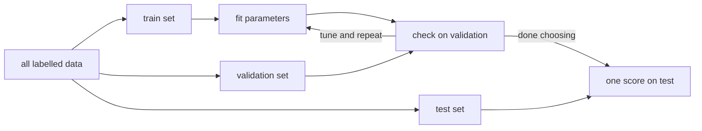

# AI, Machine Learning and Deep Learning
> **Level:** Beginner · **Reading time:** 8 min · **Phase:** 0 · ML Foundations

**In one line:** AI is the big goal of making machines act intelligently, machine learning is the way of reaching it by learning from examples instead of writing rules, and deep learning is machine learning that uses many-layered neural networks.

**Before you start:** Nothing. This is the first page of the roadmap's foundations phase. Basic Python helps for the code.

**Words to know:**
- **Model:** a function with adjustable numbers inside. Given an input, it gives an output (a prediction).
- **Parameters (weights):** the adjustable numbers inside a model. Training means finding good values for them.
- **Feature:** one measurable input, such as a house's size in square metres.
- **Label:** the correct answer for an example, such as the house's real price.
- **Training data:** the examples the model learns from.
- **Neural network:** a model built from many small units (neurons) joined in layers.

## Explain it like I'm new
Think of three nested circles. The outer one is **artificial intelligence (AI)**: any technique that makes a computer do something we would call smart. A chess program that follows hand-written rules is AI.

Inside it is **machine learning (ML)**. Instead of a programmer writing the rules, you show the computer many examples and it works out the rules itself. You do not write "if the email says 'free money', it is spam". You show it thousands of emails marked spam or not spam, and it finds the patterns.

Inside that is **deep learning (DL)**: machine learning that uses neural networks with many layers. This is the technology behind modern image recognition and large language models (LLMs).

**Three ways to learn:**
- **Supervised learning:** every training example comes with the right answer (a label). The model learns to predict the label. Examples: spam or not spam, house price from size.
- **Unsupervised learning:** no labels. The model looks for structure by itself, such as grouping similar customers (clustering).
- **Reinforcement learning:** an agent tries actions and gets rewards or penalties. It learns which actions earn the most reward over time, like training a dog with treats.

(LLMs are first trained with a trick called self-supervised learning: the "label" for each piece of text is simply the next word, which is already in the text. See [How LLMs Are Trained](../../03-llm-concepts/topics/24-how-llms-are-trained.md).)

**The golden rule: never grade a model on data it trained on.** A student who memorises last year's exam answers will ace last year's exam and may fail a new one. So we split the data into three parts:
- **Training set:** the model learns from this.
- **Validation set:** you use this to compare settings and choose between models.
- **Test set:** you look at this once, at the very end, to estimate how the model will do on brand-new data.

<!-- anim:01-ai-ml-deep-learning -->
## Watch it


*It plays on a loop. Read the caption in the box, one step at a time. Want to go at your own pace? [Step through it with Previous and Next](https://techsaurabh-394.github.io/ai-engineer-roadmap/#01-ai-ml-deep-learning).*

## How it works
```text
prediction = model(features; parameters)
learning   = change the parameters until predictions match the labels
```

1. Collect examples (features plus labels, for supervised learning).
2. Split them: commonly about 70% train, 15% validation, 15% test (80/10/10 is also common).
3. Choose a model and a **loss** (a number measuring how wrong it is; see [Loss and Gradient Descent](02-loss-and-gradient-descent.md)).
4. Train: adjust the parameters on the training set to reduce the loss.
5. Check the validation set. If it is bad while training is good, the model is [overfitting](05-overfitting-and-regularization.md). Adjust and repeat.
6. When you are done choosing, measure once on the test set and report that number.

**Worked example.** You have 1,000 labelled emails (spam or not).

| Set | Share | Emails | Used for |
|---|---|---|---|
| Training | 70% | 700 | fit the parameters |
| Validation | 15% | 150 | pick the model and settings |
| Test | 15% | 150 | one final honest score |

Now a real run of why the split matters (from [`ml_overfitting.py`](../code/ml_overfitting.py): fit a curve to 10 training points, judge it on 300 separate validation points; lower error is better):

| Model | Training error | Validation error |
|---|---|---|
| Degree 3 polynomial | 0.1164 | 0.1592 |
| Degree 9 polynomial | 0.0000 | 3.2875 |

The degree 9 model has a perfect training score because it has memorised the 10 points, yet it is about 20 times worse on data it has not seen. Judged by training error alone you would pick the wrong model. Judged by validation error you choose degree 3 over degree 9. Only after choosing do you score the test set once and report that number.



## Code example
The split happens in every demo. From [`ml_overfitting.py`](../code/ml_overfitting.py) (run `python 00-ml-foundations/code/ml_overfitting.py`), the model is fit on 10 training points and judged on 300 separate validation points:

```python
import ml_overfitting as ov

train = ov.make_grid_data(10, 0.3, seed=5)   # the model learns from these
val = ov.make_data(300, 0.3, seed=99)        # it is judged on these
w = ov.fit(train[0], train[1], degree=3)
print("train error     ", round(ov.mse(w, *train), 4))   # 0.1164
print("validation error", round(ov.mse(w, *val), 4))     # 0.1592
```

**In real projects** use a library for the split. For example, with scikit-learn (`pip install scikit-learn`):

```python
from sklearn.model_selection import train_test_split

X_train, X_rest, y_train, y_rest = train_test_split(X, y, test_size=0.3, random_state=0)
X_val, X_test, y_val, y_test = train_test_split(X_rest, y_rest, test_size=0.5, random_state=0)
```

## When to use it / when not to
| Situation | Approach |
|---|---|
| Rules are easy to write and never change (tax of 18% on an invoice) | Plain code, no ML |
| Patterns are too messy to write as rules (spam, faces, language) | Machine learning |
| Inputs are images, audio or text, and you have lots of data | Deep learning |
| Small table of numbers, a few thousand rows | Simple ML models often beat deep learning |
| Labels are expensive but raw data is plentiful | Unsupervised or self-supervised learning |

- If you can write the rule, write the rule. ML is for when you cannot.

## Common mistakes
- Evaluating on the training data and reporting that number.
- Tuning settings by repeatedly looking at the test set. Then the test set has become a second validation set and its score is too optimistic.
- Splitting randomly when examples are linked (for example, many rows from the same patient, or time series where you must not train on the future).
- Thinking "AI", "ML" and "deep learning" are three different things. They are nested: deep learning is a kind of ML, and ML is a kind of AI.
- Believing more labels are always needed. Unsupervised and self-supervised methods use data with no labels.

## Recap
If you remember only three things:
- AI contains machine learning, which contains deep learning. ML learns rules from examples; DL does it with many-layered neural networks.
- Supervised learning has labels, unsupervised has none, reinforcement learning learns from rewards.
- Split data into train, validation and test sets, and only trust the score on data the model has not seen.

## Interview questions
**1. What is the difference between AI, machine learning and deep learning?**
<details><summary>Answer</summary>
They are nested. AI is any technique that makes machines behave intelligently, including hand-written rules. Machine learning is the subset that learns patterns from data instead of being programmed with rules. Deep learning is the subset of ML that uses neural networks with many layers.
</details>

**2. What is the difference between supervised, unsupervised and reinforcement learning?**
<details><summary>Answer</summary>
Supervised learning trains on labelled examples to predict the label (classification, regression). Unsupervised learning has no labels and finds structure such as clusters. Reinforcement learning has an agent act in an environment and learn from rewards.
</details>

**3. Why do we need separate training, validation and test sets?**
<details><summary>Answer</summary>
A model can memorise its training data, so training error is too optimistic. The validation set lets you choose models and settings without touching the final judge. The test set, used once at the end, gives an unbiased estimate of performance on new data. If you tune against the test set, it stops being unbiased.
</details>

## Go deeper
- [Deep Learning, Goodfellow, Bengio and Courville (2016)](https://www.deeplearningbook.org/)
- [scikit-learn user guide: Cross-validation and model evaluation](https://scikit-learn.org/stable/modules/cross_validation.html)

**Prev:** [Phase 0 overview](../README.md) · **Next:** [Loss and Gradient Descent](02-loss-and-gradient-descent.md) · **Back to phase:** [Phase 0](../README.md)
