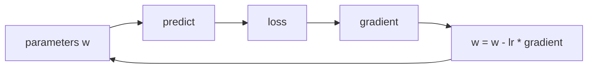

# Loss and Gradient Descent
> **Level:** Beginner · **Reading time:** 9 min · **Phase:** 0 · ML Foundations

**In one line:** A loss is a single number that says how wrong the model is, and gradient descent is the method that nudges the model's parameters downhill on that number, a small step at a time.

**Before you start:** [AI, Machine Learning and Deep Learning](01-ai-ml-deep-learning.md) (what a model, parameters and labels are).

**Words to know:**
- **Loss (cost):** a number, computed from predictions and labels, that is lower when the model is better.
- **MSE (mean squared error):** the average of (prediction minus answer) squared. Used for predicting numbers.
- **Cross-entropy:** minus the natural log of the probability the model gave the correct answer. Used for classification.
- **Gradient:** the slope of the loss with respect to a parameter. It points toward higher loss.
- **Learning rate (lr):** the size of each step. A setting you choose, not something the model learns.
- **Epoch:** one full pass over the training data.

## Explain it like I'm new
Imagine standing on a foggy hillside and wanting to reach the valley floor. You cannot see far, but you can feel the slope under your feet. So you take a small step in the direction that goes downhill, feel the slope again, and repeat.

That is **gradient descent**. The hill is the **loss**: height means "how wrong the model is". Your position is the model's parameters. The slope under your feet is the **gradient**. The size of your step is the **learning rate**.
- Steps too small: you get there, but very slowly.
- Steps too big: you leap across the valley and land higher than where you started. You can even bounce out of control (**diverge**).
- Steps about right: you move steadily to the bottom.

**Two common losses:**
- **MSE** for predicting a number (a price, a temperature). Squaring means a miss of 2 costs four times as much as a miss of 1.
- **Cross-entropy** for classification. If the correct class got probability `p`, the loss is `-ln(p)`. Giving the right answer probability 0.9 costs 0.105; giving it 0.01 costs 4.605. Confident wrong answers are punished hard.

<!-- anim:02-loss-and-gradient-descent -->
## Watch it


*It plays on a loop. Read the caption in the box, one step at a time. Want to go at your own pace? [Step through it with Previous and Next](https://techsaurabh-394.github.io/ai-engineer-roadmap/#02-loss-and-gradient-descent).*

## How it works
```text
MSE           = (1/n) * sum_i (y_hat_i - y_i)^2
cross-entropy = -ln( p_correct )
update rule   : w  <-  w - lr * (d loss / d w)
```

1. Start with parameters (often small random numbers).
2. Run the model on the training data and compute the loss.
3. Compute the gradient of the loss with respect to every parameter.
4. Move every parameter a little against its gradient: `w = w - lr * gradient`.
5. Repeat until the loss stops falling. (For many parameters at once, [backpropagation](04-backpropagation.md) computes all the gradients efficiently.)

**Worked example (loss values, by hand).** True values `3, 5, 7`, predictions `2, 5, 9`. Errors are `-1, 0, +2`. Squared: `1, 0, 4`. MSE = `(1 + 0 + 4) / 3 = 1.667`. For cross-entropy, a model that gives the correct class probability 0.9, 0.5, 0.1 or 0.01 has loss `-ln(p)` of 0.105, 0.693, 2.303 or 4.605.

**Worked example (gradient descent, one parameter).** Minimise `loss(w) = (w - 3)^2`. The minimum is obviously at `w = 3`, but pretend we cannot see it. The slope is `d loss / d w = 2 (w - 3)`. Start at `w = 0` with `lr = 0.1` (numbers from [`ml_gradient_descent.py`](../code/ml_gradient_descent.py)):

| Step | w | gradient 2(w-3) | loss |
|---|---|---|---|
| 0 | 0.0000 | -6.0000 | 9.0000 |
| 1 | 0.6000 | -4.8000 | 5.7600 |
| 2 | 1.0800 | -3.8400 | 3.6864 |
| 3 | 1.4640 | -3.0720 | 2.3593 |
| 4 | 1.7712 | -2.4576 | 1.5099 |
| 5 | 2.0170 | -1.9661 | 0.9664 |

Step 1 by hand: gradient at `w = 0` is `2 (0 - 3) = -6`, so `w = 0 - 0.1 * (-6) = 0.6`. The gradient is negative (loss falls as `w` rises), so subtracting it moves `w` up. The steps shrink on their own as the slope flattens near the bottom. After 10 steps `w = 2.6779` and loss = 0.1038.

**The learning rate decides everything.** Same problem, loss after 10 steps:

| lr | Loss after 10 steps | What happens |
|---|---|---|
| 0.01 | 6.008 | too slow, barely moved |
| 0.1 | 0.1038 | steady progress |
| 0.5 | 0 | lands exactly on 3 in one step (special to this shape) |
| 1.0 | 9 (never changes) | bounces between `w = 0` and `w = 6` |
| 1.1 | 345 | diverges: each overshoot is bigger than the last |

For this loss, any `lr` above 1.0 diverges. The safe limit depends on how steep the loss is, so real networks need it tuned.

**Linear regression.** The same recipe fits a line `y_hat = w x + b` to 20 noisy points around `y = 2x + 1`, with MSE gradients `d/dw = (2/n) sum (y_hat - y) x` and `d/db = (2/n) sum (y_hat - y)`. With `lr = 0.5`, the MSE goes 4.2951 → 0.1376 (epoch 10) → 0.1076 (epoch 200), ending at `w = 2.05, b = 0.9245` (close to the true 2 and 1; the gap is the noise). With `lr = 2.0` the loss explodes to 6.563e12 by epoch 10.



## Code example
From [`ml_gradient_descent.py`](../code/ml_gradient_descent.py) (run `python 00-ml-foundations/code/ml_gradient_descent.py`):

```python
def descend_1d(lr, start=0.0, steps=10, target=3.0):
    w = start
    rows = [(0, w, (w - target) ** 2)]
    for step in range(1, steps + 1):
        grad = 2 * (w - target)       # slope of (w - target)^2
        w = w - lr * grad             # step downhill
        rows.append((step, w, (w - target) ** 2))
    return rows

for lr in (0.01, 0.1, 1.1):
    print(lr, round(descend_1d(lr)[-1][2], 4))   # 6.008, 0.1038, 345.0
```

**In real projects** you never code this by hand. A framework does the gradients and the update (this needs `pip install torch`):

```python
import torch
w = torch.tensor(0.0, requires_grad=True)
opt = torch.optim.SGD([w], lr=0.1)
for _ in range(10):
    loss = (w - 3) ** 2
    opt.zero_grad(); loss.backward(); opt.step()
```

## When to use it / when not to
| Use | Not |
|---|---|
| Any model with a smooth loss and many parameters (neural networks, linear and logistic regression) | When a direct formula exists and the problem is small (ordinary least squares has a closed form) |
| MSE for numeric targets, cross-entropy for classes | MSE for classification probabilities (cross-entropy gives stronger gradients when confidently wrong) |

- Real training uses **mini-batches** (the gradient from a small random sample of data per step) and fancier optimisers such as Adam, but they are variations on this same update.
- On a bumpy loss surface gradient descent can stop in a local minimum or a flat patch. In practice, large networks train well anyway.

## Common mistakes
- Setting the learning rate too high and seeing the loss rise or turn into `nan`. Lower it by 3x to 10x.
- Adding the gradient instead of subtracting it. That climbs the hill.
- Judging training by the loss on the training set only (see [train/validation/test](01-ai-ml-deep-learning.md)).
- Forgetting that cross-entropy needs probabilities, so a [softmax or sigmoid](03-neurons-and-forward-propagation.md) comes first.
- Assuming a lower loss always means a better product. The loss is a stand-in for what you really care about.

## Recap
If you remember only three things:
- Loss is one number for "how wrong": MSE for numbers, cross-entropy for classes.
- Gradient descent repeats `w = w - lr * gradient`, walking downhill on the loss.
- The learning rate is the key knob: too small is slow, too large diverges.

## Interview questions
**1. Why do we use cross-entropy instead of MSE for classification?**
<details><summary>Answer</summary>
Cross-entropy is `-ln(p)` of the correct class, so a confident wrong prediction gets a very large loss and a large gradient. With a sigmoid or softmax output, MSE gradients become tiny when the unit is saturated and wrong, so learning stalls. Cross-entropy also matches maximum-likelihood estimation for categorical outcomes.
</details>

**2. What happens if the learning rate is too high or too low?**
<details><summary>Answer</summary>
Too low: training is very slow and may look stuck. Too high: updates overshoot the minimum, the loss oscillates or grows, and it can diverge to infinity or `nan`. In the 1-D example, `lr = 0.01` barely moves in 10 steps, while `lr = 1.1` makes the loss grow every step.
</details>

**3. What is the difference between batch, stochastic and mini-batch gradient descent?**
<details><summary>Answer</summary>
Batch uses the whole training set for each update: exact gradient, slow per step. Stochastic uses a single example: very noisy but cheap. Mini-batch uses a small group (such as 32 to 512 examples): a good balance and the one used in practice, since it also maps well onto GPUs.
</details>

## Go deeper
- [Deep Learning, Goodfellow, Bengio and Courville: Chapter 4 (Numerical Computation) and Chapter 8 (Optimization)](https://www.deeplearningbook.org/)
- [scikit-learn user guide: Stochastic Gradient Descent](https://scikit-learn.org/stable/modules/sgd.html)
- [Adam: A Method for Stochastic Optimization (Kingma and Ba, 2014)](https://arxiv.org/abs/1412.6980)

**Prev:** [AI, Machine Learning and Deep Learning](01-ai-ml-deep-learning.md) · **Next:** [Neurons and Forward Propagation](03-neurons-and-forward-propagation.md) · **Back to phase:** [Phase 0](../README.md)
