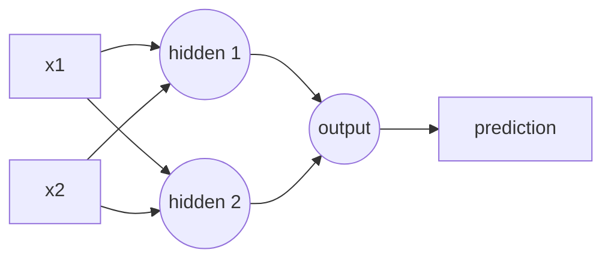

# Neurons and Forward Propagation
> **Level:** Beginner · **Reading time:** 9 min · **Phase:** 0 · ML Foundations

**In one line:** A neuron multiplies its inputs by weights, adds them up with a bias, and passes the total through an activation function; forward propagation is just doing that layer after layer to get a prediction.

**Before you start:** [Loss and Gradient Descent](02-loss-and-gradient-descent.md) (what weights are and why we adjust them).

**Words to know:**
- **Neuron (unit):** a tiny function: weighted sum of inputs plus a bias, then an activation.
- **Weight:** a number that says how much one input matters to this neuron.
- **Bias:** a number added to the sum, which shifts when the neuron "turns on".
- **Activation function:** a non-linear function applied to the sum, such as sigmoid, tanh or ReLU.
- **Layer:** a group of neurons that all look at the same inputs.
- **Forward propagation (forward pass):** computing the output of the network from the input, layer by layer.

## Explain it like I'm new
Think of a neuron as a voter who weighs advice. Three friends tell you whether to go out tonight. You trust one friend a lot (large weight), another a little (small weight), and one gives bad advice (negative weight). You add up their weighted opinions, add your own mood (the bias), and then decide how strongly to say yes. That last squashing step is the activation function.

A single neuron can only draw a straight line between two groups. Stack neurons into layers and the network can bend and combine those lines into complicated shapes. The activation function is what makes stacking useful: without it, many layers would collapse into one big weighted sum, no more powerful than a single neuron.

**Three common activations:**
- **Sigmoid:** squashes any number into 0 to 1. Good for a probability. Flat at both ends, which slows learning.
- **tanh:** squashes into -1 to 1, centred on 0.
- **ReLU:** `max(0, z)`. Zero for negatives, unchanged for positives. Cheap, and the default in most modern hidden layers.

<!-- anim:03-neurons-and-forward-propagation -->
## Watch it


*It plays on a loop. Read the caption in the box, one step at a time. Want to go at your own pace? [Step through it with Previous and Next](https://techsaurabh-394.github.io/ai-engineer-roadmap/#03-neurons-and-forward-propagation).*

## How it works
```text
z = w1*x1 + w2*x2 + ... + b        (weighted sum plus bias)
a = activation(z)                  (the neuron's output)

sigmoid(z) = 1 / (1 + e^-z)        tanh(z) = (e^z - e^-z) / (e^z + e^-z)        ReLU(z) = max(0, z)
```

| z | sigmoid | tanh | ReLU |
|---|---|---|---|
| -2 | 0.1192 | -0.9640 | 0 |
| -1 | 0.2689 | -0.7616 | 0 |
| 0 | 0.5000 | 0.0000 | 0 |
| 1 | 0.7311 | 0.7616 | 1 |
| 2 | 0.8808 | 0.9640 | 2 |

**Forward pass through a 2-2-1 network** (2 inputs, 2 hidden neurons, 1 output; the same tiny network used in [`ml_tiny_network.py`](../code/ml_tiny_network.py), with sigmoid everywhere). The starting weights are:

```text
hidden neuron 1: weights (0.5, -0.4), bias  0.1
hidden neuron 2: weights (0.3,  0.8), bias -0.2
output neuron  : weights (0.7, -0.6), bias  0.05
```

Feed in `x = (0, 1)`:

1. Hidden neuron 1: `z = 0.5*0 + (-0.4)*1 + 0.1 = -0.3`, so `a = sigmoid(-0.3) = 0.4256`.
2. Hidden neuron 2: `z = 0.3*0 + 0.8*1 + (-0.2) = 0.6`, so `a = sigmoid(0.6) = 0.6457`.
3. Output neuron: `z = 0.7*0.4256 + (-0.6)*0.6457 + 0.05 = 0.2979 - 0.3874 + 0.05 = -0.0395`, so `a = sigmoid(-0.0395) = 0.4901`.

The network says 0.4901. If the right answer for `(0, 1)` is 1 (as in XOR), the squared-error loss `0.5 * (0.4901 - 1)^2` is 0.1300. That is a poor prediction, as expected from untrained weights. In fact all four XOR inputs give almost the same output at the start: 0.5368, 0.4901, 0.5466, 0.5021. The job of training is to change the weights so these separate to near 0, 1, 1, 0. See [Backpropagation](04-backpropagation.md).

In matrix form, a whole layer is one line: `a = activation(W x + b)`, where each row of `W` holds one neuron's weights.



## Code example
From [`ml_tiny_network.py`](../code/ml_tiny_network.py) (run `python 00-ml-foundations/code/ml_tiny_network.py`):

```python
import math

def sigmoid(z):
    return 1.0 / (1.0 + math.exp(-z))

def forward(x, params):
    W1, b1, W2, b2 = params["W1"], params["b1"], params["W2"], params["b2"]
    z1 = [sum(W1[j][i] * x[i] for i in range(2)) + b1[j] for j in range(2)]
    a1 = [sigmoid(z) for z in z1]
    z2 = sum(W2[0][j] * a1[j] for j in range(2)) + b2[0]
    a2 = sigmoid(z2)
    return {"x": list(x), "z1": z1, "a1": a1, "z2": z2, "a2": a2}
```

**In real projects** you stack layers in a framework (this needs `pip install torch`):

```python
import torch.nn as nn
model = nn.Sequential(nn.Linear(2, 2), nn.Sigmoid(), nn.Linear(2, 1), nn.Sigmoid())
```

## When to use it / when not to
| Activation | Typical use |
|---|---|
| ReLU (and variants such as GELU) | hidden layers of most modern networks |
| Sigmoid | output for a yes/no probability; gates inside some networks |
| Softmax | output for choosing one of many classes |
| tanh | when you want outputs centred on zero (some recurrent networks) |
| None (linear) | output for predicting an unbounded number |

- Do not use sigmoid or tanh in the hidden layers of a deep network if you can avoid it: they flatten at the ends and gradients shrink (the "vanishing gradient" problem). ReLU avoids this for positive inputs.

## Common mistakes
- Leaving out the activation between layers. Two linear layers in a row equal one linear layer.
- Mixing up the shape of the weight matrix: for `n_in` inputs and `n_out` neurons, `W` is `n_out` by `n_in`.
- Using a sigmoid output for a number that is not between 0 and 1.
- Starting with all weights equal. Every neuron in a layer would then compute the same thing and get the same updates. Use small random values.
- Forgetting the bias.

## Recap
If you remember only three things:
- A neuron computes `a = activation(w · x + b)`.
- A network's forward pass applies this layer by layer, using the previous layer's outputs as the next inputs.
- Non-linear activations are what let deeper networks learn more than a single line.

## Interview questions
**1. What does a single neuron compute?**
<details><summary>Answer</summary>
It takes the weighted sum of its inputs, adds a bias, and applies an activation function: `a = f(w · x + b)`.
</details>

**2. Why do we need non-linear activation functions?**
<details><summary>Answer</summary>
Without them, each layer is a linear map and a stack of linear maps is just another linear map, so depth adds no power. A non-linearity between layers lets the network represent curved and complex functions. XOR, for example, cannot be solved by one linear neuron but can by two layers with a non-linearity.
</details>

**3. Why is ReLU usually preferred to sigmoid in hidden layers?**
<details><summary>Answer</summary>
Sigmoid's slope is at most 0.25 and nearly 0 for large positive or negative inputs, so gradients shrink as they pass back through many layers (vanishing gradients). ReLU has slope 1 for positive inputs, is cheap to compute, and trains deep networks more easily. Its drawback is that a neuron stuck in the negative region outputs 0 and gets no gradient ("dying ReLU").
</details>

## Go deeper
- [Deep Learning, Goodfellow, Bengio and Courville: Chapter 6 (Deep Feedforward Networks)](https://www.deeplearningbook.org/)
- [scikit-learn user guide: Neural network models (supervised)](https://scikit-learn.org/stable/modules/neural_networks_supervised.html)

**Prev:** [Loss and Gradient Descent](02-loss-and-gradient-descent.md) · **Next:** [Backpropagation](04-backpropagation.md) · **Back to phase:** [Phase 0](../README.md)
