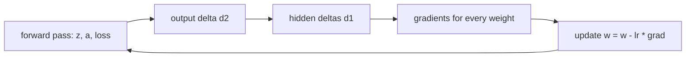

# Backpropagation
> **Level:** Intermediate · **Reading time:** 11 min · **Phase:** 0 · ML Foundations

**In one line:** Backpropagation uses the chain rule to work out, in one backward sweep through the network, how much each weight contributed to the loss, so gradient descent knows how to change every weight.

**Before you start:** [Neurons and Forward Propagation](03-neurons-and-forward-propagation.md) (the forward pass we now run in reverse) and [Loss and Gradient Descent](02-loss-and-gradient-descent.md) (the update rule). You should be comfortable with the idea of a derivative as a slope.

**Words to know:**
- **Derivative:** how fast one quantity changes when another changes slightly.
- **Chain rule:** if `y` depends on `u` and `u` depends on `x`, then `dy/dx = dy/du * du/dx`.
- **Backward pass:** computing gradients starting at the loss and moving toward the inputs.
- **Delta (δ):** the gradient of the loss with respect to a neuron's pre-activation sum `z`. Written `dL/dz`.
- **Cache:** the values saved during the forward pass (`z`, `a`) because the backward pass needs them.

## Explain it like I'm new
Imagine a relay of workers passing a bucket of paint along a line, and the last worker delivers a bad colour. To fix it, you need to know how much each worker is to blame. You ask the last worker first: "how much did you change the final colour?" Then you ask the one before: "your effect on the final colour is your effect on the next worker times that worker's effect on the end." You move backward, reusing each answer for the previous worker. That reuse is why it is fast.

That is backpropagation. The forward pass computes the prediction and the loss. The backward pass starts at the loss and, one layer at a time, multiplies local slopes together (the **chain rule**) to get the gradient for every weight. One backward pass costs about the same as one forward pass, no matter how many weights there are. This is what made training large networks practical (Rumelhart, Hinton and Williams, 1986).

<!-- anim:04-backpropagation -->
## Watch it


*It plays on a loop. Read the caption in the box, one step at a time. Want to go at your own pace? [Step through it with Previous and Next](https://techsaurabh-394.github.io/ai-engineer-roadmap/#04-backpropagation).*

## How it works
For our 2-2-1 sigmoid network with loss `L = 0.5 * (a2 - y)^2`, the forward pass was `z1 = W1 x + b1`, `a1 = sigmoid(z1)`, `z2 = W2 a1 + b2`, `a2 = sigmoid(z2)`. The sigmoid has a convenient slope: `sigmoid'(z) = a * (1 - a)`.

```text
output delta   : d2    = (a2 - y) * a2 * (1 - a2)                      (= dL/dz2)
hidden deltas  : d1[j] = d2 * W2[j] * a1[j] * (1 - a1[j])              (= dL/dz1[j])

gradients      : dL/dW2[j]    = d2    * a1[j]        dL/db2    = d2
                 dL/dW1[j][i] = d1[j] * x[i]         dL/db1[j] = d1[j]
update         : w  <-  w - lr * dL/dw
```

Why these formulas: `L` depends on `a2`, which depends on `z2`, which depends on `W2`. The chain rule multiplies `dL/da2 = (a2 - y)`, then `da2/dz2 = a2 (1 - a2)`, then `dz2/dW2[j] = a1[j]`. For a hidden weight there is one more link: `z2` depends on `a1[j]` with slope `W2[j]`, `a1[j]` on `z1[j]` with slope `a1[j](1 - a1[j])`, and `z1[j]` on `W1[j][i]` with slope `x[i]`.

**Worked example.** Same network and input as before: `x = (0, 1)`, target `y = 1`, starting weights from [`ml_tiny_network.py`](../code/ml_tiny_network.py). The forward pass gave `a1 = (0.4256, 0.6457)` and `a2 = 0.4901`, loss 0.1300.

1. Output delta: `d2 = (0.4901 - 1) * 0.4901 * (1 - 0.4901) = -0.5099 * 0.2499 = -0.1274`. Negative: raising `z2` would lower the loss.
2. Hidden deltas, pushing `d2` back through `W2 = (0.7, -0.6)`:
   - `d1[0] = -0.1274 * 0.7 * 0.4256 * 0.5744 = -0.0218`
   - `d1[1] = -0.1274 * (-0.6) * 0.6457 * 0.3543 = +0.0175`
3. Gradients of the output layer: `dL/dW2 = (d2 * 0.4256, d2 * 0.6457) = (-0.0542, -0.0823)` and `dL/db2 = -0.1274`.
4. Gradients of the hidden layer. Because `x = (0, 1)`, the weights on the first input get zero gradient (that input was 0, so those weights had no say):
   - `dL/dW1 = [[0, -0.0218], [0, 0.0175]]`, `dL/db1 = (-0.0218, 0.0175)`
5. Update with `lr = 0.5`, `w = w - lr * gradient`: `W2 = (0.7271, -0.5589)`, `b2 = 0.1137`, `W1[0][1] = -0.3891`, `W1[1][1] = 0.7913`, `b1 = (0.1109, -0.2087)`.
6. Run the forward pass again: `a2 = 0.5171`, loss = 0.1166. It was 0.1300, so the loss on this example fell, and the output moved toward the target 1.

**Check your gradients with finite differences.** A classic test is to nudge one weight by a tiny `h` and measure the change in loss: `dL/dw ≈ (L(w + h) - L(w - h)) / 2h`. If backprop is right, the two agree. The test file `test_ml_tiny_network.py` does this for all 9 parameters and requires agreement to 1e-6.

**Training on all four XOR rows** (full batch, `lr = 1.0`, the mean loss from the demo):

| Epoch | Mean loss |
|---|---|
| 0 | 0.12572 |
| 500 | 0.12509 |
| 2000 | 0.12492 |
| 3000 | 0.12277 |
| 4000 | 0.04771 |
| 5000 | 0.00378 |

After 5000 epochs the predictions for `(0,0), (0,1), (1,0), (1,1)` are 0.088, 0.895, 0.925, 0.076: XOR is solved. Notice the long flat stretch (a plateau where gradients are tiny) before the loss drops. Small sigmoid networks often do that, and it is why training can look stuck and then suddenly improve.



## Code example
From [`ml_tiny_network.py`](../code/ml_tiny_network.py):

```python
def backward(cache, y, params):
    a1, a2, x = cache["a1"], cache["a2"], cache["x"]
    W2 = params["W2"]
    d2 = (a2 - y) * a2 * (1 - a2)                                  # dL/dz2
    d1 = [d2 * W2[0][j] * a1[j] * (1 - a1[j]) for j in range(2)]   # dL/dz1[j]
    return {
        "W2": [[d2 * a1[0], d2 * a1[1]]],
        "b2": [d2],
        "W1": [[d1[j] * x[i] for i in range(2)] for j in range(2)],
        "b1": list(d1),
        "d2": d2, "d1": d1,
    }
```

**In real projects** frameworks do this for you through automatic differentiation (this needs `pip install torch`):

```python
loss.backward()   # fills .grad on every parameter by running backprop
opt.step()        # w = w - lr * w.grad (or an Adam-style variant)
```

## When to use it / when not to
- Backprop is how essentially all neural networks, including LLMs, are trained. You rarely write it by hand.
- Write it by hand once to learn it, and to verify custom layers with a finite-difference check.
- It needs a differentiable model. Hard thresholds or sampling steps need tricks or different methods.
- It stores every layer's activations from the forward pass, so memory grows with depth and batch size.

## Common mistakes
- Forgetting that the backward pass needs the forward-pass values (`a`, `z`).
- Dropping the activation's derivative term (`a * (1 - a)` for sigmoid).
- Mixing up `dL/dz` (delta) with `dL/da`.
- Updating weights in the middle of the backward pass, so later layers use already-changed weights. Compute all gradients first, then update.
- Averaging gradients over a batch in one place but not the other, which silently changes the effective learning rate.
- Not gradient-checking a hand-written layer.

## Recap
If you remember only three things:
- Backpropagation is the chain rule applied from the loss back to every weight, reusing results layer by layer.
- Each weight's gradient is (delta of the neuron it feeds) times (the value flowing into the weight).
- A finite-difference check confirms the gradients, and gradient descent then updates all weights.

## Interview questions
**1. What is backpropagation, in one sentence?**
<details><summary>Answer</summary>
An algorithm that applies the chain rule backward from the loss through the network to compute the gradient of the loss with respect to every weight, reusing intermediate results so the cost is about the same as one forward pass.
</details>

**2. Why are sigmoid networks prone to vanishing gradients?**
<details><summary>Answer</summary>
The sigmoid's slope `a(1 - a)` is at most 0.25 and near zero when the unit is saturated. The backward pass multiplies one such factor per layer, so the gradient reaching early layers shrinks exponentially with depth. ReLU (slope 1 for positive inputs), good initialisation and residual connections reduce the problem.
</details>

**3. How would you verify that your backprop implementation is correct?**
<details><summary>Answer</summary>
Gradient checking: for each parameter, compute `(L(w + h) - L(w - h)) / 2h` with a small `h` such as 1e-5 and compare with the backprop gradient; they should agree to many decimal places. Use float64 and a tiny dataset. The repo's `test_ml_tiny_network.py` does exactly this.
</details>

## Go deeper
- [Learning representations by back-propagating errors (Rumelhart, Hinton and Williams, 1986), Nature 323, 533-536](https://www.nature.com/articles/323533a0)
- [Deep Learning, Goodfellow, Bengio and Courville: Chapter 6.5 (Back-Propagation and Other Differentiation Algorithms)](https://www.deeplearningbook.org/)

**Prev:** [Neurons and Forward Propagation](03-neurons-and-forward-propagation.md) · **Next:** [Overfitting and Regularization](05-overfitting-and-regularization.md) · **Back to phase:** [Phase 0](../README.md)
