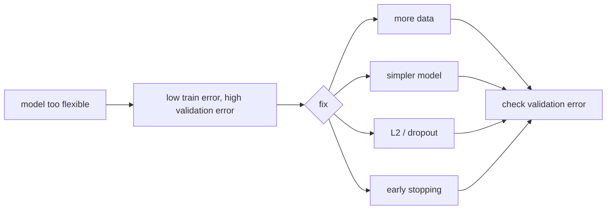

# Overfitting and Regularization
> **Level:** Intermediate · **Reading time:** 10 min · **Phase:** 0 · ML Foundations

**In one line:** Overfitting is when a model memorises the quirks and noise of its training data and so does worse on new data; regularization is any trick that makes memorising harder, such as an L2 penalty, early stopping, dropout or simply more data.

**Before you start:** [AI, Machine Learning and Deep Learning](01-ai-ml-deep-learning.md) (train, validation and test sets) and [Loss and Gradient Descent](02-loss-and-gradient-descent.md).

**Words to know:**
- **Overfitting:** low error on training data, high error on new data. The model is too flexible for the amount of data.
- **Underfitting:** high error on both. The model is too simple to capture the pattern.
- **Generalization:** how well a model does on data it has never seen.
- **Regularization:** any technique that reduces overfitting.
- **L2 (ridge, weight decay):** a penalty on the sum of squared weights, added to the loss.
- **Early stopping:** stop training when the validation error stops improving.
- **Dropout:** randomly switch off neurons during training.

## Explain it like I'm new
Imagine fitting a curve through 10 dots. A straight line misses most dots: **underfitting**. A wiggly curve that passes through every single dot looks perfect on those dots, but between them it swings wildly. Draw a new dot from the same source and the curve is far off: **overfitting**. A smooth curve that follows the general trend is best.

As you make a model more flexible (more parameters, more training), two errors behave differently:
- **Training error** keeps going down.
- **Validation error** goes down, then turns around and climbs. It makes a U shape. The bottom of the U is the sweet spot.

**Ways to fight overfitting:**
- **More (and more varied) data.** The most reliable fix.
- **A simpler model.** Fewer parameters or a lower polynomial degree.
- **L2 regularization.** Add a penalty for large weights, which keeps the curve smooth.
- **Early stopping.** Watch validation error during training and stop (keeping the best weights) when it starts to rise.
- **Dropout.** During training, randomly zero out a share of neurons on each step, so no neuron can rely on a specific partner. At test time all neurons are used (Srivastava et al., 2014).

<!-- anim:05-overfitting-and-regularization -->
## Watch it


*It plays on a loop. Read the caption in the box, one step at a time. Want to go at your own pace? [Step through it with Previous and Next](https://techsaurabh-394.github.io/ai-engineer-roadmap/#05-overfitting-and-regularization).*

## How it works
```text
regularized loss = data loss + lambda * sum(w^2)        (L2 / ridge)
gradient step    : w <- w - lr * (dLoss/dw + 2 * lambda * w)     (weights "decay" a little every step)
```

`lambda` sets the trade-off: 0 means no penalty (free to overfit), very large means weights are forced toward 0 (underfit). Choose it using the validation set. Usually the intercept (bias) is not penalised.

**Worked example.** From [`ml_overfitting.py`](../code/ml_overfitting.py): data is `y = sin(2πx) + noise` (noise standard deviation 0.3, so no model can do better than an error of about 0.09). We fit a polynomial of each degree to just 10 training points and measure the mean squared error on those 10 points and on 300 separate validation points:

| Degree | Training MSE | Validation MSE |
|---|---|---|
| 1 | 0.3071 | 0.4509 |
| 2 | 0.3067 | 0.4529 |
| 3 | 0.1164 | 0.1592 |
| 4 | 0.0872 | 0.1694 |
| 5 | 0.0764 | 0.1580 |
| 6 | 0.0739 | 0.1670 |
| 7 | 0.0651 | 0.1976 |
| 8 | 0.0645 | 0.2110 |
| 9 | 0.0000 | 3.2875 |

Reading the table:
- Training error only goes down. Degree 9 has 10 coefficients for 10 points, so it passes through every point exactly: training MSE 0.0000.
- Validation error is high at degrees 1 and 2 (**underfitting**: a line or parabola cannot follow a sine wave), lowest around degrees 3 to 5 (about 0.158), then rises, and at degree 9 it explodes to 3.2875 (**overfitting**). That is the U shape, and degree 9 is about 21 times worse than degree 5 on unseen data.
- The huge validation error comes with huge weights: the largest coefficient at degree 9 is about 1.674e+06. The model uses giant opposite-sign terms to thread every dot.

**Now add L2 to the degree 9 model** (the penalty is `lambda * sum(w^2)` added to the summed squared error, intercept not penalised):

| lambda | Training MSE | Validation MSE | Largest abs(weight) |
|---|---|---|---|
| 0 | 0.0000 | 3.2875 | 1.674e+06 |
| 1e-06 | 0.0769 | 0.1586 | 54.78 |
| 0.0001 | 0.0807 | 0.1561 | 22.94 |
| 0.001 | 0.1012 | 0.1780 | 13.2 |
| 0.01 | 0.1907 | 0.2753 | 3.818 |
| 0.1 | 0.2402 | 0.3575 | 0.9933 |
| 1 | 0.2942 | 0.4864 | 0.3148 |

A tiny penalty (`lambda = 1e-4`) cuts validation error from 3.2875 to 0.1561, the best result in either table, and shrinks the largest weight from 1.674e+06 to 22.94. Training error rises a little (0.0000 to 0.0807): that is the point, we gave up a perfect fit to the training data to get a much better fit to new data. Push `lambda` too high and the model underfits again (validation 0.4864 at `lambda = 1`).

This is one random draw of 10 points, so the exact numbers vary with the data; the U shape and the rescue by regularization are the lasting lessons.



## Code example
From [`ml_overfitting.py`](../code/ml_overfitting.py) (run `python 00-ml-foundations/code/ml_overfitting.py`):

```python
def fit(xs, ys, degree, lam=0.0):
    """Minimise sum (X w - y)^2 + lam * sum_{k>=1} w_k^2 via the normal equations."""
    X = design(xs, degree)
    d = degree + 1
    A = [[sum(X[r][i] * X[r][j] for r in range(len(xs))) for j in range(d)] for i in range(d)]
    for i in range(1, d):
        A[i][i] += lam          # the L2 penalty: add lambda to the diagonal
    b = [sum(X[r][i] * ys[r] for r in range(len(xs))) for i in range(d)]
    return solve(A, b)
```

**In real projects** (needs `pip install scikit-learn`):

```python
from sklearn.linear_model import Ridge
from sklearn.preprocessing import PolynomialFeatures
from sklearn.pipeline import make_pipeline

model = make_pipeline(PolynomialFeatures(9), Ridge(alpha=1e-4))
```

In PyTorch, use `torch.optim.AdamW(params, weight_decay=0.01)` for weight decay, `nn.Dropout(p=0.5)` for dropout, and stop training when your validation loss has not improved for a set number of epochs (the "patience").

## When to use it / when not to
| Situation | Try first |
|---|---|
| Train score much better than validation score | More data, then regularization or a simpler model |
| Both scores poor | Underfitting: a bigger or better model, better features, train longer; less regularization |
| Neural network, validation loss starts rising mid-training | Early stopping, dropout, weight decay |
| Very large dataset | You may need little regularization |

- Regularization is not free: too much makes the model underfit. Tune strength on validation data.
- Dropout is switched off at inference time; frameworks do this when you call `model.eval()`.

## Common mistakes
- Choosing `lambda` or the stopping point with the test set instead of the validation set.
- Regularizing when the real problem is underfitting.
- Forgetting to scale features before using L2: a penalty on weights depends on the feature scale.
- Leaving dropout on at inference (do `model.eval()`).
- Believing a perfect training score is good news. It is usually a warning.

## Recap
If you remember only three things:
- Training error always falls with model flexibility; validation error is U-shaped, and the bottom of the U is where to be.
- Overfitting means low training error and high validation error; underfitting means both are high.
- Fix overfitting with more data, a simpler model, L2, early stopping or dropout, and tune the strength on the validation set.

## Interview questions
**1. How can you tell whether a model is overfitting or underfitting?**
<details><summary>Answer</summary>
Compare training and validation error. A large gap (good on training, bad on validation) means overfitting. Both errors high means underfitting. A learning curve (errors versus training-set size or epochs) shows it clearly.
</details>

**2. What does L2 regularization do, and why does it help?**
<details><summary>Answer</summary>
It adds `lambda * sum(w^2)` to the loss, so large weights are penalised and the model prefers smoother, simpler functions. In the repo's demo it shrank the largest weight of a degree 9 fit from about 1.7 million to 22.9 and cut validation error from 3.29 to 0.16. In gradient descent it acts as weight decay: each step multiplies the weights by slightly less than 1.
</details>

**3. How does dropout work, and what changes at test time?**
<details><summary>Answer</summary>
During training each neuron's output is set to zero with probability p on every step, so the network cannot depend on any single neuron and behaves like an average of many thinner networks. At test time dropout is turned off and all neurons are used; in the common "inverted dropout" version the kept activations are scaled by 1/(1-p) during training so no extra scaling is needed at test time.
</details>

## Go deeper
- [Dropout: A Simple Way to Prevent Neural Networks from Overfitting (Srivastava et al., 2014), JMLR 15](https://jmlr.org/papers/v15/srivastava14a.html)
- [Deep Learning, Goodfellow, Bengio and Courville: Chapter 7 (Regularization for Deep Learning)](https://www.deeplearningbook.org/)
- [scikit-learn user guide: Underfitting vs. Overfitting example](https://scikit-learn.org/stable/auto_examples/model_selection/plot_underfitting_overfitting.html)

**Prev:** [Backpropagation](04-backpropagation.md) · **Next:** [Phase 1 · RAG Foundations](../../01-rag-foundations/README.md) · **Back to phase:** [Phase 0](../README.md)
