# 00 · Start here

**Goal:** get your computer ready and understand how this roadmap works. Time: 20 minutes.

> New to AI? Good. This roadmap assumes you know basic Python (variables, functions, lists, loops) and nothing about AI. Every term is explained the first time it appears.

## How the roadmap works



There are **7 learning phases** with **100 topics**, plus interview prep and projects. Each topic is one short page. Do the phases in order. Inside a phase, do the topics in order.

| Phase | Folder | You will learn | Level |
|---|---|---|---|
| 1 | [01-rag-foundations](../01-rag-foundations/README.md) | embeddings, chunking, vector search, BM25, hybrid search | Beginner |
| 2 | [02-advanced-rag](../02-advanced-rag/README.md) | reranking, query rewriting, HyDE, GraphRAG, RAG evaluation | Intermediate → Advanced |
| 3 | [03-llm-concepts](../03-llm-concepts/README.md) | transformers, attention, KV cache, sampling, prompting | Beginner → Advanced |
| 4 | [04-agentic-ai](../04-agentic-ai/README.md) | tool calling, ReAct, memory, multi-agent, guardrails | Intermediate |
| 5 | [05-frameworks](../05-frameworks/README.md) | LangChain, LangGraph, LlamaIndex, CrewAI, AutoGen, DSPy and more | Intermediate |
| 6 | [06-mcp](../06-mcp/README.md) | Model Context Protocol: servers, clients, tools, resources, prompts | Intermediate → Advanced |
| 7 | [07-production-ai](../07-production-ai/README.md) | FastAPI, Docker, Kubernetes, queues, monitoring, security, cost | Advanced |
| — | [08-interview-prep](../08-interview-prep/README.md) | questions with answers | Practice |
| — | [09-projects](../09-projects/README.md) | portfolio projects to build | Practice |

**Why RAG before LLM internals?** You can build useful things with RAG on day one. Phase 3 then explains *why* the model behaves the way it does. If you prefer theory first, do Phase 3 before Phase 1. Both orders work.

## Every topic page has the same shape

1. **In one line**: a definition you can quote in an interview
2. **Explain it like I'm new**: an everyday analogy
3. **How it works**: steps plus a diagram
4. **Code example**: small, runnable Python
5. **When to use it / when not to**
6. **Common mistakes**
7. **Interview questions** with hidden answers
8. **Go deeper**: links to the original paper or official docs

## Setup (one time)

### Python (all phases except the TypeScript server in phase 6)
```bash
python --version                       # 3.10 or newer recommended (CI runs 3.12)
python -m venv .venv
source .venv/bin/activate              # Windows: .venv\Scripts\activate
pip install -r requirements.txt
pytest                                 # all green = your setup works
```
The demo scripts in `code/` folders use only the Python standard library and run offline with no API key. `pip install -r requirements.txt` adds `pytest` (to run the tests) and the optional `anthropic` package (used only if you set `ANTHROPIC_API_KEY`). Code snippets inside topic pages that mention `pip install` (LangChain, FAISS, FastAPI and similar) need those packages; the [what-you-need table](../README.md#what-youll-need) lists which phases.

### Node.js (only for the TypeScript MCP server in phase 6)
```bash
node --version                         # 18 or newer (CI builds it on Node 22)
```

### Optional: a model API key
Some demos can call a real model if you set a key. Everything still works without one.
```bash
export ANTHROPIC_API_KEY=your_key      # Windows PowerShell: $env:ANTHROPIC_API_KEY="your_key"
```

## How to learn from this
1. Read one topic. Run its code. Change one number. Run it again.
2. Answer the interview questions **out loud** before opening the answers.
3. At the end of each phase, take the checkpoint quiz in the phase README.
4. Tick the topic in the [main checklist](../README.md#the-full-checklist) on your fork.
5. Build one project from [09-projects](../09-projects/README.md) after Phase 4. Building is where it sticks.

## Suggested pace
| Pace | Time per day | Finish in |
|---|---|---|
| Relaxed | 30 min (1 topic) | about 4 months |
| Steady | 1 hour (2 topics) | about 2 months |
| Intensive | 3 hours | about 3 weeks |

**Next:** [Phase 1 · RAG Foundations](../01-rag-foundations/README.md)

---

<p align="center">
  <b>Saurabh Pathak</b> · AI Engineer &amp; Full-Stack Developer<br/>
  <a href="https://github.com/techsaurabh-394">GitHub</a> ·
  <a href="https://www.linkedin.com/in/tech-saurabh/">LinkedIn</a> ·
  <a href="https://mernstackdev.com">Blog</a> ·
  <a href="mailto:saurabhpathak394@gmail.com">saurabhpathak394@gmail.com</a><br/>
  <a href="https://buymeacoffee.com/saurabhdev"></a>
</p>
