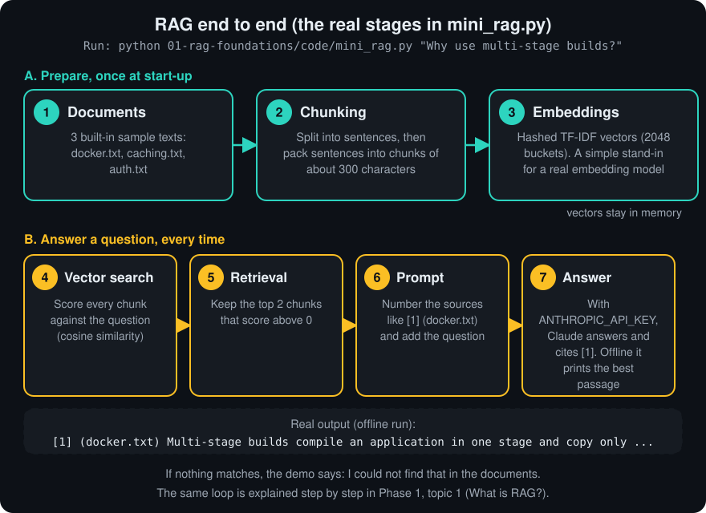

# Phase 1 · RAG Foundations

**Goal:** understand every building block of a Retrieval-Augmented Generation (RAG) system — chunking, embeddings, similarity, vector indexes and retrieval — well enough to build one from scratch and explain each choice in an interview.

**Who it's for:** beginners who can read basic Python and want to make an AI answer from *their own* documents, with citations.

**Prerequisites:**
- Phase 0: [Start here](../00-start-here/README.md)
- Python basics: lists, dictionaries, functions, loops
- School maths: multiplication, square roots. Everything else is explained as we go.

**Time:** about 8–12 hours for reading plus the code exercises.

## The big idea
A language model does not know your private or recent documents. RAG fixes that in two phases:

1. **Ingest (once per document):** split into chunks, turn each chunk into a vector, store it with metadata.
2. **Answer (every question):** turn the question into a vector, find the closest chunks, give *only those* to the model, and ask it to answer with citations.


## Topics

| # | Topic | Level | Link |
|---|---|---|---|
| 1 | What is RAG? | Beginner | [01-what-is-rag.md](topics/01-what-is-rag.md) |
| 2 | Embeddings | Beginner | [02-embeddings.md](topics/02-embeddings.md) |
| 3 | Tokenization | Beginner | [03-tokenization.md](topics/03-tokenization.md) |
| 4 | Chunking | Beginner | [04-chunking.md](topics/04-chunking.md) |
| 5 | Recursive Chunking | Beginner | [05-recursive-chunking.md](topics/05-recursive-chunking.md) |
| 6 | Semantic Chunking | Intermediate | [06-semantic-chunking.md](topics/06-semantic-chunking.md) |
| 7 | Parent Child Chunking | Intermediate | [07-parent-child-chunking.md](topics/07-parent-child-chunking.md) |
| 8 | Sliding Window Chunking | Beginner | [08-sliding-window-chunking.md](topics/08-sliding-window-chunking.md) |
| 9 | Metadata | Beginner | [09-metadata.md](topics/09-metadata.md) |
| 10 | Vector Databases | Intermediate | [10-vector-databases.md](topics/10-vector-databases.md) |
| 11 | Cosine Similarity | Beginner | [11-cosine-similarity.md](topics/11-cosine-similarity.md) |
| 12 | Euclidean Distance | Beginner | [12-euclidean-distance.md](topics/12-euclidean-distance.md) |
| 13 | Dot Product | Beginner | [13-dot-product.md](topics/13-dot-product.md) |
| 14 | HNSW | Advanced | [14-hnsw.md](topics/14-hnsw.md) |
| 15 | IVF Index | Advanced | [15-ivf-index.md](topics/15-ivf-index.md) |
| 16 | Hybrid Search | Intermediate | [16-hybrid-search.md](topics/16-hybrid-search.md) |
| 17 | BM25 | Intermediate | [17-bm25.md](topics/17-bm25.md) |
| 18 | Sparse Retrieval | Intermediate | [18-sparse-retrieval.md](topics/18-sparse-retrieval.md) |
| 19 | Dense Retrieval | Intermediate | [19-dense-retrieval.md](topics/19-dense-retrieval.md) |
| 20 | Metadata Filtering | Intermediate | [20-metadata-filtering.md](topics/20-metadata-filtering.md) |

## Learning order
Read the topics in number order. They build on each other in five blocks:

1. **The idea (1–3):** what RAG is, what embeddings are, how text becomes tokens.
2. **Preparing documents (4–9):** five chunking strategies and why every chunk needs metadata.
3. **Measuring similarity (10–13):** where vectors live and the three ways to compare them.
4. **Searching fast (14–15):** how HNSW and IVF avoid comparing the query with every vector.
5. **Retrieval strategies (16–20):** keyword (BM25, sparse), meaning (dense), both (hybrid), and filters.

After each block, run the matching code file below and change a number to see what happens.

## The whole pipeline at a glance



## Run the code
Every demo in `code/` runs offline with the Python standard library: no downloads. Only the tests need `pytest`. `mini_rag.py` calls Claude only if you set `ANTHROPIC_API_KEY` (and `pip install anthropic`); without a key it prints the best passage.

```bash
cd 01-rag-foundations/code
python mini_rag.py "Why use multi-stage builds?"     # the whole RAG loop in ~100 lines
python rag_chunkers.py                               # fixed, recursive, sliding, semantic, parent-child
python rag_vector_math.py                            # cosine, Euclidean, dot product, worked examples
python rag_bm25.py "rotate refresh token"            # BM25, toy dense, RRF hybrid, metadata filters
python rag_hnsw_ivf.py                               # brute force vs IVF vs graph search (recall vs work)
python -m pytest -q                                  # run all tests
```

| File | What it shows | Topics |
|---|---|---|
| [`mini_rag.py`](code/mini_rag.py) | Chunk → hashed TF-IDF vectors → search → answer with citations. Uses Claude only if `ANTHROPIC_API_KEY` is set. | 1, 4, 18 |
| [`rag_chunkers.py`](code/rag_chunkers.py) | Five chunking strategies on the same text | 4–8 |
| [`rag_vector_math.py`](code/rag_vector_math.py) | Similarity maths and how rankings change with normalization | 11–13 |
| [`rag_bm25.py`](code/rag_bm25.py) | BM25, reciprocal rank fusion, metadata filtering | 16–20 |
| [`rag_hnsw_ivf.py`](code/rag_hnsw_ivf.py) | Toy IVF and graph indexes vs brute force | 10, 14, 15 |

### Try it
1. Add your own document to `DOCS` in `mini_rag.py` and ask a question about it.
2. In `rag_chunkers.py`, change the chunk size from 120 to 40. What breaks first?
3. In `rag_hnsw_ivf.py`, set `nprobe=1` and `ef=2`. How much recall do you lose, and how much work do you save?
4. Ask `mini_rag.py` a paraphrase that shares no words with the text. It fails. That is why real systems use dense embeddings or hybrid search.

## Common mistakes in this phase
- Chunks too big (vague matches) or too small (no context).
- No metadata, so you cannot cite sources, filter, or update documents.
- Mixing embedding models between ingest and query.
- Comparing raw scores across different metrics or models.
- Filtering permissions after generation instead of before retrieval.
- Skipping evaluation, so you cannot tell if a change helped (covered in Phase 2).

## Phase checkpoint quiz
Try to answer out loud before opening each answer.

**1. Why retrieve first instead of pasting every document into the prompt?**
<details><summary>Answer</summary>
Context windows are limited, long prompts are slower and cost more, and models use facts buried in very long inputs less reliably. Retrieval sends only the few relevant chunks, which also makes citations easy. See <a href="topics/01-what-is-rag.md">What is RAG?</a>
</details>

**2. What is an embedding, and why must queries and documents use the same model?**
<details><summary>Answer</summary>
A vector that captures meaning so similar texts are close together. Each model has its own coordinate system, so vectors from different models cannot be compared. See <a href="topics/02-embeddings.md">Embeddings</a>.
</details>

**3. Why should chunk sizes be measured in tokens rather than characters?**
<details><summary>Answer</summary>
Embedding and LLM limits and costs are counted in tokens. Character counts are only an estimate and can overflow the model limit, causing silent truncation. See <a href="topics/03-tokenization.md">Tokenization</a>.
</details>

**4. What problem does parent-child chunking solve?**
<details><summary>Answer</summary>
Small chunks retrieve precisely but lack context; large chunks have context but match vaguely. Search small child chunks, then send their larger parent chunks to the LLM. See <a href="topics/07-parent-child-chunking.md">Parent Child Chunking</a>.
</details>

**5. Vectors a = [1, 2, 3] and b = [2, 4, 6]. What are their dot product, cosine similarity and Euclidean distance?**
<details><summary>Answer</summary>
Dot = 1·2 + 2·4 + 3·6 = 28. Cosine = 1.0 (same direction). Euclidean = √(1 + 4 + 9) = √14 ≈ 3.74. See <a href="topics/11-cosine-similarity.md">Cosine Similarity</a>.
</details>

**6. When do cosine, dot product and Euclidean distance give the same ranking?**
<details><summary>Answer</summary>
When all vectors are normalized to length 1. Then dot product equals cosine, and squared Euclidean distance equals 2 − 2·cosine. See <a href="topics/12-euclidean-distance.md">Euclidean Distance</a>.
</details>

**7. How do HNSW and IVF make search faster than brute force, and which knob trades speed for recall in each?**
<details><summary>Answer</summary>
HNSW walks a layered neighbour graph from coarse to fine; <code>ef_search</code> controls the candidate list size. IVF clusters vectors with k-means and searches only the closest clusters; <code>nprobe</code> controls how many. See <a href="topics/14-hnsw.md">HNSW</a> and <a href="topics/15-ivf-index.md">IVF Index</a>.
</details>

**8. What is the difference between sparse, dense and hybrid retrieval?**
<details><summary>Answer</summary>
Sparse (e.g. BM25) matches shared words using an inverted index and is strong on exact terms. Dense compares embedding vectors and is strong on meaning and paraphrases. Hybrid runs both and fuses the results, often with reciprocal rank fusion. See <a href="topics/16-hybrid-search.md">Hybrid Search</a>.
</details>

**9. In BM25, what do IDF, k1 and b do?**
<details><summary>Answer</summary>
IDF gives rare terms more weight. k1 controls how quickly repeated occurrences stop adding score (saturation). b controls how much long documents are penalized. See <a href="topics/17-bm25.md">BM25</a>.
</details>

**10. Why must permission filters be applied at retrieval time, and why is post-filtering risky?**
<details><summary>Answer</summary>
Anything retrieved can leak into the answer, and prompt instructions are not a security boundary. Post-filtering searches first and drops items afterwards, which can leave fewer than k results or none. See <a href="topics/20-metadata-filtering.md">Metadata Filtering</a>.
</details>

More interview-style answers: [Interview prep · RAG](../08-interview-prep/02-rag.md)

## Level up
The full app with PDF upload, a web UI, FastAPI and an evaluation script lives in the [rag-docs-chat](https://github.com/techsaurabh-394/rag-docs-chat) repo.

**Prev:** [Phase 0 · Start here](../00-start-here/README.md) · **Next:** [Phase 2 · Advanced RAG](../02-advanced-rag/README.md)

---

<p align="center">
  <b>Saurabh Pathak</b> · AI Engineer &amp; Full-Stack Developer<br/>
  <a href="https://github.com/techsaurabh-394">GitHub</a> ·
  <a href="https://www.linkedin.com/in/tech-saurabh/">LinkedIn</a> ·
  <a href="https://mernstackdev.com">Blog</a> ·
  <a href="mailto:saurabhpathak394@gmail.com">saurabhpathak394@gmail.com</a><br/>
  <a href="https://buymeacoffee.com/saurabhdev"></a>
</p>
