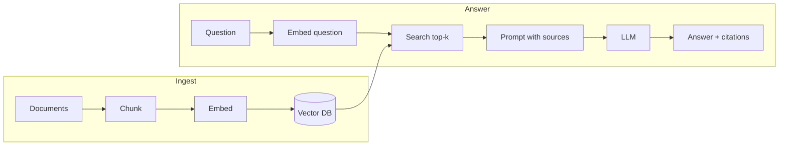

# What is RAG?
> **Level:** Beginner · **Reading time:** 6 min · **Phase:** 1 — RAG Foundations

**In one line:** RAG (Retrieval-Augmented Generation) means you first *find* the relevant pieces of your own documents, then give only those pieces to a language model so it answers from them.

## Explain it like I'm new
Think of an open-book exam. A student who studied a year ago (the model) knows a lot, but not your company handbook or last week's release notes. RAG hands the student the right two pages from the book before they answer, and asks them to point at the line they used.

A **large language model (LLM)** is a program trained on a huge amount of text that predicts the next word. It only knows what was in its training data, up to a cut-off date. It does not know your private files. When it does not know, it may still produce a confident answer that is wrong. This is called a **hallucination**.

**Retrieval** means searching a collection and getting back the most relevant items. **Generation** means the LLM writing text. RAG joins the two: retrieve first, generate second. The model now has evidence in front of it, and you can show the user which source each sentence came from (a **citation**).

Why not paste every document into the prompt? Prompts have a size limit (the **context window**), long prompts cost more and are slower, and models are worse at using facts buried in the middle of very long inputs (see "Lost in the Middle" below). Retrieval keeps the prompt small and focused.

## How it works
RAG has two phases.

**Ingest (once per document)**
1. Load the document (PDF, web page, Markdown).
2. Split it into small pieces called **chunks**.
3. Turn each chunk into a list of numbers called an **embedding** (a vector) that captures its meaning.
4. Store the vectors, the chunk text and some **metadata** (source, page, date) in a **vector database**.

**Answer (every question)**
1. Turn the question into a vector with the same embedding model.
2. Find the chunks whose vectors are closest to the question vector (top-k).
3. Put those chunks into a prompt: "Answer only from these sources and cite them."
4. The LLM writes the answer with citations.



## Code example
This repo already has the full loop in one file: [`code/mini_rag.py`](../code/mini_rag.py). The core is four steps:

```python
from mini_rag import DOCS, Index, answer

index = Index(DOCS)                                   # chunk + embed + store
question = "Where should refresh tokens be stored?"
hits = index.search(question, k=2)                    # retrieve
for score, source, text in hits:
    print(f"{score:.2f} {source}: {text[:60]}...")
print(answer(question, hits))                         # generate (or print best chunk offline)
```

Run it: `cd 01-rag-foundations/code && python mini_rag.py "Why use multi-stage builds?"`

**In real projects** (LangChain + Chroma, needs `pip install langchain-chroma langchain-openai` and an API key):

```python
from langchain_chroma import Chroma
from langchain_openai import OpenAIEmbeddings

store = Chroma.from_texts(texts=chunks, embedding=OpenAIEmbeddings(), metadatas=metas)
docs = store.similarity_search("Where should refresh tokens be stored?", k=3)
```

## When to use it / when not to
- Use RAG when answers must come from documents the model has not seen: internal wikis, contracts, product docs, support tickets.
- Use it when facts change often. You update the index, not the model.
- Use it when users need citations they can check.
- Do not use it for tasks that need no outside facts (rewriting tone, summarising text the user already pasted).
- If you need the model to learn a *style* or *format*, fine-tuning may fit better. RAG adds knowledge; fine-tuning changes behaviour.

| Need | RAG | Fine-tuning | Long prompt |
|---|---|---|---|
| Private, changing facts | Good | Poor (retrain each change) | OK for small sets |
| Citations | Easy | Hard | Possible |
| Cost per query | Low | Low | High for big docs |

## Common mistakes
- Skipping evaluation, so you cannot tell if a change helped or hurt.
- Not telling the model to say "I don't know" when the sources do not contain the answer.
- Bad chunking: pieces too big (vague matches) or too small (no context).
- Using a different embedding model for questions than for documents.
- Applying user permissions after generation instead of before retrieval.

## Interview questions
**1. Why use RAG instead of putting all documents in the prompt?**
<details><summary>Answer</summary>
Context windows are limited, long prompts cost more and are slower, and models use facts in the middle of long inputs less reliably. Retrieval sends only the few relevant chunks, which is cheaper, faster and easier to cite.
</details>

**2. What are the two phases of a RAG system?**
<details><summary>Answer</summary>
Ingestion (load, chunk, embed, store with metadata) runs when documents change. Query time (embed question, retrieve top-k, build prompt, generate with citations) runs on every question.
</details>

**3. Does RAG remove hallucinations?**
<details><summary>Answer</summary>
No. It reduces them by giving evidence, but the model can still ignore or misread sources, and retrieval can return the wrong chunks. You still need grounding instructions, citations and evaluation.
</details>

## Go deeper
- Lewis et al., *Retrieval-Augmented Generation for Knowledge-Intensive NLP Tasks* — https://arxiv.org/abs/2005.11401
- Liu et al., *Lost in the Middle: How Language Models Use Long Contexts* — https://arxiv.org/abs/2307.03172

**Prev:** [Phase 1 overview](../README.md) · **Next:** [Embeddings](02-embeddings.md) · **Back to phase:** [Phase 1](../README.md)
