# Chunking
> **Level:** Beginner · **Reading time:** 8 min · **Phase:** 1 — RAG Foundations

**In one line:** Chunking is cutting long documents into smaller pieces so each piece can be embedded, searched and shown to the model on its own.

**Before you start:** [What is RAG?](01-what-is-rag.md) and [Tokenization](03-tokenization.md). You should know that RAG searches small pieces of documents, and that sizes are often counted in tokens.

## Explain it like I'm new
Imagine a 300-page cookbook and someone asks "how long do I boil an egg?". You would not photocopy the whole book for them. You would hand them the one paragraph about eggs. Chunking prepares the book in advance by cutting it into paragraph-sized cards, so later you can hand over just the right card.

Why not embed the whole document as one vector? One vector for 300 pages is a blurry average of every topic in it. It matches everything a little and nothing well. Small pieces give sharp vectors that match specific questions.

Why not cut into single sentences? A sentence like "It should be rotated on every use." is useless alone. What is "it"? Chunks need enough surrounding text to make sense.

So chunking is a balance between **precision** (small, focused pieces) and **context** (enough text to be understood). Two numbers control it:
- **Chunk size**: how big each piece is, in characters or tokens.
- **Overlap**: how much text neighbouring chunks share, so an idea cut at a border still appears whole in one chunk.

Words to know:
- **Chunk:** one piece of a document that is embedded and searched on its own.
- **Chunk size:** how long each chunk is, in characters or tokens.
- **Overlap:** the text shared by two neighbouring chunks.
- **Strategy:** the rule used to decide where to cut.
- **Metadata:** facts about a chunk, such as its source file and page.
- **Embed:** turn text into a vector (a list of numbers) that stands for its meaning.

<!-- anim:chunking -->
## Watch it


*The diagram plays on a loop. Read the caption in the box, one step at a time.*

## How it works
1. Clean the text (remove headers, footers, repeated menus).
2. Choose a strategy (the next topics cover each one):
   - **Fixed-size**: cut every N characters or tokens.
   - **[Recursive](05-recursive-chunking.md)**: split on paragraphs, then lines, then sentences, until pieces fit.
   - **[Semantic](06-semantic-chunking.md)**: cut where the topic changes.
   - **[Parent-child](07-parent-child-chunking.md)**: search small chunks, return their larger parent.
   - **[Sliding window](08-sliding-window-chunking.md)**: overlapping windows that step forward.
3. Attach [metadata](09-metadata.md) to every chunk: source, page, heading, position.
4. Embed and store each chunk.

```text
Document: [==========================================================]
Fixed, size 20, overlap 5:
          [=========chunk 1====]
                          [====chunk 2=========]
                                          [====chunk 3=========]
                         ^^^^^ overlap: shared text at each border
```

Worked example: a 1,000-token document, chunk size 300, overlap 50. Each new chunk starts 250 tokens after the previous one (300 − 50). Chunks start at 0, 250, 500 and 750, so you get 4 chunks and the last one is shorter (250 tokens).

### Worked example
Here is real output from the repo's fixed-size chunker on a short sample text, with size 60 characters and overlap 10. It makes 6 chunks. These are the first two:
```text
'Docker images are built in layers. Each instruction in a Doc'
'n in a Dockerfile adds a layer.\n\nMulti-stage builds use seve'
```
Trace it:
1. Chunk 1 is characters 0 to 59.
2. The step is 60 − 10 = 50, so chunk 2 starts at character 50, not 60.
3. That is why both chunks contain `n in a Doc`: those 10 shared characters are the overlap.
4. The cut is blind to meaning. Chunk 1 stops in the middle of "Dockerfile", and chunk 2 starts mid-word at `n in a`.

That mid-word cut is the main weakness of fixed-size chunking. The next topic, [Recursive Chunking](05-recursive-chunking.md), fixes it by cutting at paragraph and sentence borders first.

## Code example
Fixed-size chunking with overlap, from [`code/rag_chunkers.py`](../code/rag_chunkers.py):

```python
def fixed_size_chunks(text, size=200, overlap=0):
    if not 0 <= overlap < size:
        raise ValueError("overlap must be >= 0 and smaller than size")
    step = size - overlap
    chunks = []
    for start in range(0, len(text), step):
        chunks.append(text[start:start + size])
        if start + size >= len(text):
            break
    return chunks

print(fixed_size_chunks("0123456789", size=4, overlap=2))
# ['0123', '2345', '4567', '6789']
```

Run all five strategies side by side: `cd 01-rag-foundations/code && python rag_chunkers.py`

**In real projects** (`pip install langchain-text-splitters`):

```python
from langchain_text_splitters import CharacterTextSplitter

splitter = CharacterTextSplitter(separator="\n\n", chunk_size=1000, chunk_overlap=100)
chunks = splitter.split_text(long_text)
```

## When to use it / when not to
- Always chunk documents longer than a few paragraphs.
- Very short items (FAQ entries, product titles, tweets) are already "chunks". Embed them whole.
- Start simple (recursive, ~200–500 tokens, ~10–15% overlap), then tune with an evaluation set. There is no universal best size.

| Chunk size | Good at | Bad at |
|---|---|---|
| Small | Precise matches, low prompt cost | Missing context, more chunks to store |
| Large | Full context in one piece | Blurry vectors, more noise in prompt |

## Common mistakes
- Cutting in the middle of words, tables or code blocks.
- Using one chunk size for every document type (legal PDFs and chat logs behave differently).
- Losing the heading, so a chunk says "Step 3" with no idea which procedure it belongs to. Prepend the section title.
- No overlap, so answers that span a border are never retrieved whole.
- Tuning by eye instead of by measuring retrieval quality.

## Recap
If you remember only three things:
- Chunking cuts documents into pieces so each piece gets its own focused vector and can be retrieved alone.
- Chunk size balances precision (small) against context (large), and overlap protects ideas cut at a border.
- Fixed-size cuts are simple but can split words and sentences, so tune the strategy by measuring retrieval quality.

## Interview questions
**1. Why chunk at all?**
<details><summary>Answer</summary>
One vector per long document averages many topics into a vague point. Smaller chunks give focused vectors that match specific questions, and they fit embedding limits and prompt budgets.
</details>

**2. What does overlap do, and what does it cost?**
<details><summary>Answer</summary>
It repeats some text across neighbouring chunks so ideas cut at a border still appear whole in one chunk. The cost is more chunks, more storage and possible duplicate results.
</details>

**3. How would you choose a chunk size?**
<details><summary>Answer</summary>
Start from the embedding model's token limit and the document structure, try a few sizes, and pick the one with the best retrieval metrics (recall@k, MRR) on a labelled question set.
</details>

## Go deeper
- LangChain text splitters — https://python.langchain.com/
- LlamaIndex node parsers — https://docs.llamaindex.ai/

**Prev:** [Tokenization](03-tokenization.md) · **Next:** [Recursive Chunking](05-recursive-chunking.md) · **Back to phase:** [Phase 1](../README.md)
