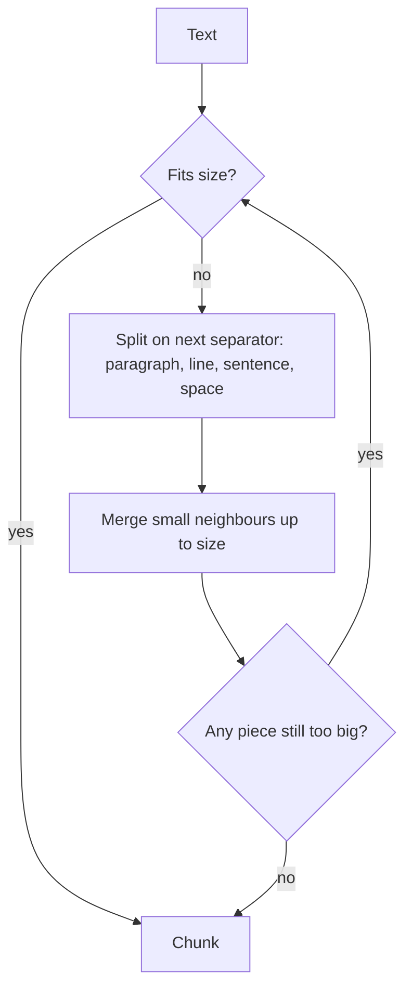

# Recursive Chunking
> **Level:** Beginner · **Reading time:** 6 min · **Phase:** 1 — RAG Foundations

**In one line:** Recursive chunking splits text on the biggest natural break first (paragraphs), and only falls back to smaller breaks (lines, sentences, words) for pieces that are still too long.

## Explain it like I'm new
Imagine packing books into boxes that hold at most 5 kg. First you try to pack whole shelves. If a shelf is too heavy, you split it into individual books. If one book is still too heavy (an encyclopedia), only then do you split it into volumes. You never tear pages unless there is no other choice.

Recursive chunking does the same with text. It keeps paragraphs whole when they fit. When one is too long, it splits that paragraph by lines, then by sentences, then by words, and as a last resort by characters. The word **recursive** means the function calls itself on the pieces that are still too big, each time with a smaller separator.

A **separator** is the string used to split, for example `"\n\n"` (blank line between paragraphs), `"\n"` (line break), `". "` (sentence end) and `" "` (space between words).

This is the most common default chunker because it respects the writer's structure at almost no cost.

## How it works
1. If the text already fits the size limit, return it as one chunk.
2. Otherwise, take the first separator in the list (e.g. `"\n\n"`) and split.
3. Walk through the pieces and **merge** neighbours into one chunk while the total still fits.
4. If a single piece is still too big, call the same function on it with the *remaining* separators.
5. If no separator is left, cut by characters.



Worked example, size 120: a document with three paragraphs of 80, 115 and 85 characters. Each fits alone, but no two fit together (80 + 115 = 195 > 120), so you get three chunks, each one a full paragraph. A 300-character paragraph would instead be split into sentences and repacked.

## Code example
From [`code/rag_chunkers.py`](../code/rag_chunkers.py):

```python
SEPARATORS = ("\n\n", "\n", ". ", " ", "")

def recursive_chunks(text, size=200, separators=SEPARATORS):
    if len(text) <= size:
        return [text] if text.strip() else []
    sep, rest = separators[0], separators[1:]
    if sep == "":
        return [text[i:i + size] for i in range(0, len(text), size)]
    if sep not in text:
        return recursive_chunks(text, size, rest)
    parts = text.split(sep)
    pieces = [p + sep for p in parts[:-1]] + [parts[-1]]   # keep the separator
    chunks, current = [], ""
    for piece in pieces:
        if len(piece) > size:                 # still too big: go one level deeper
            if current:
                chunks.append(current); current = ""
            chunks.extend(recursive_chunks(piece, size, rest))
        elif len(current) + len(piece) <= size:
            current += piece                  # merge small neighbours
        else:
            chunks.append(current); current = piece
    if current:
        chunks.append(current)
    return [c for c in chunks if c.strip()]
```

**In real projects** (`pip install langchain-text-splitters`):

```python
from langchain_text_splitters import RecursiveCharacterTextSplitter

splitter = RecursiveCharacterTextSplitter(
    chunk_size=500, chunk_overlap=50,
    separators=["\n\n", "\n", ". ", " ", ""],
)
chunks = splitter.split_text(long_text)
```

`RecursiveCharacterTextSplitter.from_language(...)` provides separators for source code (functions, classes) in many languages.

## When to use it / when not to
- Good default for prose, Markdown, docs and most web pages.
- Use language-aware separators for code and Markdown headings.
- Not ideal when structure lies (PDFs extracted with broken line breaks) — clean the text first.
- If topics change mid-paragraph often, [semantic chunking](06-semantic-chunking.md) may cut in better places.

## Common mistakes
- Measuring size in characters when the embedding model limit is in tokens. Most libraries accept a custom length function (e.g. a token counter).
- Dropping the separator, so sentences run together ("end.Start").
- Putting `" "` before `"\n\n"` in the list, which defeats the point.
- Forgetting overlap, so context at chunk borders is lost.

## Interview questions
**1. Why is recursive chunking a popular default?**
<details><summary>Answer</summary>
It keeps natural units (paragraphs, sentences) intact when they fit, only splits further when needed, needs no model calls, and is fast and predictable.
</details>

**2. What happens when a single word is longer than the chunk size?**
<details><summary>Answer</summary>
After all separators are used up, the last fallback (empty separator) cuts by characters, so every chunk still respects the size limit.
</details>

**3. How would you adapt it for source code?**
<details><summary>Answer</summary>
Use separators that match code structure, such as class and function definitions first, then blank lines, then lines, so functions stay whole when possible.
</details>

## Go deeper
- LangChain text splitters (RecursiveCharacterTextSplitter) — https://python.langchain.com/

**Prev:** [Chunking](04-chunking.md) · **Next:** [Semantic Chunking](06-semantic-chunking.md) · **Back to phase:** [Phase 1](../README.md)
