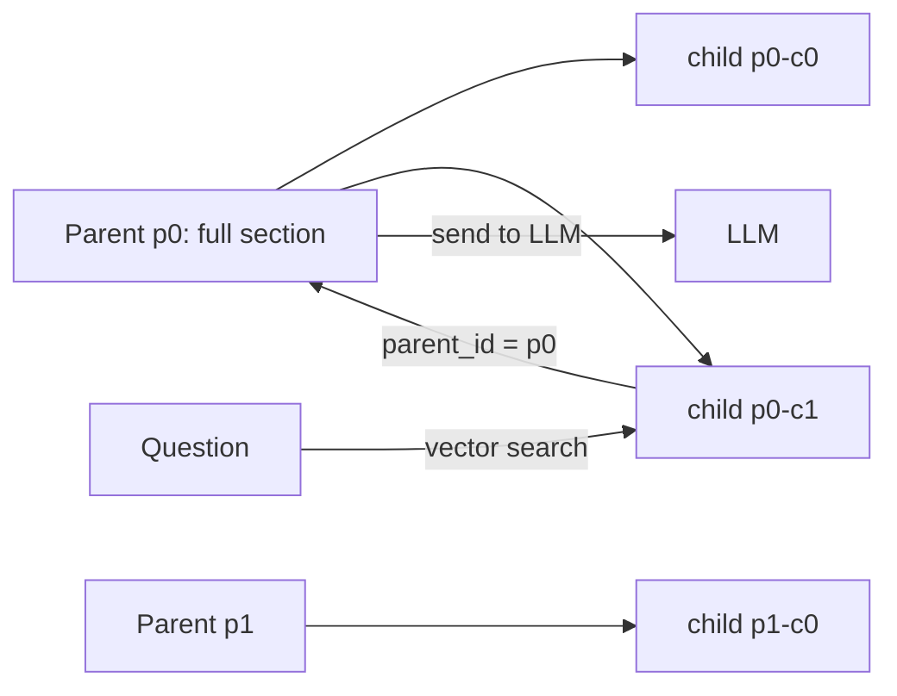

# Parent Child Chunking
> **Level:** Intermediate · **Reading time:** 6 min · **Phase:** 1 — RAG Foundations

**In one line:** Parent-child chunking searches over small "child" chunks for precise matches, then gives the model the larger "parent" chunk each child came from, for full context.

## Explain it like I'm new
Think of a library index card. The card is tiny: "Egg boiling times — page 112". It is easy to find the right card. But you do not read the card to cook; you open the book to page 112 and read the whole section. The card is the **child**. The page is the **parent**.

Chunking has a built-in conflict (see [Chunking](04-chunking.md)): small chunks are best for *finding*, large chunks are best for *understanding*. Parent-child chunking stops choosing. It stores both sizes and links them.

- **Child chunk:** small (for example 100–200 tokens). It is embedded and searched.
- **Parent chunk:** large (for example 500–2,000 tokens, or a whole section). It is stored but usually not embedded. Each child keeps a `parent_id` in its [metadata](09-metadata.md).

At query time you search children, collect their parent IDs, remove duplicates, and send the parents to the LLM. In LangChain this is called the **ParentDocumentRetriever**. LlamaIndex has a related idea called auto-merging retrieval.

## How it works
1. Split each document into parent chunks (by section or with a large [recursive](05-recursive-chunking.md) split).
2. Split each parent into child chunks.
3. Give each child a `parent_id`. Embed children and store them in the vector database.
4. Store parents in a simple key-value store (`parent_id → text`).
5. At query time: search children (top-k), map them to parent IDs, deduplicate, fetch parents.
6. Send parents (not children) to the LLM.



Worked example: 3 children are retrieved with parent IDs `p4, p4, p9`. After deduplication you send 2 parents, `p4` and `p9`. If parents are 800 tokens each, the prompt carries about 1,600 tokens of context.

## Code example
From [`code/rag_chunkers.py`](../code/rag_chunkers.py), building on `recursive_chunks`:

```python
def parent_child_chunks(text, parent_size=400, child_size=100):
    parents, children = {}, []
    for p_idx, parent in enumerate(recursive_chunks(text, parent_size)):
        pid = f"p{p_idx}"
        parents[pid] = parent
        for c_idx, child in enumerate(recursive_chunks(parent, child_size)):
            children.append({"id": f"{pid}-c{c_idx}", "parent_id": pid, "text": child})
    return parents, children

def retrieve_parents(question, children, parents, search, k=3):
    hits = search(question, [c["text"] for c in children], k)   # indexes of best children
    seen, out = set(), []
    for i in hits:
        pid = children[i]["parent_id"]
        if pid not in seen:
            seen.add(pid); out.append(parents[pid])
    return out
```

`search` can be any retriever, for example BM25 from [`code/rag_bm25.py`](../code/rag_bm25.py).

**In real projects** (LangChain, with any vector store and embeddings you already use):

```python
from langchain.retrievers import ParentDocumentRetriever
from langchain.storage import InMemoryStore
from langchain_text_splitters import RecursiveCharacterTextSplitter

retriever = ParentDocumentRetriever(
    vectorstore=vectorstore,                      # holds child embeddings
    docstore=InMemoryStore(),                     # holds parents
    child_splitter=RecursiveCharacterTextSplitter(chunk_size=200),
    parent_splitter=RecursiveCharacterTextSplitter(chunk_size=1000),
)
retriever.add_documents(docs)
results = retriever.invoke("Where should refresh tokens be stored?")
```

Import paths move between LangChain versions; check the docs for your version.

## When to use it / when not to
- Good when answers need surrounding context: manuals, policies, legal or medical text, code docs.
- Good when questions are short and specific but the answer spans a section.
- Not needed when items are already short (FAQs, product records).
- Watch the prompt budget: k children can expand into k large parents.

## Common mistakes
- Forgetting to deduplicate parents, so the same section appears three times in the prompt.
- Parents so large that only one or two fit in the context window.
- Losing the link (no `parent_id`) when re-ingesting or updating documents.
- Evaluating retrieval on children while the LLM sees parents. Measure what the model actually receives.

## Interview questions
**1. What problem does parent-child chunking solve?**
<details><summary>Answer</summary>
The trade-off between precise retrieval (small chunks) and enough context for generation (large chunks). It searches small children and returns their large parents.
</details>

**2. Which chunks are embedded?**
<details><summary>Answer</summary>
Usually only the children. Parents are stored by ID in a document store and fetched after the search.
</details>

**3. What is a risk of this approach?**
<details><summary>Answer</summary>
Prompt size can grow quickly, and duplicate or irrelevant parent text can add noise. You need deduplication and a cap on the number or size of parents.
</details>

## Go deeper
- LangChain retrievers (ParentDocumentRetriever) — https://python.langchain.com/
- LlamaIndex (auto-merging retrieval) — https://docs.llamaindex.ai/

**Prev:** [Semantic Chunking](06-semantic-chunking.md) · **Next:** [Sliding Window Chunking](08-sliding-window-chunking.md) · **Back to phase:** [Phase 1](../README.md)
