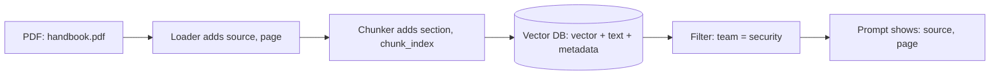

# Metadata
> **Level:** Beginner · **Reading time:** 5 min · **Phase:** 1 — RAG Foundations

**In one line:** Metadata is extra information stored next to each chunk — like source file, page, date, author or access level — used for citations, filtering and debugging.

## Explain it like I'm new
A photo on your phone is not just pixels. It also stores when it was taken, where, and on which camera. That is metadata: "data about data". You can search "photos from Paris in 2024" without looking at a single pixel.

In RAG, every chunk should carry metadata alongside its text and its [embedding](02-embeddings.md). Without it, a chunk is an orphan sentence: you cannot say where it came from, whether it is out of date, or whether this user is allowed to see it.

Metadata is usually a small dictionary of **fields** (names) and **values**:

```text
{"source": "security-handbook.pdf", "page": 12, "section": "Tokens",
 "updated": "2025-03-01", "team": "security", "access": ["staff"]}
```

It powers four things:
1. **Citations**: "according to security-handbook.pdf, page 12".
2. **[Filtering](20-metadata-filtering.md)**: only search documents from 2025, or only this customer's files.
3. **Context**: adding the document title or section heading to the chunk text makes vague chunks clearer.
4. **Maintenance**: find and delete all chunks from a document when it changes.

## How it works
1. **Capture** during loading: file name, URL, page number, heading path, timestamps.
2. **Derive** extra fields: language, document type, product, or tags from rules or an LLM.
3. **Attach** the dictionary to every chunk created from that document, plus chunk-level fields (position, `parent_id`).
4. **Store** it in the vector database with the vector. Most vector databases index metadata so filters are fast.
5. **Use** it at query time to filter, then pass source info into the prompt for citations.



## Code example
Stdlib demo: attach metadata during chunking, then cite it.

```python
def chunk_with_metadata(doc_text, source, updated, team, size=200):
    from rag_chunkers import recursive_chunks          # from this phase's code/ folder
    chunks = []
    for i, text in enumerate(recursive_chunks(doc_text, size)):
        chunks.append({
            "id": f"{source}#{i}",
            "text": text,
            "meta": {"source": source, "chunk_index": i, "updated": updated, "team": team},
        })
    return chunks

def format_sources(hits):
    return "\n".join(f"[{n}] ({h['meta']['source']}, chunk {h['meta']['chunk_index']}) {h['text']}"
                     for n, h in enumerate(hits, 1))
```

The `DOCS` list in [`code/rag_bm25.py`](../code/rag_bm25.py) stores `{"text": ..., "meta": {...}}` items and filters on them.

**In real projects** (Chroma, `pip install chromadb`):

```python
import chromadb

col = chromadb.Client().create_collection("docs")
col.add(ids=["auth#0"], documents=["Refresh tokens belong in an httpOnly cookie."],
        metadatas=[{"source": "auth.md", "team": "security", "year": 2025}])
res = col.query(query_texts=["where do refresh tokens go?"], n_results=1,
                where={"team": "security"})
print(res["metadatas"][0][0]["source"])
```

## When to use it / when not to
- Always store at least: a stable chunk ID, source document ID, and position (page or index).
- Add fields you will actually filter or display on. Each field costs storage and, in some databases, index memory.
- Keep values simple and consistent (ISO dates, lowercase tags, numbers as numbers).

## Common mistakes
- No stable document ID, so updating a file leaves old chunks behind as duplicates.
- Dates stored as free text ("March 1st"), which cannot be compared.
- Putting permissions only in the app layer and forgetting them in the index.
- Writing huge text blobs into metadata instead of the chunk body.
- Mixing types for one field (`"2025"` in some chunks, `2025` in others) so filters miss rows.

## Interview questions
**1. What metadata would you store for each chunk?**
<details><summary>Answer</summary>
Chunk ID, document ID, source (file or URL), position (page, section, index), timestamps, and fields used for filtering such as tenant, team, language or access level.
</details>

**2. How does metadata help with document updates?**
<details><summary>Answer</summary>
With a document ID on every chunk you can delete all old chunks for that document and insert the new ones, avoiding stale or duplicate results.
</details>

**3. Why prepend titles or headings to chunk text?**
<details><summary>Answer</summary>
A chunk like "Step 3: restart the service" is ambiguous alone. Adding "Guide: Resetting VPN > Step 3" gives the embedding and the LLM the missing context.
</details>

## Go deeper
- Chroma docs (metadata and `where` filters) — https://docs.trychroma.com/
- LlamaIndex (documents, nodes and metadata) — https://docs.llamaindex.ai/

**Prev:** [Sliding Window Chunking](08-sliding-window-chunking.md) · **Next:** [Vector Databases](10-vector-databases.md) · **Back to phase:** [Phase 1](../README.md)
