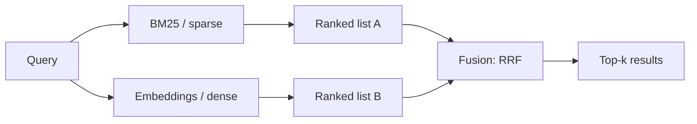

# Hybrid Search
> **Level:** Intermediate · **Reading time:** 7 min · **Phase:** 1 — RAG Foundations

**In one line:** Hybrid search runs keyword search and embedding search side by side and merges their results, so you catch both exact-term matches and same-meaning matches.

## Explain it like I'm new
Imagine asking two librarians for help. One is a stickler for exact words: ask for "error E1234" and she finds every page that says E1234. The other understands meaning: ask "how do I reset my login?" and he finds the page titled "Password recovery". Each misses things the other finds. Hybrid search asks both and combines their lists.

The two librarians are:
- **[Sparse retrieval](18-sparse-retrieval.md)** (keyword search), usually **[BM25](17-bm25.md)**. Great at exact terms: product codes, names, rare words, error messages.
- **[Dense retrieval](19-dense-retrieval.md)** (embedding search). Great at paraphrases and synonyms, weaker on rare exact strings it never saw in training.

The hard part is merging. BM25 scores might range from 0 to 25; cosine similarities from 0 to 1. You cannot just add them. Two common methods:
- **Reciprocal Rank Fusion (RRF)**: ignore the raw scores, use only each document's *rank* in each list.
- **Weighted score fusion**: normalize both scores to 0–1, then combine, e.g. `0.5·dense + 0.5·sparse`.

## How it works
1. Run the query through BM25 → ranked list A.
2. Embed the query and run vector search → ranked list B.
3. (Optional, recommended) apply the same [metadata filter](20-metadata-filtering.md) to both.
4. Fuse the lists. With RRF, each document gets `score = Σ 1 / (k + rank)` over the lists it appears in. `k` is a constant, commonly 60, that dampens the effect of top ranks.
5. Take the top results, optionally pass them to a **reranker** (a model that re-scores query–document pairs; see Phase 2).



Worked RRF example, `k = 60`:

| Doc | Rank in BM25 | Rank in dense | RRF score |
|---|---|---|---|
| d1 | 1 | 3 | 1/61 + 1/63 = 0.03227 |
| d2 | 2 | 1 | 1/62 + 1/61 = 0.03252 |
| d3 | — | 2 | 1/62 = 0.01613 |

Order: d2, d1, d3. d2 wins because both systems rank it high.

## Code example
From [`code/rag_bm25.py`](../code/rag_bm25.py). The "dense" side here is a toy character-trigram similarity so it runs offline; swap in real embeddings in practice.

```python
def reciprocal_rank_fusion(rankings, k=60):
    scores = {}
    for ranking in rankings:
        for rank, doc_id in enumerate(ranking, start=1):
            scores[doc_id] = scores.get(doc_id, 0.0) + 1.0 / (k + rank)
    return sorted(scores, key=lambda d: (-scores[d], d))

def hybrid_search(query, docs, k=3, filters=None):
    texts = [d["text"] for d in docs]
    allowed = None
    if filters:
        allowed = {i for i, d in enumerate(docs) if matches(d["meta"], filters)}
    sparse = [i for _, i in BM25(texts).search(query, k=len(texts), allowed=allowed)]
    dense = [i for s, i in toy_dense_scores(query, texts, allowed) if s > 0]
    return reciprocal_rank_fusion([sparse, dense])[:k]

print(reciprocal_rank_fusion([["d1", "d2"], ["d2", "d3", "d1"]]))   # ['d2', 'd1', 'd3']
```

Run: `cd 01-rag-foundations/code && python rag_bm25.py "rotate refresh token"`

**In real projects** (LangChain, `pip install langchain langchain-community rank_bm25`):

```python
from langchain.retrievers import EnsembleRetriever
from langchain_community.retrievers import BM25Retriever

bm25 = BM25Retriever.from_texts(chunks); bm25.k = 5
dense = vectorstore.as_retriever(search_kwargs={"k": 5})   # any LangChain vector store
hybrid = EnsembleRetriever(retrievers=[bm25, dense], weights=[0.5, 0.5])  # weighted RRF
docs = hybrid.invoke("error E1234 after password reset")
```

Many databases have hybrid search built in (Weaviate, Qdrant, Elasticsearch/OpenSearch, Milvus). Import paths change across LangChain versions; check the docs.

## When to use it / when not to
- Use when queries mix exact identifiers and natural language: support tickets, code, legal or medical terms, product catalogues.
- A strong default for production RAG; it often helps over either method alone, but measure on your own data.
- Skip it if your evaluation shows dense alone is as good and you want a simpler stack.

| Method | Strength | Weakness |
|---|---|---|
| Sparse (BM25) | Exact terms, rare words, no training | Misses synonyms and paraphrases |
| Dense | Meaning, paraphrases | Rare codes, new jargon, needs a model |
| Hybrid | Both | Two indexes, fusion to tune |

## Common mistakes
- Adding raw BM25 scores to cosine scores without normalizing.
- Filtering only one side, so forbidden documents re-enter through the other list.
- Using different chunks for the two indexes, so IDs do not line up.
- Fetching only top-3 from each side before fusion. Fetch more (e.g. 20–50), fuse, then cut.

## Interview questions
**1. Why combine sparse and dense retrieval?**
<details><summary>Answer</summary>
They fail differently. Sparse is good at exact terms and rare strings; dense is good at meaning and paraphrases. Combining them raises recall across both kinds of queries.
</details>

**2. How does Reciprocal Rank Fusion work and why is it popular?**
<details><summary>Answer</summary>
Each document scores the sum of 1/(k + rank) over the lists it appears in. It uses only ranks, so it needs no score normalization or tuning beyond k, and it rewards documents that several retrievers agree on.
</details>

**3. What is a pitfall of weighted score fusion?**
<details><summary>Answer</summary>
Scores from different systems have different scales and distributions. You must normalize them (e.g. min-max per query), and the weights need tuning on an evaluation set.
</details>

## Go deeper
- Cormack, Clarke & Büttcher, *Reciprocal Rank Fusion outperforms Condorcet and individual rank learning methods* (SIGIR 2009) — https://dl.acm.org/doi/10.1145/1571941.1572114
- LangChain retrievers (EnsembleRetriever) — https://python.langchain.com/

**Prev:** [IVF Index](15-ivf-index.md) · **Next:** [BM25](17-bm25.md) · **Back to phase:** [Phase 1](../README.md)
