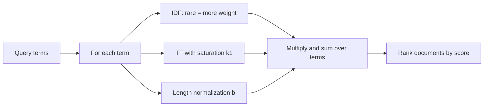

# BM25
> **Level:** Intermediate · **Reading time:** 8 min · **Phase:** 1 — RAG Foundations

**In one line:** BM25 is a classic keyword-ranking formula that scores a document higher when it contains the query's words often, when those words are rare across the collection, and when the document is not padded with extra text.

## Explain it like I'm new
Imagine searching a pile of letters for "volcano eruption". A letter that says "volcano" five times is probably more relevant than one that says it once. But a letter that says "the" fifty times tells you nothing, because every letter has "the". And a 30-page letter that mentions "volcano" twice is less focused than a postcard that mentions it twice.

BM25 turns those three intuitions into a score:
1. **Term frequency (TF)**: how often the query word appears in the document. More is better, but with **diminishing returns** — the 10th mention adds much less than the 1st. This is called **saturation**.
2. **Inverse document frequency (IDF)**: rare words matter more. "Kubernetes" in a cooking corpus is a strong signal; "the" is not.
3. **Length normalization**: long documents naturally contain more words, so their counts are scaled down relative to the average length.

"BM" stands for "Best Matching"; 25 is the version number from the original research series (Okapi BM25). It powers the default ranking in Lucene, Elasticsearch and OpenSearch. It needs no training and no GPU.

## How it works
For a query with terms `t` and a document `d`:

```text
score(q, d) = Σ over t in q   IDF(t) × tf(t,d) × (k1 + 1)
                              ---------------------------------------------
                              tf(t,d) + k1 × (1 − b + b × |d| / avgdl)

IDF(t) = ln( (N − df(t) + 0.5) / (df(t) + 0.5) + 1 )
```

- `tf(t,d)`: times term `t` appears in `d`.
- `df(t)`: number of documents containing `t`. `N`: total documents.
- `|d|`: document length in words. `avgdl`: average document length.
- `k1` (typically 1.2–2.0): how fast TF saturates. `b` (typically 0.75): how strongly length is normalized (0 = off, 1 = full).

Worked example: `N = 3` documents, query term "fish" appears in 1 document, "cat" appears in all 3.
- `IDF(fish) = ln((3 − 1 + 0.5) / (1 + 0.5) + 1) = ln(2.667) ≈ 0.98`
- `IDF(cat) = ln((3 − 3 + 0.5) / (3 + 0.5) + 1) = ln(1.143) ≈ 0.13`

"fish" carries about 7× more weight than "cat". Now saturation, with `k1 = 1.5`, `b = 0` (no length effect): the TF part is `tf × 2.5 / (tf + 1.5)`. For tf = 1 → 1.0; tf = 2 → 1.43; tf = 10 → 2.17. Ten mentions score barely double one mention.



## Code example
From [`code/rag_bm25.py`](../code/rag_bm25.py):

```python
import math, re
from collections import Counter

def tokenize(text):
    return re.findall(r"[a-z0-9]+", text.lower())

class BM25:
    def __init__(self, texts, k1=1.5, b=0.75):
        self.k1, self.b = k1, b
        self.tfs = [Counter(tokenize(t)) for t in texts]
        self.lengths = [sum(tf.values()) for tf in self.tfs]
        self.n = len(texts)
        self.avgdl = sum(self.lengths) / self.n
        self.df = Counter(term for tf in self.tfs for term in tf)

    def idf(self, term):
        d = self.df.get(term, 0)
        return math.log((self.n - d + 0.5) / (d + 0.5) + 1)

    def score(self, query, i):
        tf, length, s = self.tfs[i], self.lengths[i], 0.0
        for t in tokenize(query):
            f = tf.get(t, 0)
            if f:
                denom = f + self.k1 * (1 - self.b + self.b * length / self.avgdl)
                s += self.idf(t) * f * (self.k1 + 1) / denom
        return s

bm = BM25(["cat dog", "cat bird", "cat fish"])
print(round(bm.idf("fish"), 2), round(bm.idf("cat"), 2))   # 0.98 0.13
```

The repo version also removes stop words, supports filters and returns sorted results.

**In real projects** (`pip install rank_bm25`):

```python
from rank_bm25 import BM25Okapi

corpus = [doc.lower().split() for doc in texts]
bm25 = BM25Okapi(corpus, k1=1.5, b=0.75)
scores = bm25.get_scores("rotate refresh token".split())
top = bm25.get_top_n("rotate refresh token".split(), texts, n=3)
```

At scale, use Elasticsearch/OpenSearch (BM25 is their default similarity) or a database with built-in full-text search.

## When to use it / when not to
- Use for exact identifiers, names, codes, error messages and domain jargon.
- Use as a strong baseline before adding embeddings; and as the sparse half of [hybrid search](16-hybrid-search.md).
- Weak on synonyms and paraphrases ("car" vs "automobile") and across languages.
- Tokenization matters: decide on lowercasing, stemming (reducing "running" to "run") and stop words for your language.

## Common mistakes
- Different tokenization for documents and queries.
- Forgetting that scores are not comparable across queries or corpora; do not use a fixed score threshold blindly.
- Expecting BM25 to understand meaning.
- Indexing huge chunks, which dilutes term frequency and weakens length normalization.

## Interview questions
**1. What are the three ideas inside BM25?**
<details><summary>Answer</summary>
Term frequency with saturation (k1), inverse document frequency (rare terms weigh more), and document length normalization (b).
</details>

**2. What do k1 and b do?**
<details><summary>Answer</summary>
k1 controls how quickly repeated occurrences stop adding score. b controls how much longer-than-average documents are penalized; b = 0 disables length normalization.
</details>

**3. Why is BM25 still used in modern RAG systems?**
<details><summary>Answer</summary>
It is fast, needs no training, is easy to explain, and handles exact terms and rare tokens that embedding models can miss. It is a strong baseline and the sparse side of hybrid search.
</details>

## Go deeper
- Robertson & Zaragoza, *The Probabilistic Relevance Framework: BM25 and Beyond* — https://dl.acm.org/doi/10.1561/1500000019
- Elasticsearch similarity settings (BM25) — https://www.elastic.co/guide/en/elasticsearch/reference/current/index-modules-similarity.html

**Prev:** [Hybrid Search](16-hybrid-search.md) · **Next:** [Sparse Retrieval](18-sparse-retrieval.md) · **Back to phase:** [Phase 1](../README.md)
