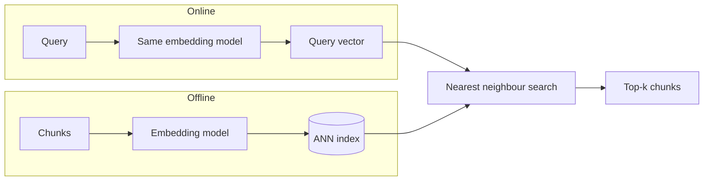

# Dense Retrieval
> **Level:** Intermediate · **Reading time:** 7 min · **Phase:** 1 — RAG Foundations

**In one line:** Dense retrieval finds documents by comparing short, meaning-based embedding vectors of the query and the documents, so it matches ideas even when the words differ.

## Explain it like I'm new
Ask a friend "how do I get back into my account?" A keyword search might miss a help page titled "Password recovery steps" because no words overlap. A friend who understands meaning would point you right to it. Dense retrieval is that friend.

It works by turning every chunk and every query into an [embedding](02-embeddings.md): a vector of a few hundred to a few thousand numbers. These vectors are **dense** — almost every number is non-zero, and no single number means one word. Meaning is spread across all of them. Texts with similar meaning end up close together, measured with [cosine similarity](11-cosine-similarity.md), [dot product](13-dot-product.md) or [Euclidean distance](12-euclidean-distance.md).

The model that makes the vectors is often called a **bi-encoder** (or two-tower model): it encodes the query and each document *separately*. That matters, because you can embed all documents once, ahead of time, and only embed the query at search time. Searching is then a [nearest neighbour search](10-vector-databases.md) in a vector database.

Dense Passage Retrieval (DPR) was an influential early paper showing a trained bi-encoder could beat BM25 on open-domain question answering benchmarks.

## How it works
**Offline (ingest)**
1. [Chunk](04-chunking.md) the documents.
2. Embed each chunk with the embedding model.
3. Store vectors (plus text and [metadata](09-metadata.md)) in an ANN index like [HNSW](14-hnsw.md) or [IVF](15-ivf-index.md).

**Online (query)**
1. Embed the query with the *same* model (some models want a prefix like `"query: "`; read the model card).
2. Search the index for the top-k nearest vectors.
3. Return those chunks to the RAG prompt or a reranker.



Worked example (toy 3-D normalized vectors):
- query "get back into my account" → `[0.80, 0.60, 0.00]`
- d0 "Password recovery steps" → `[0.75, 0.66, 0.00]` → dot = 0.600 + 0.396 = **0.996**
- d1 "Docker image layers" → `[0.00, 0.10, 0.99]` → dot = 0 + 0.06 + 0 = **0.06**

d0 wins with zero shared words. (Numbers made up to illustrate; a real model produces its own.)

## Code example
The core of dense search, assuming you already have normalized embeddings (here a stand-in dictionary):

```python
def dot(a, b):
    return sum(x * y for x, y in zip(a, b))

doc_vecs = {
    "Password recovery steps": [0.75, 0.66, 0.00],
    "Docker image layers":     [0.00, 0.10, 0.99],
    "Rotate refresh tokens":   [0.50, 0.40, 0.77],
}
query_vec = [0.80, 0.60, 0.00]          # embed("get back into my account")

ranked = sorted(doc_vecs, key=lambda d: dot(query_vec, doc_vecs[d]), reverse=True)
print(ranked[:2])   # ['Password recovery steps', 'Rotate refresh tokens']
```

[`code/rag_bm25.py`](../code/rag_bm25.py) includes `toy_dense_scores`, a character-trigram stand-in that runs offline and shows how dense-style scoring catches word variants ("caching" vs "cache") that BM25 misses.

**In real projects** (`pip install sentence-transformers`):

```python
from sentence_transformers import SentenceTransformer, util

model = SentenceTransformer("all-MiniLM-L6-v2")
docs = ["Password recovery steps", "Docker image layers", "Rotate refresh tokens"]
doc_emb = model.encode(docs, normalize_embeddings=True)
q_emb = model.encode("get back into my account", normalize_embeddings=True)
hits = util.semantic_search(q_emb, doc_emb, top_k=2)[0]
print([(docs[h["corpus_id"]], round(h["score"], 3)) for h in hits])
```

## When to use it / when not to
- Users ask in natural language and documents use different wording.
- Multilingual search (with a multilingual model).
- Weaker for exact codes, rare names and new jargon the model never saw — add [sparse retrieval](18-sparse-retrieval.md) via [hybrid search](16-hybrid-search.md).
- Domain shift: a general model may underperform on very specialized text. Evaluate, and consider a domain model or fine-tuning.

## Common mistakes
- Different models (or versions) for queries and documents.
- Ignoring model-specific query/document prefixes or instructions.
- Text longer than the model's limit gets truncated silently.
- No evaluation set, so you cannot compare models or detect regressions.
- Trusting similarity scores as "confidence". Top-1 can be on-topic and still not contain the answer.

## Interview questions
**1. What is a bi-encoder and why does it suit retrieval?**
<details><summary>Answer</summary>
It encodes queries and documents separately into vectors. Document vectors can be computed once and indexed, so search only needs one query embedding plus a fast nearest-neighbour lookup.
</details>

**2. When does dense retrieval fail where BM25 succeeds?**
<details><summary>Answer</summary>
Exact identifiers, rare names, codes and out-of-domain jargon. The embedding may not preserve those exact strings, while BM25 matches them directly.
</details>

**3. How would you pick an embedding model?**
<details><summary>Answer</summary>
Shortlist from a benchmark like MTEB for your language and task, check size, latency, max input length and license, then compare finalists on your own labelled queries with recall@k or MRR.
</details>

## Go deeper
- Karpukhin et al., *Dense Passage Retrieval for Open-Domain Question Answering* — https://arxiv.org/abs/2004.04906
- Muennighoff et al., *MTEB: Massive Text Embedding Benchmark* — https://arxiv.org/abs/2210.07316
- Sentence Transformers docs — https://www.sbert.net/

**Prev:** [Sparse Retrieval](18-sparse-retrieval.md) · **Next:** [Metadata Filtering](20-metadata-filtering.md) · **Back to phase:** [Phase 1](../README.md)
