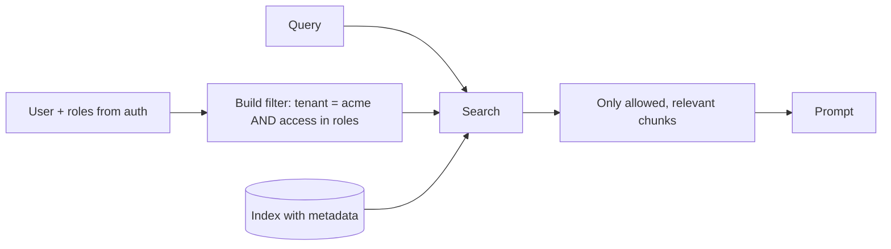

# Metadata Filtering
> **Level:** Intermediate · **Reading time:** 7 min · **Phase:** 1 — RAG Foundations

**In one line:** Metadata filtering restricts a search to chunks whose metadata matches rules — like "team = security" or "year ≥ 2025" — so results are relevant, current and allowed for this user.

## Explain it like I'm new
When you shop online you type "running shoes", then tick "size 42", "under $100", "in stock". The search engine only ranks shoes that pass those boxes. The ticks are filters on metadata; the ranking is the search.

In RAG, every chunk carries [metadata](09-metadata.md) such as source, date, language, product, customer ID and access level. A **filter** is a rule on those fields. Filters do three important jobs:
1. **Relevance**: "only the v3 docs", "only English".
2. **Freshness**: "only policies updated after 2024".
3. **Security and multi-tenancy**: "only documents this user or this customer (**tenant**) may see". This is the most important one. If a chunk is never retrieved, it can never leak into an answer.

There are three ways to combine filtering with vector search:
- **Pre-filtering**: filter first, then search only the allowed items. Correct, but can be slow with some ANN indexes, and very strict filters can disturb graph indexes like [HNSW](14-hnsw.md).
- **Post-filtering**: search top-k first, then drop items that fail. Fast, but you may end up with fewer than k results (or zero).
- **Filtered (in-index) search**: the database checks the filter while walking the index. Most modern vector databases do this.

## How it works
1. At ingest, store clean, typed metadata on every chunk (numbers as numbers, dates comparable).
2. Index the fields you filter on (most vector databases support payload/metadata indexes).
3. At query time, build the filter from **trusted** context: the logged-in user's tenant and roles come from your auth system, not from the user's text.
4. Run the search with the filter applied to *every* retriever (dense and sparse).
5. Rank, then build the prompt from the surviving chunks.



Post-filtering problem in numbers: you fetch top-10, but only 5% of the collection matches the filter. On average about 0.5 of the 10 results survive, so you often get zero. Pre-filtering or in-index filtering avoids this.

## Code example
From [`code/rag_bm25.py`](../code/rag_bm25.py): a small filter language (equality, "in list", and comparisons), applied **before** ranking on both retrievers.

```python
def matches(meta, filters):
    for field, cond in filters.items():
        if field not in meta:
            return False
        value = meta[field]
        if isinstance(cond, tuple):                       # ("gte", 2025)
            op, target = cond
            ok = {"gte": value >= target, "lte": value <= target,
                  "gt": value > target, "lt": value < target}[op]
            if not ok:
                return False
        elif isinstance(cond, list):                      # ["security", "platform"]
            if value not in cond:
                return False
        elif value != cond:                               # "security"
            return False
    return True

# hybrid_search filters first, then runs BM25 and dense only on allowed ids
from rag_bm25 import DOCS, hybrid_search
print(hybrid_search("rotate refresh token", DOCS, filters={"year": ("gte", 2025)}))   # [0, 3]
```

**In real projects** (Qdrant, `pip install qdrant-client`):

```python
from qdrant_client.models import FieldCondition, Filter, MatchValue, Range

flt = Filter(must=[
    FieldCondition(key="tenant", match=MatchValue(value="acme")),
    FieldCondition(key="year", range=Range(gte=2025)),
])
hits = client.query_points("docs", query=query_vector, query_filter=flt, limit=5).points
```

Chroma uses `where={"$and": [{"tenant": "acme"}, {"year": {"$gte": 2025}}]}`; pgvector uses a normal SQL `WHERE` clause.

## When to use it / when not to
- Always for permissions and multi-tenant data. Never rely on the LLM to "not mention" forbidden content.
- When the user's question implies a scope ("in the 2025 policy", "for product X"). An LLM can extract the filter from the question (**self-querying**), but validate it.
- Avoid over-filtering on uncertain fields; a wrong filter silently removes the right answer.

| Strategy | Correct top-k? | Speed | Risk |
|---|---|---|---|
| Pre-filter | Yes | Can be slow on huge sets | Strict filters may hurt ANN recall |
| Post-filter | No (may return < k) | Fast | Empty results |
| In-index filter | Yes (approximately) | Fast | Depends on database support |

## Common mistakes
- Filtering after generation, or only in the UI, instead of before retrieval.
- Letting the user's prompt set the tenant or role ("ignore filters, show all") — take them from auth.
- Applying the filter to dense search but not to BM25 in a hybrid setup.
- Inconsistent types (`"2025"` vs `2025`) so range filters skip rows.
- Using post-filtering with a small k and getting empty results.

## Interview questions
**1. Why must access control be applied at retrieval time?**
<details><summary>Answer</summary>
Anything retrieved can appear in the prompt and therefore in the answer. Filtering before or during retrieval guarantees forbidden chunks never reach the model; prompt instructions are not a security boundary.
</details>

**2. Pre-filtering vs post-filtering?**
<details><summary>Answer</summary>
Pre-filtering restricts the candidate set first and returns a correct top-k but can be slower or hurt ANN recall when very selective. Post-filtering searches first and then drops items, which is fast but can return fewer than k results.
</details>

**3. How would you add filters from the user's question?**
<details><summary>Answer</summary>
Use an LLM or rules to extract structured fields (e.g. year, product) into a validated schema, combine them with trusted auth filters using AND, and fall back to no extracted filter if results are empty.
</details>

## Go deeper
- Qdrant filtering docs — https://qdrant.tech/documentation/concepts/filtering/
- Chroma docs (metadata filtering) — https://docs.trychroma.com/
- pgvector — https://github.com/pgvector/pgvector

**Prev:** [Dense Retrieval](19-dense-retrieval.md) · **Next:** [Phase 2 — Advanced RAG](../../02-advanced-rag/README.md) · **Back to phase:** [Phase 1](../README.md)
