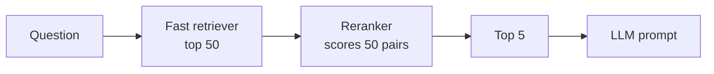

# Reranking

> **Level:** Intermediate · **Reading time:** 6 min · **Phase:** 2 — Advanced RAG

**In one line:** Reranking is a second, more careful pass that re-orders the chunks your first search returned, so the best ones end up at the top.

## Explain it like I'm new

Think of hiring. First, a recruiter skims 500 CVs in an hour and keeps 30 that mention the right keywords. Then a senior engineer reads those 30 carefully and picks the best 5. The recruiter is fast but shallow. The engineer is slow but sharp. You need both: the engineer cannot read 500 CVs, and the recruiter alone picks some poor fits.

RAG retrieval works the same way. The first stage, called **retrieval** or **recall stage**, uses a fast method (vector search, keyword search like BM25, or both) to pull, say, the top 50 **candidates** (possibly relevant chunks) out of millions. It is tuned to not *miss* good chunks, even if it lets in some noise.

The second stage, the **reranker**, scores only those 50 candidates with a slower but smarter model and keeps the top 3–5. Those few go into the prompt. The reranker is tuned for **precision**: the chunks at the top should really answer the question.

Why bother? The language model only sees what you put in the prompt. If the right chunk sits at position 14, it never gets used. Models also pay less attention to text buried in the middle of long prompts, so order matters too.

## How it works

1. User asks a question.
2. A fast retriever returns the top *k* candidates (often 20–100).
3. A reranker scores each `(question, chunk)` pair.
4. Sort by the new score and keep the top *n* (often 3–5).
5. Build the prompt from those *n* chunks.



Tiny worked example. The question is "How do I cancel my subscription and get a refund?"

| Chunk | Fast score | Rerank score |
|---|---|---|
| "Refund refund refund. Refund policy." | 0.48 | 0.20 |
| "To cancel your subscription open Settings… A refund is issued…" | 0.38 | 0.67 |

The first chunk repeats "refund", so the fast vector match likes it. The reranker checks how much of the *whole* question each chunk covers, and flips the order.

## Code example

The repo demo [`adv_rerank.py`](../code/adv_rerank.py) does exactly this offline:

```python
from adv_rerank import retrieve_then_rerank

candidates, final = retrieve_then_rerank("How do I cancel my subscription and get a refund?", k=3, top_n=2)
print(candidates)  # [(0.4811, 'refund-faq'), (0.3849, 'cancel-guide'), (0.1768, 'pricing')]
print(final)       # [(0.6667, 'cancel-guide'), (0.2, 'pricing')]
```

The core of reranking is just "score pairs, sort, slice":

```python
def rerank(query, candidates, docs, top_n=2):
    rescored = [(cross_score(query, docs[doc_id]), doc_id) for _, doc_id in candidates]
    rescored.sort(key=lambda x: (-x[0], x[1]))
    return rescored[:top_n]
```

**In real projects** you use a trained cross-encoder model, for example with `sentence-transformers`:

```python
from sentence_transformers import CrossEncoder

model = CrossEncoder("cross-encoder/ms-marco-MiniLM-L-6-v2")
scores = model.predict([(question, chunk) for chunk in candidates])
ranked = sorted(zip(scores, candidates), reverse=True)[:5]
```

Hosted rerank APIs exist too. They follow the same idea: send the query and candidate texts, get back scores.

## When to use it / when not to

- **Use it** when your top-k contains the right chunk but not at the top, which is common.
- **Use it** when you combine several retrievers (hybrid search) and need one fair ordering.
- **Skip it** when latency is very tight and your first-stage quality is already good on your eval set.
- **Skip it** when the right chunk is not in the candidates at all. A reranker cannot find what retrieval missed; fix recall first.

| | First-stage retriever | Reranker |
|---|---|---|
| Speed | Very fast (pre-computed index) | Slower (scores each pair) |
| Scale | Millions of chunks | Tens to hundreds |
| Goal | Recall (don't miss) | Precision (best on top) |

## Common mistakes

- Retrieving only 5 candidates and then reranking 5. Give the reranker room: retrieve more than you keep.
- Reranking full documents that exceed the model's input limit. The text gets cut off silently.
- Not measuring. Check hit@k and MRR before and after on a golden set (see [RAG Evaluation](20-rag-evaluation.md)).
- Ignoring latency. Reranking 200 pairs on CPU per request can add noticeable delay.

## Interview questions

**1. Why not just use the reranker for everything?**
<details><summary>Answer</summary>
A cross-encoder must run once per (query, document) pair at query time, and nothing can be pre-computed. Over millions of documents that is far too slow. So we use a cheap retriever to shortlist and the reranker only on the shortlist.
</details>

**2. Your reranker didn't improve results. What do you check?**
<details><summary>Answer</summary>
First, whether the correct chunk is in the candidate set at all (recall@k of the first stage). If not, the reranker cannot help. Then check the candidate count, input truncation, domain mismatch of the reranker model, and whether the eval set is large enough to show a difference.
</details>

**3. Where does reranking sit relative to filtering by permissions?**
<details><summary>Answer</summary>
Permission and metadata filters should apply before or during retrieval, so forbidden chunks never become candidates. Reranking only orders chunks the user is allowed to see.
</details>

## Go deeper

- [Passage Re-ranking with BERT (Nogueira & Cho)](https://arxiv.org/abs/1901.04085)
- [Sentence-Transformers docs: cross-encoders](https://www.sbert.net/)

**Prev:** [Phase 1 — RAG Foundations](../../01-rag-foundations/README.md) · **Next:** [Cross Encoder](02-cross-encoder.md) · **Back to phase:** [Phase 2](../README.md)
