# Cross Encoder

> **Level:** Intermediate · **Reading time:** 8 min · **Phase:** 2 — Advanced RAG

**In one line:** A cross-encoder is a model that reads the question and a document *together* and outputs one relevance score for that pair.

**Before you start:** [Reranking](01-reranking.md). You should know that a second pass re-orders the candidates a fast search returned.

## Explain it like I'm new

Imagine two ways to judge whether a key fits a lock. Way one: photograph every key once, photograph the lock, and compare photos. Fast, and you can photograph all keys in advance. Way two: actually put each key into the lock and turn it. Slow, but much more accurate, because you test how the two *interact*.

A cross-encoder is way two. An **encoder** is a neural network (usually a transformer like BERT) that turns text into numbers. "Cross" means the question and the document are fed in as *one* combined input, so every word of the question can pay **attention** (look at and weigh) every word of the document. The model can notice things like "the question asks about cancelling *and* refunds, and this passage covers both".

Words to know:
- **Encoder:** a neural network that turns text into numbers.
- **Transformer:** the kind of neural network (BERT is one) that lets words look at each other.
- **Attention:** how the model weighs which other words matter for each word.
- **Forward pass:** one run of the model on one input.
- **Token:** a small piece of text, roughly a word or part of a word, that the model reads.
- **Sigmoid:** a function that squashes any number into the range 0 to 1.

The output is a single number, often between 0 and 1 after a sigmoid, meaning "how relevant is this document to this question". There is no reusable vector for the document. That is the price: you must run the model again for every new question.

<!-- anim:02-cross-encoder -->
## Watch it


*It plays on a loop. Read the caption in the box, one step at a time. Want to go at your own pace? [Step through it with Previous and Next](https://techsaurabh-394.github.io/ai-engineer-roadmap/#02-cross-encoder).*

## How it works

1. Join the texts: `[CLS] question [SEP] document [SEP]`. `[CLS]` and `[SEP]` are special marker tokens.
2. Run the joined text through the transformer. Attention flows across both parts.
3. A small layer on top of the `[CLS]` output produces one score.
4. Repeat for every candidate document. Sort by score.

```text
           ┌──────────────────────────────────────────┐
question ─▶│                                          │
           │   Transformer (full cross-attention)     │──▶ score 0.91
document ─▶│                                          │
           └──────────────────────────────────────────┘
        one forward pass PER (question, document) pair
```

### Worked example
Question: "How do I cancel my subscription and get a refund?" Two candidates from the demo corpus:

| Candidate text | What the pair check sees | Toy score |
|---|---|---|
| "Refund refund refund. Refund policy. Refund rules." | Covers only the "refund" part of the question; no "cancel" | 0.2 |
| "To cancel your subscription open Settings... A refund for the unused month is issued..." | Covers cancel, subscription and refund | 0.6667 |

These are the real numbers from `cross_score` in the code below. Each score needed the question and the document together, so nothing could be computed for the documents in advance. With 2 candidates that is 2 model runs; with 50 candidates it is 50.

Cost example: 1 question × 50 candidates = 50 forward passes. 1 question × 10 million documents = 10 million passes. That is why cross-encoders are used for **reranking** a shortlist, not for searching a whole corpus.

Cross-encoders are trained on labelled pairs, for example MS MARCO, a large dataset of real search queries with passages marked relevant. The model learns to push relevant pairs up and irrelevant ones down.

## Code example

A real cross-encoder learns its features. This stdlib toy from [`adv_rerank.py`](../code/adv_rerank.py) hand-writes two pair features to show the idea that the score depends on *both* texts at once:

```python
def cross_score(query, doc):
    q, d = tokens(query), tokens(doc)
    if not q or not d:
        return 0.0
    coverage = len(set(q) & set(d)) / len(set(q))          # how much of the question is answered
    q_bi, d_bi = set(zip(q, q[1:])), set(zip(d, d[1:]))
    phrase = len(q_bi & d_bi) / len(q_bi) if q_bi else 0.0  # word order matches
    return round(0.8 * coverage + 0.2 * phrase, 4)
```

Notice there is no `embed(doc)` you could store. The score is computed from the pair.

**In real projects** with `sentence-transformers`:

```python
from sentence_transformers import CrossEncoder

reranker = CrossEncoder("cross-encoder/ms-marco-MiniLM-L-6-v2")
pairs = [("How do I reset my password?", text) for text in candidate_texts]
scores = reranker.predict(pairs)  # one float per pair
```

## When to use it / when not to

- **Use it** as the second stage after a bi-encoder or BM25 retriever.
- **Use it** when small wording differences matter (legal, medical, support FAQs).
- **Don't use it** as your only retriever over a large corpus. It does not scale.
- **Don't use it** when you cannot afford extra latency or GPU cost per query.

| | Cross-encoder | [Bi-encoder](03-bi-encoder.md) |
|---|---|---|
| Input | (query, doc) together | query and doc separately |
| Pre-compute docs? | No | Yes |
| Accuracy | Higher | Lower |
| Speed at query time | Slow, per pair | Fast, one query embedding + vector search |

## Common mistakes

- Feeding documents longer than the model's maximum input length (often 512 tokens). The end gets truncated, and the answer may be in the end.
- Comparing raw scores across different cross-encoder models. Score scales differ; only the ranking within one model is meaningful.
- Using a model trained on web search for a very different domain without checking it on your own eval set.
- Scoring one pair at a time instead of in batches, which wastes the GPU.

## Recap
If you remember only three things:
- A cross-encoder reads the question and one document together and returns one relevance score.
- It is more accurate than a bi-encoder but must run once per pair, so it only suits a shortlist.
- Scores from different models are not comparable; only the ranking inside one model means something.

## Interview questions

**1. Why is a cross-encoder more accurate than a bi-encoder?**
<details><summary>Answer</summary>
Because query and document tokens attend to each other inside the model, it can model fine-grained interactions (negation, which entity does what, whether all parts of the question are covered). A bi-encoder compresses each text into one vector independently, losing that interaction.
</details>

**2. Can you cache cross-encoder results?**
<details><summary>Answer</summary>
Only per exact (query, document) pair. You can cache scores for repeated popular queries, but you cannot pre-compute document representations the way you do with a bi-encoder.
</details>

**3. How would you pick k (candidates) and n (kept) for a reranking setup?**
<details><summary>Answer</summary>
Measure. Raise k until first-stage recall@k stops improving or latency becomes unacceptable; choose n based on the context budget and answer quality on a golden set. Typical starting points are k=20–100 and n=3–8.
</details>

## Go deeper

- [Passage Re-ranking with BERT](https://arxiv.org/abs/1901.04085)
- [Sentence-BERT paper (compares bi- and cross-encoders)](https://arxiv.org/abs/1908.10084)
- [Sentence-Transformers documentation](https://www.sbert.net/)

**Prev:** [Reranking](01-reranking.md) · **Next:** [Bi Encoder](03-bi-encoder.md) · **Back to phase:** [Phase 2](../README.md)
