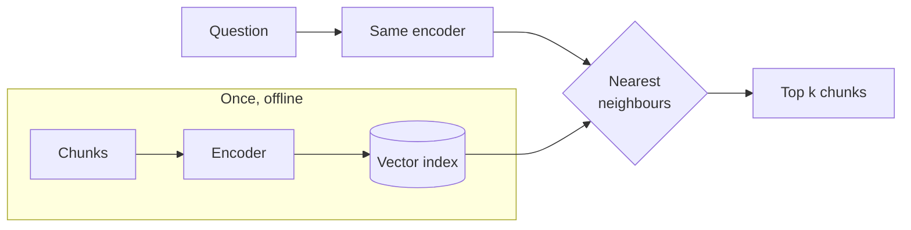

# Bi Encoder

> **Level:** Intermediate · **Reading time:** 6 min · **Phase:** 2 — Advanced RAG

**In one line:** A bi-encoder turns the question and each document into vectors *separately*, then finds matches by comparing those vectors.

## Explain it like I'm new

Think of a library where every book has a coloured sticker that summarises its topic. When you walk in, the librarian gives your question a sticker too, and you just look for books with the closest colour. Stickers for books are made once, when the book arrives. Only your question needs a new sticker.

That is a bi-encoder. "Bi" means two: the same encoder (or two sibling encoders) runs on the query and on the document **independently**. Each output is an **embedding**, a list of numbers (for example 384 or 768 of them) that places the text in a "meaning space" where similar texts land close together.

Because document embeddings do not depend on the question, you compute them once at ingest time and store them in a **vector index** (a data structure such as HNSW that finds nearest vectors fast). At query time you embed only the question and ask the index for its nearest neighbours. This is what people usually mean by "dense retrieval" or "vector search".

## How it works

1. **Ingest:** for each chunk, `vec = encoder(chunk)`; store `vec` in the index.
2. **Query:** `q = encoder(question)`.
3. **Compare:** compute similarity between `q` and stored vectors, usually **cosine similarity**.
4. **Return** the top *k* chunks.



Cosine similarity, worked: `a = [1, 1, 0]`, `b = [1, 0, 0]`.
dot = 1·1 + 1·0 + 0·0 = 1. |a| = √2 ≈ 1.414, |b| = 1. cosine = 1 / 1.414 ≈ **0.71**.
Same direction gives 1.0, unrelated (perpendicular) gives 0.

## Code example

From [`adv_rerank.py`](../code/adv_rerank.py). The "encoder" here is a word-count vector so it runs offline, but the shape is the same as a real bi-encoder: document vectors are built once in `__init__`.

```python
class BiEncoderIndex:
    def __init__(self, docs):
        self.docs = docs
        self.vectors = {doc_id: embed(text) for doc_id, text in docs.items()}  # pre-computed

    def search(self, query, k=3):
        q = embed(query)                                                      # only the query, per request
        scored = [(cosine(q, v), doc_id) for doc_id, v in self.vectors.items()]
        scored.sort(key=lambda x: (-x[0], x[1]))
        return [(round(s, 4), d) for s, d in scored[:k] if s > 0]
```

The demo also shows a weakness: a document that just repeats "refund" beats the real answer, because one vector per text cannot check whether the whole question is answered. That is the job of a [cross-encoder](02-cross-encoder.md).

**In real projects** with `sentence-transformers`:

```python
from sentence_transformers import SentenceTransformer, util

model = SentenceTransformer("all-MiniLM-L6-v2")
doc_emb = model.encode(chunks, normalize_embeddings=True)      # once, store these
q_emb = model.encode("How do I cancel?", normalize_embeddings=True)
scores = util.cos_sim(q_emb, doc_emb)[0]
```

At scale you store `doc_emb` in a vector database or a library such as FAISS instead of comparing against every vector.

## When to use it / when not to

- **Use it** as the first stage over large corpora. It is the standard way to get semantic recall.
- **Use it** when users paraphrase ("cancel plan" vs "end subscription"), where keyword search fails.
- **Be careful** with exact identifiers (error codes, SKUs, names). Combine with BM25 ([Ensemble Retrieval](12-ensemble-retrieval.md)).
- **Add a reranker** when the order of the top results matters.

| | Bi-encoder | Cross-encoder |
|---|---|---|
| Doc vectors reusable | Yes | No |
| Query-time cost | 1 embedding + index lookup | 1 model run per candidate |
| Typical role | Retrieve top 50 | Rerank to top 5 |

## Common mistakes

- Embedding queries and documents with **different** models, or changing the model without re-embedding the corpus. Vectors from different models are not comparable.
- Forgetting model-specific prefixes. Some embedding models expect "query: " / "passage: " style prefixes; check the model card.
- Mixing normalised and unnormalised vectors, then using dot product as if it were cosine.
- Chunks far longer than the model's input limit, so the tail is silently ignored.

## Interview questions

**1. Why can bi-encoders search millions of documents in milliseconds?**
<details><summary>Answer</summary>
Document embeddings are computed offline. At query time you embed one short query and run an approximate nearest-neighbour search (e.g. HNSW) that avoids comparing against every vector.
</details>

**2. What does a bi-encoder lose compared with a cross-encoder?**
<details><summary>Answer</summary>
Token-level interaction between query and document. Each text is squeezed into one fixed vector before they ever meet, so subtle relations like negation or "covers both parts of the question" are harder to capture.
</details>

**3. You upgraded the embedding model. What must you do?**
<details><summary>Answer</summary>
Re-embed every document with the new model (and re-build the index), then re-run the retrieval eval. Old and new vectors live in different spaces and must not be mixed.
</details>

## Go deeper

- [Sentence-BERT (Reimers & Gurevych)](https://arxiv.org/abs/1908.10084)
- [Dense Passage Retrieval (Karpukhin et al.)](https://arxiv.org/abs/2004.04906)

**Prev:** [Cross Encoder](02-cross-encoder.md) · **Next:** [Context Compression](04-context-compression.md) · **Back to phase:** [Phase 2](../README.md)
