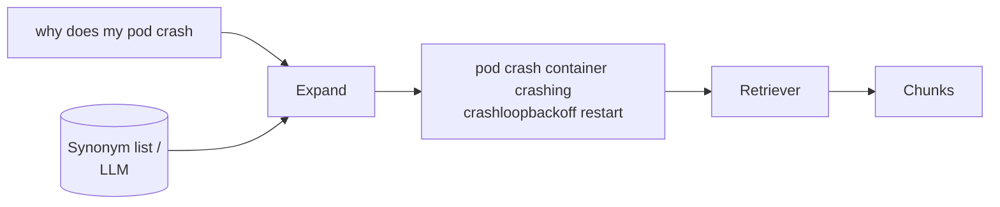

# Query Expansion

> **Level:** Intermediate · **Reading time:** 5 min · **Phase:** 2 — Advanced RAG

**In one line:** Query expansion adds related words or phrasings to the user's question so the search finds documents that use different words for the same thing.

## Explain it like I'm new

You search a cookbook index for "aubergine" and find nothing, because the book is American and says "eggplant". A helpful librarian would quietly search both words. That is query expansion.

Users and documents rarely use the same words. This is called the **vocabulary mismatch** problem. Keyword search (like BM25) only matches exact terms, so it suffers most. Vector search handles paraphrases better, but still struggles with acronyms, product names and internal jargon ("k8s" vs "Kubernetes", "PTO" vs "annual leave").

Query expansion rewrites the query *before* retrieval by adding:

- **Synonyms** from a hand-made list or thesaurus.
- **Acronym expansions** ("k8s" → "kubernetes").
- **Related terms** from the top results of a first search (called **pseudo-relevance feedback**: assume the top hits are relevant and borrow their words).
- **LLM-generated terms or passages** (ask a model "what words would a relevant document contain?").

## How it works

1. Take the user query.
2. Find candidate extra terms (dictionary, feedback, or LLM).
3. Append them, keeping the original words first (and optionally weighting them higher).
4. Run retrieval with the expanded query.
5. Answer using the original question, not the expanded one.



Example from the repo demo: the plain query "Why does my pod crash over and over?" finds 2 documents with keyword search. The expanded query also finds the document about liveness probes restarting containers, because it now contains "restart" and "container".

## Code example

From [`adv_query_transform.py`](../code/adv_query_transform.py):

```python
SYNONYMS = {
    "crash": ["crashing", "crashloopbackoff", "restart"],
    "pod": ["container"],
    "k8s": ["kubernetes"],
}

def expand_query(query, synonyms=SYNONYMS):
    words = tokens(query)
    extra = []
    for w in words:
        for s in synonyms.get(w, []):
            if s not in words and s not in extra:
                extra.append(s)
    return " ".join(words + extra)

print(expand_query("Why does my pod crash over and over?"))
# pod crash over over container crashing crashloopbackoff restart
```

An LLM-based version replaces the dictionary with a prompt such as: "List 5 search keywords or synonyms for this question. Output one per line." Parse the lines and append them. Query2doc goes further and appends a whole model-written pseudo-document; [HyDE](07-hyde.md) searches with the pseudo-document alone.

## When to use it / when not to

- **Use it** with keyword search, where vocabulary mismatch hurts the most.
- **Use it** in domains full of acronyms and internal names. A small curated synonym list is cheap and reliable.
- **Be careful** with vector search: adding many words can blur the query vector and pull in off-topic results.
- **Avoid** broad automatic expansion for precise lookups (error codes, IDs, legal clauses). It adds noise.

| Source of terms | Cost | Quality |
|---|---|---|
| Hand-made synonym list | Very low | High for known terms, no coverage beyond |
| Pseudo-relevance feedback | Low | Good if the first results are good; drifts if not |
| LLM expansion | One model call | Broad, but can add wrong terms |

## Common mistakes

- Expanding with terms that change the meaning ("Java" → "coffee").
- Sending the expanded query to the LLM as the question. Expansion is for search only.
- Not measuring: expansion often raises recall while lowering precision. Check both, and consider adding a [reranker](01-reranking.md) after it.
- Letting the synonym list go stale as product names change.

## Interview questions

**1. What problem does query expansion solve?**
<details><summary>Answer</summary>
Vocabulary mismatch: relevant documents use different words than the user. Expansion adds synonyms or related terms so retrieval can match them, which mostly improves recall.
</details>

**2. What is pseudo-relevance feedback and its risk?**
<details><summary>Answer</summary>
Run a first search, assume the top results are relevant, and add frequent terms from them to the query. If the first results are off-topic, the query drifts further off-topic ("query drift").
</details>

**3. How does query expansion differ from multi-query retrieval?**
<details><summary>Answer</summary>
Expansion produces one longer query. Multi-query produces several separate queries, runs each, and merges the result lists (for example with Reciprocal Rank Fusion).
</details>

## Go deeper

- [Query2doc: Query Expansion with LLMs (Wang et al.)](https://arxiv.org/abs/2303.07678)
- [HyDE (Gao et al.)](https://arxiv.org/abs/2212.10496)

**Prev:** [Context Compression](04-context-compression.md) · **Next:** [Multi Query Retrieval](06-multi-query-retrieval.md) · **Back to phase:** [Phase 2](../README.md)
