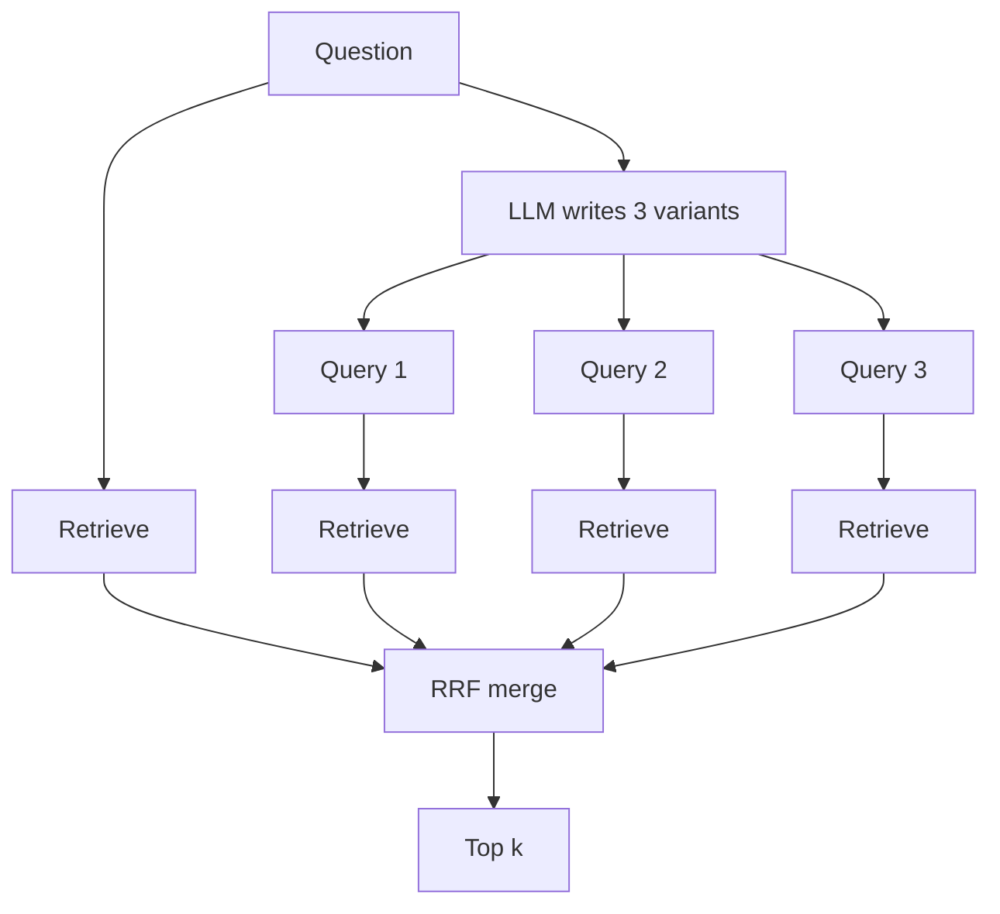

# Multi Query Retrieval

> **Level:** Intermediate · **Reading time:** 6 min · **Phase:** 2 — Advanced RAG

**In one line:** Multi-query retrieval asks an LLM to rewrite one question into several different search queries, runs them all, and merges the results.

## Explain it like I'm new

If you lose your keys, you don't search one way. You check "where did I last drive", "which jacket was I wearing", "did I leave them in the door". Each angle finds different places. Together they cover much more ground.

A single user question is one angle. If it is phrased vaguely, or the documents phrase things differently, retrieval misses. Multi-query retrieval uses a **large language model (LLM)** to write, say, three alternative versions of the question. Each version goes to the retriever separately. You then **merge** the result lists into one ranking.

The most common way to merge is **Reciprocal Rank Fusion (RRF)**. It ignores raw scores (which are hard to compare across queries) and looks only at positions. Documents that rank well in many lists win.

## How it works

1. Prompt an LLM: "Write 3 different search queries for this question, one per line."
2. Keep the original question plus the 3 variants.
3. Retrieve top *k* for each query.
4. Merge with RRF: for each document, `score = Σ 1 / (60 + rank)` over every list it appears in. The constant 60 is the usual default; it softens the gap between rank 1 and rank 2.
5. Take the top results and generate the answer with the **original** question.



RRF worked example with k=60:

| Doc | Ranks in lists | RRF score |
|---|---|---|
| A | 1, 3 | 1/61 + 1/63 = 0.0164 + 0.0159 = **0.0323** |
| B | 2, 1, 1 | 1/62 + 1/61 + 1/61 = **0.0489** |
| C | 3 | 1/63 = **0.0159** |

B wins: it appears in three lists near the top.

## Code example

From [`adv_query_transform.py`](../code/adv_query_transform.py). `FakeLLM` returns fixed variants so it runs offline.

```python
def rrf_merge(rankings, k=60):
    scores = {}
    for ranking in rankings:
        for rank, doc_id in enumerate(ranking, start=1):
            scores[doc_id] = scores.get(doc_id, 0.0) + 1.0 / (k + rank)
    return sorted(scores, key=lambda d: (-scores[d], d))

def multi_query_retrieve(question, llm, corpus=CORPUS, k=3):
    prompt = f"Write 3 different search queries that would help answer this question, one per line.\nQuestion: {question}"
    variants = [l.strip() for l in llm.complete(prompt).splitlines() if l.strip()]
    queries = [question] + variants
    rankings = [keyword_search(q, corpus, k=k) for q in queries]
    return queries, rrf_merge(rankings)[:k]
```

Run `python adv_query_transform.py` in `02-advanced-rag/code` to see the merged ranking.

**In real projects** LangChain ships a `MultiQueryRetriever` that wraps any retriever and an LLM, and LlamaIndex has fusion retrievers that do the same with RRF. Module paths change between versions, so copy the import from the current docs: [LangChain](https://python.langchain.com/), [LlamaIndex](https://docs.llamaindex.ai/).

## When to use it / when not to

- **Use it** for vague, short or multi-part questions ("compare X and Y").
- **Use it** when recall is your main problem and you can afford one extra LLM call.
- **Skip it** for exact lookups ("error E1042") where one query is already precise.
- **Skip it** when latency budgets are tight. You pay one LLM call plus N retrievals (run them in parallel).

| | Single query | Multi-query + RRF |
|---|---|---|
| LLM calls before retrieval | 0 | 1 |
| Retrieval calls | 1 | N+1 |
| Recall on vague questions | Lower | Higher |

## Common mistakes

- Merging by raw similarity scores. Scores from different queries are not on the same scale; use RRF or normalise.
- Dropping the original question from the query set. It is often the best single query.
- Generating variants that all say the same thing. Ask for different angles or sub-questions.
- Running the N searches one after another instead of concurrently.

## Interview questions

**1. Why use RRF instead of summing similarity scores?**
<details><summary>Answer</summary>
Scores from different queries or different retrievers (BM25 vs vectors) live on different scales. RRF uses only ranks, so it is scale-free, simple, and robust without tuning.
</details>

**2. What is the cost of multi-query retrieval?**
<details><summary>Answer</summary>
One LLM call to generate variants plus N extra retrievals, which adds latency and spend. Retrievals can run in parallel; the LLM call is usually the main added delay.
</details>

**3. How is multi-query different from query decomposition?**
<details><summary>Answer</summary>
Multi-query writes alternative phrasings of the same question. Decomposition splits a complex question into distinct sub-questions that may each need separate answers, which are then combined.
</details>

## Go deeper

- [Retrieval-Augmented Generation for LLMs: A Survey (Gao et al.) — covers query rewriting and fusion](https://arxiv.org/abs/2312.10997)
- [LangChain documentation](https://python.langchain.com/)

**Prev:** [Query Expansion](05-query-expansion.md) · **Next:** [HyDE](07-hyde.md) · **Back to phase:** [Phase 2](../README.md)
