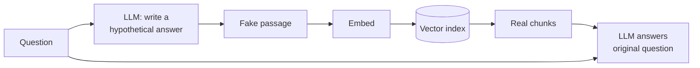

# HyDE

> **Level:** Advanced · **Reading time:** 6 min · **Phase:** 2 — Advanced RAG

**In one line:** HyDE (Hypothetical Document Embeddings) asks an LLM to write a fake answer to the question, then searches with that fake answer instead of the question.

## Explain it like I'm new

Suppose you want a photo of "a cosy reading corner". Searching for that phrase works so-so. Now imagine you first sketch the picture — armchair, lamp, bookshelf, blanket — and then search for photos that *look like your sketch*. Your sketch is wrong in details, but it looks much more like the real photos than the four-word phrase did.

Questions and answers look different. A question is short and full of "how", "why", "what". Documents are long, declarative statements. In embedding space, a question can sit far from the passage that answers it. HyDE closes that gap: the LLM writes a **hypothetical document**, a plausible answer that may contain made-up details. You embed *that* and search for real documents near it. Real documents that answer the question tend to look like a plausible answer.

The fake answer is **never shown to the user** and never used as evidence. It is only a better search key. The final answer is still generated from the real retrieved chunks.

## How it works

1. Prompt the LLM: "Write a short passage that answers this question."
2. Embed the generated passage (optionally average several passages, and the question too).
3. Run vector search with that embedding.
4. Pass the **real** retrieved chunks and the **original** question to the LLM for the answer.



Example. Question: "Why does my pod crash over and over?" The fake passage: "A pod that keeps crashing goes into CrashLoopBackOff; Kubernetes restarts the container with back-off delays." Searching with this text matches the real CrashLoopBackOff document first, because it shares the document's vocabulary and style.

The original paper (Gao et al., 2022) used this for **zero-shot** dense retrieval: no relevance labels were needed to train the retriever.

## Code example

From [`adv_query_transform.py`](../code/adv_query_transform.py):

```python
def hyde_prompt(question):
    return (
        "Write a short passage that answers the question. It may contain made-up details.\n"
        f"Question: {question}\nPassage:"
    )

def hyde_retrieve(question, llm, corpus=CORPUS, k=3):
    hypothetical = llm.complete(hyde_prompt(question)).strip()
    return hypothetical, keyword_search(hypothetical, corpus, k)

passage, top = hyde_retrieve("Why does my pod crash over and over?", FakeLLM())
print(top)  # ['d2', 'd1', 'd3'] -> d2 is the CrashLoopBackOff doc
```

The demo searches with keywords to stay offline. In a real system you would embed `hypothetical` with the same embedding model used for your documents.

## When to use it / when not to

- **Use it** when queries are short and documents are long and formal (technical docs, papers, policies).
- **Use it** when you have no labelled data to fine-tune a retriever.
- **Avoid it** for questions about things the LLM knows nothing about (private product names, internal codes). The fake passage may drift to the wrong topic.
- **Avoid it** when latency is tight: it adds one generation call before every search.

| | Plain query embedding | HyDE |
|---|---|---|
| Extra LLM call | No | Yes |
| Matches document style | Weak | Strong |
| Risk | Misses paraphrases | Fake passage can mislead search |

## Common mistakes

- Showing or citing the hypothetical passage as if it were a source. It may be fiction.
- Using HyDE on exact-match queries (IDs, error codes) where the original query is better.
- Not combining with the original query. Fusing results from both (for example with RRF) is a safer default.
- Using a long generation. A short paragraph is usually enough and cheaper.

## Interview questions

**1. Why does searching with a fake answer work?**
<details><summary>Answer</summary>
Answer-like text is closer in embedding space to real answer passages than a short question is. Even if details are wrong, the vocabulary and structure match relevant documents, so nearest-neighbour search finds them.
</details>

**2. What's the main risk of HyDE?**
<details><summary>Answer</summary>
If the LLM misunderstands the question or lacks domain knowledge, the hypothetical document points search in the wrong direction. It also adds latency and cost.
</details>

**3. Is the hallucinated passage a problem for faithfulness?**
<details><summary>Answer</summary>
Not if it is used only as a search key. The final answer must be grounded only in real retrieved chunks; the hypothetical passage should never enter the answer prompt as evidence.
</details>

## Go deeper

- [Precise Zero-Shot Dense Retrieval without Relevance Labels (HyDE paper)](https://arxiv.org/abs/2212.10496)

**Prev:** [Multi Query Retrieval](06-multi-query-retrieval.md) · **Next:** [Step Back Prompting](08-step-back-prompting.md) · **Back to phase:** [Phase 2](../README.md)
