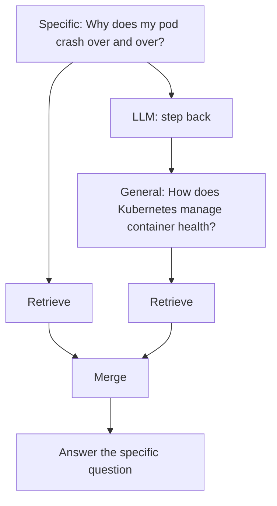

# Step Back Prompting

> **Level:** Advanced · **Reading time:** 5 min · **Phase:** 2 — Advanced RAG

**In one line:** Step-back prompting first asks a more general question about the underlying concept, retrieves for that too, and uses both to answer the specific question.

## Explain it like I'm new

A student asks, "What happens to the pressure of a gas if the temperature doubles and the volume halves?" A good teacher first says, "Let's step back: what is the ideal gas law?" Once the principle is on the table, the specific answer is easy.

Specific questions often match no document directly. Your docs might explain *how Kubernetes handles container health* in general, but never mention your exact symptom. Step-back prompting asks an LLM to produce a **step-back question**: a broader, more abstract version ("How does Kubernetes manage container health and restarts?"). You retrieve for both the original and the step-back question. The general chunks give the model the principles; the specific chunks give it the details.

The technique comes from a 2023 Google DeepMind paper that showed abstraction-first prompting helped on reasoning-heavy tasks. In RAG, the same idea is used as a retrieval trick.

## How it works

1. Prompt the LLM to write a more general question.
2. Retrieve top *k* for the original question.
3. Retrieve top *k* for the step-back question.
4. Merge (concatenate with labels, or fuse with RRF).
5. Answer the **original** question using both sets of context.



A prompt that works well includes one or two examples of step-back pairs, such as:

```text
Original: Which team did Messi play for in 2010?
Step-back: What is Messi's career history?
```

## Code example

From [`adv_query_transform.py`](../code/adv_query_transform.py):

```python
def step_back_prompt(question):
    return (
        "Write a more general, higher-level question whose answer would help answer the question below.\n"
        f"Question: {question}\nGeneral question:"
    )

def step_back_retrieve(question, llm, corpus=CORPUS, k=3):
    general = llm.complete(step_back_prompt(question)).strip()
    fused = rrf_merge([keyword_search(question, corpus, k), keyword_search(general, corpus, k)])
    return general, fused[:k]

general, top = step_back_retrieve("Why does my pod crash over and over?", FakeLLM())
print(general)  # How does Kubernetes manage container health and restarts?
print(top)      # ['d1', 'd2', 'd3']
```

The step-back query pulls in `d1` (liveness probes restart containers), the general principle behind the crash loop.

When you build the answer prompt, label the context so the model knows which is which:

```text
Background (general principles):
[d1] ...
Specific evidence:
[d2] ...
Question: Why does my pod crash over and over?
```

## When to use it / when not to

- **Use it** for "why" and reasoning questions where principles matter (science, engineering, policy).
- **Use it** when documents are written at a general level and questions are specific.
- **Skip it** for simple fact lookups ("What is the refund window?"). It only adds cost.
- **Skip it** when the general question would retrieve huge amounts of loosely related text.

| Technique | What the LLM writes | Goal |
|---|---|---|
| [Multi-query](06-multi-query-retrieval.md) | Paraphrases | Cover phrasings |
| [HyDE](07-hyde.md) | A fake answer | Match document style |
| Step-back | A broader question | Fetch principles |

## Common mistakes

- Replacing the original question with the step-back question. You need both.
- Stepping back too far ("What is computing?"), which retrieves generic noise.
- Not labelling general vs specific context, so the model answers the general question instead.
- Using it everywhere without measuring; for many factual queries it does not help.

## Interview questions

**1. What is a step-back question?**
<details><summary>Answer</summary>
A more abstract version of the user's question that targets the underlying concept or principle, e.g. "What is the ideal gas law?" for a specific gas-pressure problem.
</details>

**2. Why retrieve for both questions?**
<details><summary>Answer</summary>
The general question brings in principles and background; the original brings specific facts. The answer usually needs both, and the original keeps the model focused on what was asked.
</details>

**3. When would step-back hurt?**
<details><summary>Answer</summary>
On simple lookups, or when abstraction drifts off-topic. It adds an LLM call and can fill the context with broad, weakly relevant chunks.
</details>

## Go deeper

- [Take a Step Back: Evoking Reasoning via Abstraction in LLMs (Zheng et al.)](https://arxiv.org/abs/2310.06117)

**Prev:** [HyDE](07-hyde.md) · **Next:** [Self Query Retriever](09-self-query-retriever.md) · **Back to phase:** [Phase 2](../README.md)
