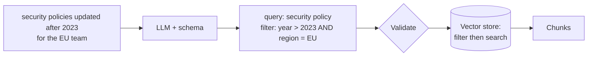

# Self Query Retriever

> **Level:** Intermediate · **Reading time:** 6 min · **Phase:** 2 — Advanced RAG

**In one line:** A self-query retriever uses an LLM to split a natural-language question into a search phrase plus structured metadata filters, then runs both.

## Explain it like I'm new

You tell a shop assistant, "I want running shoes under $100 in size 42." A good assistant does not search the whole store for the words "under $100". They walk to *running shoes*, then filter by *price < 100* and *size = 42*. They turned your sentence into a category plus filters.

Most documents in a RAG system have **metadata**: structured fields such as `author`, `year`, `product`, `department`, `language`. Pure vector search ignores these. Ask "security policies updated after 2023" and the embedding of "after 2023" barely matters; you get old policies that are semantically similar.

A self-query retriever asks an LLM to read the question and output two things: a **semantic query** (what the text should be about) and a **filter** (structured conditions on metadata). The vector store then searches only among documents that pass the filter. "Self-query" means the system writes its own structured query.

## How it works

1. Describe your metadata schema to the LLM: field names, types, allowed values.
2. LLM converts the question into JSON: `{"query": "...", "filter": {...}}`.
3. **Validate** the JSON: known fields only, correct types, allowed operators.
4. Apply the filter in the vector store, then run similarity search on the query.
5. If the filter returns nothing, fall back to search without it (or tell the user).



## Code example

A stdlib sketch with the LLM's output hard-coded, showing the important part: validation and filtering.

```python
DOCS = [
    {"text": "Password rotation every 90 days.", "year": 2022, "region": "EU"},
    {"text": "Security policy: MFA required for all staff.", "year": 2024, "region": "EU"},
    {"text": "Security policy: VPN for remote work.", "year": 2024, "region": "US"},
]
SCHEMA = {"year": int, "region": str}
OPS = {"eq": lambda a, b: a == b, "gt": lambda a, b: a > b, "lt": lambda a, b: a < b}

def validate(filters):
    clean = []
    for field, op, value in filters:
        if field in SCHEMA and op in OPS and isinstance(value, SCHEMA[field]):
            clean.append((field, op, value))
    return clean  # silently drops anything the LLM invented

def self_query(llm_output, docs=DOCS):
    filters = validate(llm_output["filter"])
    pool = [d for d in docs if all(OPS[op](d[f], v) for f, op, v in filters)]
    words = set(llm_output["query"].lower().split())
    return sorted(pool, key=lambda d: -len(words & set(d["text"].lower().split())))

# What an LLM might return for "security policies updated after 2023 for the EU team":
parsed = {"query": "security policy", "filter": [("year", "gt", 2023), ("region", "eq", "EU"), ("colour", "eq", "red")]}
print([d["text"] for d in self_query(parsed)])
# ['Security policy: MFA required for all staff.']
```

**In real projects** LangChain provides a `SelfQueryRetriever` that takes an LLM, a vector store, a document description and a list of metadata field descriptions, and translates the result into the store's native filter syntax. LlamaIndex offers a similar "auto-retrieval" with metadata filters. Check the current docs for imports: [LangChain](https://python.langchain.com/), [LlamaIndex](https://docs.llamaindex.ai/).

## When to use it / when not to

- **Use it** when questions mention structured constraints: dates, versions, authors, products, prices, regions.
- **Use it** when you already store clean metadata.
- **Avoid it** when metadata is missing or messy. Filters will silently exclude good documents.
- **Avoid it** for security. Access control must be enforced by your code, never by an LLM-written filter.

| | Pure vector search | Self-query |
|---|---|---|
| Understands "after 2023" | No | Yes |
| Extra LLM call | No | Yes |
| Failure mode | Wrong-era documents | Over-strict or invented filters |

## Common mistakes

- Trusting the LLM's filter without validation. It can invent fields or use wrong types.
- Letting the LLM control permission filters. Add tenant and access filters in code, after parsing.
- No fallback when the filter returns zero results.
- Vague schema descriptions. Tell the LLM the allowed values ("region: one of EU, US, APAC").

## Interview questions

**1. What two outputs does a self-query retriever produce?**
<details><summary>Answer</summary>
A semantic query string for similarity search and a structured metadata filter (field, operator, value conditions) applied by the vector store.
</details>

**2. How do you make it safe?**
<details><summary>Answer</summary>
Validate the parsed filter against a schema (known fields, types, operators, allowed values), never let it touch access control, and add tenant/permission filters in code that the LLM cannot override.
</details>

**3. The filter returns no documents. What do you do?**
<details><summary>Answer</summary>
Relax it: drop the least important condition or search without filters, and optionally tell the user which constraint could not be met. Log the case to improve the schema prompt.
</details>

## Go deeper

- [LangChain documentation (retrievers)](https://python.langchain.com/)
- [LlamaIndex documentation (metadata filters)](https://docs.llamaindex.ai/)

**Prev:** [Step Back Prompting](08-step-back-prompting.md) · **Next:** [Multi Vector Retriever](10-multi-vector-retriever.md) · **Back to phase:** [Phase 2](../README.md)
