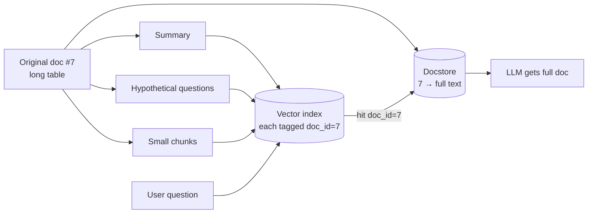

# Multi Vector Retriever

> **Level:** Advanced · **Reading time:** 6 min · **Phase:** 2 — Advanced RAG

**In one line:** A multi-vector retriever stores several different vectors for each document (summary, questions it answers, small pieces) but returns the full original document when any of them matches.

## Explain it like I'm new

A book can be found in a library in many ways: by title, by the blurb on the back, by the index terms, by "readers who asked about X". Each is a different *handle* on the same book. Whichever handle you grab, you walk away with the whole book.

Normal RAG stores one vector per chunk. That forces a trade-off: the text you **search** with is the same text you **give the LLM**. But good search text (short, focused) and good answer text (complete, with context) are different. A dense table is hard to embed well, yet it is exactly what the model needs to see.

A multi-vector retriever separates the two:

- **Index side:** for each document, create several representations and embed each one. Examples: an LLM-written summary, 3–5 hypothetical questions the document answers, or small sub-chunks.
- **Storage side:** keep the original document in a **docstore** (a simple key–value store) under an ID.
- Each vector carries the document ID. At query time, match on any vector, then look up and return the original.

## How it works

1. For each document `doc_id`, generate representations: `summary`, `questions[]`, `sub_chunks[]`.
2. Embed every representation; store vector + `doc_id` in the vector index.
3. Store the full document in the docstore: `docstore[doc_id] = text`.
4. At query time, search the vector index for top *k* representation hits.
5. Collect unique `doc_id`s (in rank order) and return `docstore[doc_id]`.



## Code example

```python
import re

def words(t):
    return set(re.findall(r"[a-z0-9]+", t.lower()))

docstore = {
    "plans": "| Plan | Price | Seats |\n| Free | $0 | 1 |\n| Team | $12 | 10 |\n| Business | $30 | 50 |",
    "sso": "Single sign-on is configured under Admin > Security using SAML.",
}
# Several handles per document. In practice an LLM writes the summary and questions.
representations = [
    ("plans", "Pricing table listing plans, monthly price and seat limits."),
    ("plans", "How much does the Team plan cost?"),
    ("plans", "How many users can the Business plan have?"),
    ("sso", "How do I set up SAML single sign-on?"),
]

def search(question, k=2):
    q = words(question)
    hits = sorted(representations, key=lambda r: -len(q & words(r[1])))[:k]
    seen, out = set(), []
    for doc_id, _ in hits:
        if doc_id not in seen:
            seen.add(doc_id)
            out.append(docstore[doc_id])  # return the ORIGINAL, not the handle
    return out

print(search("how many users can the business plan have")[0])  # prints the whole pricing table
```

The raw table shares almost no words with "how many users", but a generated question does. The model still receives the complete table.

**In real projects** LangChain has a `MultiVectorRetriever` that pairs a vector store with a docstore and an `id_key`. ColBERT is a related but different idea: it stores one vector per *token* and scores with "late interaction". Check [LangChain docs](https://python.langchain.com/) for current imports.

## When to use it / when not to

- **Use it** for tables, images (embed a caption), code, and long sections that embed poorly.
- **Use it** when users ask questions in a very different style from the documents.
- **Avoid it** when documents are already short, clean prose. Plain chunking is cheaper.
- **Watch cost:** generating summaries and questions needs an LLM call per document at ingest.

| Representation | Good for |
|---|---|
| Summary | Long sections, tables |
| Hypothetical questions | FAQ-style queries |
| Small sub-chunks | Precise matches, then return the parent (see [Parent Document Retriever](11-parent-document-retriever.md)) |

## Common mistakes

- Returning the representation (summary) to the LLM instead of the original document.
- Duplicates: several handles of the same doc fill the top *k*. De-duplicate by `doc_id`.
- Forgetting to delete all representations when a document changes ([Incremental Indexing](18-incremental-indexing.md)).
- Generated questions that leak facts not in the document. Ask the LLM to only use the given text.

## Interview questions

**1. What problem does the multi-vector pattern solve?**
<details><summary>Answer</summary>
It decouples what you search with from what you give the LLM. You can embed short, search-friendly representations while still passing the complete original document as context.
</details>

**2. How is it different from parent-document retrieval?**
<details><summary>Answer</summary>
Parent-document retrieval is a special case where the representations are small child chunks of the parent. Multi-vector is more general: representations can be summaries, generated questions, image captions, or anything else linked by ID.
</details>

**3. What must you handle when a document is updated?**
<details><summary>Answer</summary>
Delete or replace every vector tagged with that document ID, regenerate representations, and update the docstore entry so search and context stay consistent.
</details>

## Go deeper

- [LangChain documentation](https://python.langchain.com/)
- [ColBERT: late interaction over BERT (Khattab & Zaharia)](https://arxiv.org/abs/2004.12832)

**Prev:** [Self Query Retriever](09-self-query-retriever.md) · **Next:** [Parent Document Retriever](11-parent-document-retriever.md) · **Back to phase:** [Phase 2](../README.md)
