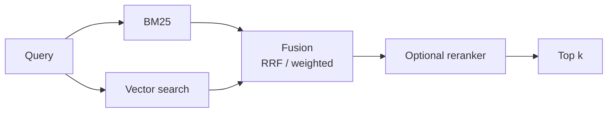

# Ensemble Retrieval

> **Level:** Intermediate · **Reading time:** 6 min · **Phase:** 2 — Advanced RAG

**In one line:** Ensemble retrieval runs several different retrievers (usually keyword and vector) on the same question and fuses their results into one ranked list.

## Explain it like I'm new

When you hire, you might ask two interviewers: one checks technical skills, one checks communication. Each misses things the other catches. Combining their rankings gives a better shortlist than either alone.

Retrievers have different blind spots:

- **Sparse / keyword retrieval** (e.g. **BM25**, a classic formula that scores documents by how often query words appear, adjusted for word rarity and document length) is great at exact terms: error codes, names, IDs. It fails on paraphrases.
- **Dense / vector retrieval** (a [bi-encoder](03-bi-encoder.md)) is great at meaning and paraphrases. It can miss exact identifiers like `ERR_CONN_RESET` or `SKU-48812`.

Ensemble retrieval, often called **hybrid search** when it combines exactly these two, runs both and merges the lists. Many vector databases offer hybrid search built in.

## How it works

1. Send the query to each retriever (in parallel).
2. Get a ranked list from each.
3. Fuse:
   - **Reciprocal Rank Fusion (RRF):** `score(d) = Σ w_i / (60 + rank_i(d))`. Only ranks matter.
   - **Weighted score fusion:** normalise each retriever's scores to 0–1, then `α·dense + (1−α)·sparse`.
4. Optionally [rerank](01-reranking.md) the fused top 50 down to 5.



Weighted fusion worked example with α = 0.5:

| Doc | BM25 (normalised) | Dense (normalised) | Fused |
|---|---|---|---|
| A (contains "ERR_CONN_RESET") | 1.0 | 0.3 | 0.65 |
| B (paraphrase of the problem) | 0.1 | 1.0 | 0.55 |
| C | 0.4 | 0.4 | 0.40 |

## Code example

A stdlib ensemble that fuses a keyword ranker and a character-trigram "semantic-ish" ranker with weighted RRF:

```python
import re

DOCS = {
    "a": "ERR_CONN_RESET appears when the proxy drops idle connections.",
    "b": "If the connection keeps getting reset, raise the proxy idle timeout.",
    "c": "Configure TLS certificates for the proxy.",
}

def kw_rank(q):
    qw = set(re.findall(r"\w+", q.lower()))
    s = {d: len(qw & set(re.findall(r"\w+", t.lower()))) for d, t in DOCS.items()}
    return [d for d in sorted(s, key=lambda d: -s[d]) if s[d] > 0]

def trigram_rank(q):
    grams = lambda t: {t[i:i + 3] for i in range(len(t) - 2)}
    qg = grams(q.lower())
    s = {d: len(qg & grams(t.lower())) / len(qg | grams(t.lower())) for d, t in DOCS.items()}
    return sorted(s, key=lambda d: -s[d])

def weighted_rrf(rankings, weights, k=60):
    scores = {}
    for ranking, w in zip(rankings, weights):
        for r, d in enumerate(ranking, 1):
            scores[d] = scores.get(d, 0) + w / (k + r)
    return sorted(scores, key=lambda d: -scores[d])

q = "connection reset by proxy"
print(weighted_rrf([kw_rank(q), trigram_rank(q)], weights=[0.5, 0.5]))
```

See `rrf_merge` in [`adv_query_transform.py`](../code/adv_query_transform.py) for the tested, unweighted version.

**In real projects** LangChain has an `EnsembleRetriever` that takes a list of retrievers and weights and fuses with weighted RRF; it is often paired with a BM25 retriever. Vector databases such as Weaviate, Qdrant, Elasticsearch/OpenSearch and others offer native hybrid search. See [LangChain docs](https://python.langchain.com/) for current imports.

## When to use it / when not to

- **Use it** as a strong default for production RAG, especially with technical content, names and codes.
- **Use it** when your eval shows dense search missing exact-match queries.
- **Skip it** for tiny prototypes where one retriever already scores well.
- **Cost:** two indexes to build and keep in sync, plus fusion tuning.

| Fusion | Needs score normalisation | Tuning |
|---|---|---|
| RRF | No | Little (weights optional) |
| Weighted score | Yes | α must be tuned on an eval set |

## Common mistakes

- Adding raw BM25 scores (unbounded) to cosine scores (−1 to 1). Normalise first, or use RRF.
- Indexing different chunk sets in the two retrievers, so IDs don't line up.
- Picking weights by gut feel. Tune on a golden set.
- Forgetting to apply the same permission filters to both retrievers.

## Interview questions

**1. Why combine BM25 with dense retrieval?**
<details><summary>Answer</summary>
They fail differently. BM25 nails exact tokens (IDs, rare names) but misses paraphrases; dense retrieval handles meaning but can miss exact identifiers. Fusing them improves recall across query types.
</details>

**2. RRF or weighted score fusion?**
<details><summary>Answer</summary>
RRF is robust and needs no normalisation, so it's a good default. Weighted fusion can do better when tuned on an eval set, but depends on careful score normalisation.
</details>

**3. Where does a reranker fit in a hybrid pipeline?**
<details><summary>Answer</summary>
After fusion: hybrid retrieval maximises recall over a candidate set (say 50), then a cross-encoder reranks for precision before the top few go to the LLM.
</details>

## Go deeper

- [BEIR benchmark: BM25 vs dense retrievers across domains (Thakur et al.)](https://arxiv.org/abs/2104.08663)
- [LangChain documentation](https://python.langchain.com/)

**Prev:** [Parent Document Retriever](11-parent-document-retriever.md) · **Next:** [Knowledge Graph RAG](13-knowledge-graph-rag.md) · **Back to phase:** [Phase 2](../README.md)
