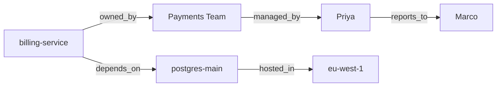

# Knowledge Graph RAG

> **Level:** Advanced · **Reading time:** 7 min · **Phase:** 2 — Advanced RAG

**In one line:** Knowledge-graph RAG stores facts as connected entities and relations, and retrieves by following those connections instead of (or as well as) matching similar text.

## Explain it like I'm new

Think of a family tree. "Who is my mother's brother's daughter?" is hard to answer by searching a pile of letters for similar sentences. With a tree, you just follow lines: me → mother → brother → daughter. Each line is a relationship.

A **knowledge graph (KG)** stores facts as **triples**: `(subject, relation, object)`, for example `(billing-service, owned_by, Payments Team)`. Subjects and objects are **entities** (nodes). Relations are **edges**. Together they form a graph you can walk.

Vector RAG finds passages that *look like* the question. It struggles with **multi-hop** questions, where the answer requires chaining facts that live in different documents. "Who manages the team that owns the billing service?" needs two hops: billing-service → owned_by → Payments Team → managed_by → Priya. No single chunk may contain both facts. A graph makes those hops explicit.

## How it works

**Build (offline):**
1. Extract triples from documents (an LLM or NER/relation-extraction model, or from structured sources such as a service catalogue or HR system).
2. Normalise entity names ("Payments team", "payments-team" → one node). This is **entity resolution**.
3. Store in a graph database (e.g. Neo4j) or a simple triple store.

**Query (online):**
1. **Entity linking:** find entities mentioned in the question.
2. **Traverse:** walk 1–3 hops from those entities, or run a structured query (Cypher, SPARQL) that an LLM writes from the question.
3. **Serialise** the found triples into short sentences.
4. Give those facts (optionally plus vector-retrieved chunks) to the LLM.



Starting at `billing-service` with `max_hops=2` reaches Payments Team, Priya, postgres-main and eu-west-1, but not Marco (3 hops).

## Code example

From [`adv_graph_rag.py`](../code/adv_graph_rag.py):

```python
from adv_graph_rag import TRIPLES, TripleStore, find_entities, follow_path, graph_context

kg = TripleStore(TRIPLES)
q = "Who manages the team that owns billing-service?"

print(find_entities(q, kg))                                         # ['billing-service']
print(follow_path(kg, "billing-service", ["owned_by", "managed_by"]))  # ['Priya']
for fact in graph_context(q, kg, max_hops=2):
    print("-", fact)
# - billing-service owned by Payments Team.
# - billing-service depends on postgres-main.
# - Payments Team managed by Priya.
# - postgres-main hosted in eu-west-1.
```

The core traversal is a breadth-first search that records every edge it crosses until it reaches `max_hops`.

**In real projects** teams often use Neo4j with Cypher queries, for example:

```cypher
MATCH (:Service {name: "billing-service"})-[:OWNED_BY]->(t:Team)-[:MANAGED_BY]->(p:Person)
RETURN p.name
```

LangChain and LlamaIndex both have graph integrations that can ask an LLM to write such queries from text. Always run LLM-written queries with a read-only database user.

## When to use it / when not to

- **Use it** for multi-hop questions over entities: org charts, service dependencies, supply chains, drug interactions, compliance links.
- **Use it** when you already have structured data (CMDB, CRM). You get triples for free.
- **Avoid it** for unstructured "explain this concept" questions; vector RAG is simpler and works well.
- **Cost:** building and maintaining a clean graph is real work, and LLM triple extraction makes errors.

| | Vector RAG | Knowledge-graph RAG |
|---|---|---|
| Finds | Similar passages | Connected facts |
| Multi-hop | Weak | Strong |
| Setup effort | Low | High (extraction, entity resolution) |
| Explainability | Chunks | Explicit paths |

## Common mistakes

- Skipping entity resolution, so "Priya S." and "Priya Sharma" are two nodes and paths break.
- Traversing too many hops, which explodes into hundreds of loosely related facts.
- Trusting LLM-extracted triples without spot-checking. Wrong edges produce confident wrong answers.
- Letting an LLM run write queries (CREATE, DELETE) against the graph.

## Interview questions

**1. What is a multi-hop question, and why does vector RAG struggle?**
<details><summary>Answer</summary>
A question whose answer requires chaining two or more facts, often from different documents. Vector search retrieves chunks similar to the question, but the intermediate entity (e.g. the team name) is not in the question, so the second fact is hard to find.
</details>

**2. How do you build a knowledge graph from documents?**
<details><summary>Answer</summary>
Extract entities and relations (LLM prompts or NER and relation-extraction models), resolve duplicate entities, validate against a schema of allowed relation types, and load into a graph store. Keep source references on each edge for citations.
</details>

**3. How do you combine KG retrieval with vector retrieval?**
<details><summary>Answer</summary>
Run both: link entities and fetch their neighbourhood from the graph, run vector search for passages, then put graph facts and text chunks together in the prompt (or use graph facts to expand the vector query).
</details>

## Go deeper

- [Unifying Large Language Models and Knowledge Graphs: A Roadmap (Pan et al.)](https://arxiv.org/abs/2306.08302)
- [Neo4j Cypher manual](https://neo4j.com/docs/cypher-manual/current/)

**Prev:** [Ensemble Retrieval](12-ensemble-retrieval.md) · **Next:** [GraphRAG](14-graphrag.md) · **Back to phase:** [Phase 2](../README.md)
