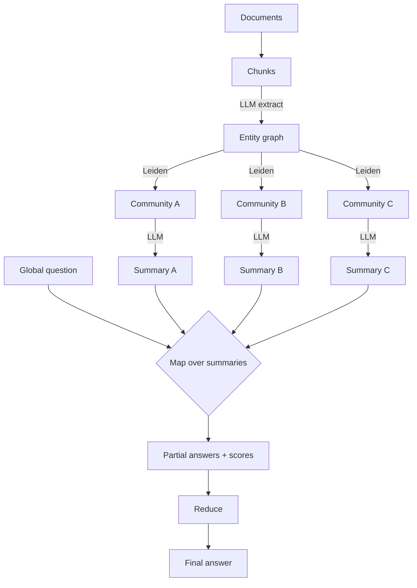

# GraphRAG

> **Level:** Advanced · **Reading time:** 8 min · **Phase:** 2 — Advanced RAG

**In one line:** GraphRAG builds an entity graph from your documents, groups it into communities, pre-writes a summary for each community, and uses those summaries to answer broad "what are the main themes?" questions.

## Explain it like I'm new

Imagine you get 10,000 customer emails and your boss asks, "What are people mainly complaining about?" Searching for "complaint" returns 20 emails. That's a sample, not an answer. What you really need is someone who read everything, grouped emails into topics ("billing", "late delivery", "app crashes"), and wrote a summary per topic. Then you can answer from the summaries.

That is the problem GraphRAG, from a 2024 Microsoft Research paper, targets. Normal RAG is good at **local** questions ("What is the refund window?") where the answer lives in a few chunks. It is bad at **global** or **sensemaking** questions ("What are the main themes in this dataset?") because no single chunk holds the answer.

GraphRAG builds a knowledge graph from text with an LLM, then runs **community detection** — an algorithm (the paper uses **Leiden**) that finds groups of nodes more connected to each other than to the rest. Each community gets an LLM-written **community summary**. Communities are hierarchical: big groups contain smaller ones, so you get summaries at different levels of detail.

## How it works

**Indexing (expensive, offline):**
1. Chunk the documents.
2. LLM extracts entities, relationships and short claims from each chunk.
3. Merge duplicates into one graph. Edge weights count how often relations appear.
4. Run Leiden community detection, recursively, for a hierarchy of communities.
5. LLM writes a summary report for every community.

**Global query (map-reduce):**
1. **Map:** for each community summary at a chosen level, ask the LLM for a partial answer plus a helpfulness score.
2. **Reduce:** drop low-score partials, combine the best ones into a final answer.



The open-source implementation also offers a **local search** mode that starts from entities in the question and gathers their neighbours, relations and source chunks — closer to [Knowledge Graph RAG](13-knowledge-graph-rag.md).

## Code example

A toy of the indexing idea: group a tiny entity graph into communities (connected components stand in for Leiden) and build per-community "summaries" that a global question can map over.

```python
from collections import defaultdict

edges = [
    ("refund", "billing"), ("billing", "invoice"), ("invoice", "refund"),
    ("courier", "late delivery"), ("late delivery", "tracking"),
    ("app", "crash"), ("crash", "login"),
]

def communities(edges):
    adj = defaultdict(set)
    for a, b in edges:
        adj[a].add(b); adj[b].add(a)
    seen, groups = set(), []
    for node in adj:
        if node in seen:
            continue
        stack, group = [node], set()
        while stack:
            n = stack.pop()
            if n not in group:
                group.add(n); stack.extend(adj[n] - group)
        seen |= group
        groups.append(sorted(group))
    return groups

def summarise(group):  # an LLM writes this in real GraphRAG
    return f"Theme about {', '.join(group)}"

def global_answer(question, groups):
    partials = [summarise(g) for g in groups]          # map
    return "Main themes: " + "; ".join(partials)        # reduce

print(global_answer("What are customers complaining about?", communities(edges)))
```

Real community detection weighs edges and finds denser sub-groups inside connected components; this toy only shows the pipeline shape.

**In real projects** Microsoft publishes an open-source `graphrag` Python package with a CLI for indexing and for global/local queries. Its configuration and commands change between releases, so follow the official repository and docs (linked below) rather than copying commands from blog posts.

## When to use it / when not to

- **Use it** for global questions over a large, fairly stable corpus: research archives, incident reports, interviews, news.
- **Use it** when analysts need themes and patterns, not single facts.
- **Avoid it** for simple fact lookup. Vector RAG is far cheaper and just as good.
- **Avoid it** for fast-changing data. Re-extracting and re-summarising is expensive.
- **Cost:** indexing makes many LLM calls (every chunk, every community). Estimate on a sample first.

| | Vector RAG | GraphRAG global search |
|---|---|---|
| Best question type | Local, specific | Global, thematic |
| Indexing cost | Embeddings only | Many LLM calls |
| Query cost | 1 retrieval + 1 LLM call | Map over many summaries + reduce |

## Common mistakes

- Using GraphRAG for everything. Route specific questions to normal RAG.
- Underestimating indexing cost and time on large corpora.
- Never re-indexing, so summaries go stale as documents change.
- Skipping evaluation. Global answers are hard to grade; use rubric-based comparison against a baseline.

## Interview questions

**1. What problem does GraphRAG solve that standard RAG doesn't?**
<details><summary>Answer</summary>
Query-focused summarisation over a whole corpus — "global" questions like "what are the main themes?" Standard RAG retrieves a few top chunks, which cannot represent the whole dataset.
</details>

**2. Describe GraphRAG indexing in four steps.**
<details><summary>Answer</summary>
LLM extracts entities and relations from chunks; build a graph; detect hierarchical communities (Leiden); LLM writes a summary report per community.
</details>

**3. How is a global query answered?**
<details><summary>Answer</summary>
Map-reduce: each community summary produces a partial answer with a helpfulness score (map), then the best partials are combined into one final answer (reduce).
</details>

## Go deeper

- [From Local to Global: A Graph RAG Approach to Query-Focused Summarization (Edge et al.)](https://arxiv.org/abs/2404.16130)
- [microsoft/graphrag on GitHub](https://github.com/microsoft/graphrag)

**Prev:** [Knowledge Graph RAG](13-knowledge-graph-rag.md) · **Next:** [Multi Modal RAG](15-multi-modal-rag.md) · **Back to phase:** [Phase 2](../README.md)
