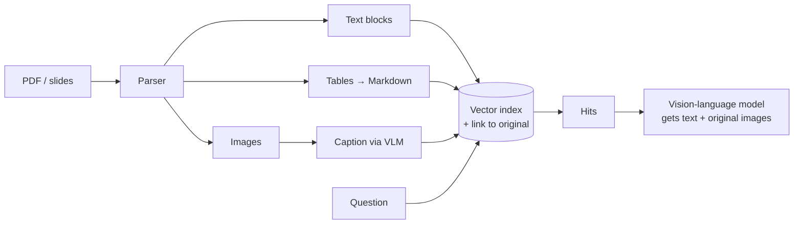

# Multi Modal RAG

> **Level:** Advanced · **Reading time:** 6 min · **Phase:** 2 — Advanced RAG

**In one line:** Multi-modal RAG retrieves not just text but also images, tables, charts, audio or video, and gives them to a model that can understand them.

## Explain it like I'm new

Ask a mechanic, "Which bolt holds the alternator?" The answer is a diagram in the manual, not a paragraph. A text-only search would never find it, because the picture has no words.

Real documents mix **modalities** (types of data): text, images, tables, slides, scanned PDFs, screenshots, audio, video. Text-only RAG throws away anything that isn't plain text, or mangles it (tables flattened into word soup). Multi-modal RAG keeps them.

There are three common designs:

1. **Convert to text:** caption images, transcribe audio, turn tables into Markdown, then use normal text RAG. Simple, but loses visual detail.
2. **Shared embedding space:** use a model like **CLIP** that maps images and text into the same vector space, so a text query can find an image directly.
3. **Summary + original:** embed a text summary or caption for search, but send the *original* image to a **vision-language model (VLM)**, a model that accepts images in its input. This is the [multi-vector](10-multi-vector-retriever.md) pattern applied to images.

## How it works

1. **Parse** documents into elements: text blocks, tables, figures, page images (layout-aware parsers or OCR).
2. **Represent** each element: text as-is, tables as Markdown or HTML, images as captions and/or image embeddings.
3. **Index** with metadata: `type`, `page`, `doc_id`, and a link to the original file.
4. **Retrieve** with a text query (or an image query).
5. **Generate** with a VLM: pass the question, retrieved text, and the original images.



## Code example

A stdlib sketch of design 3: search over captions, return the original asset path to send to a VLM.

```python
import re

ELEMENTS = [
    {"id": "p3-fig1", "type": "image", "path": "manual/p3_fig1.png",
     "caption": "Exploded diagram of the alternator showing the two mounting bolts and belt tensioner."},
    {"id": "p3-txt", "type": "text", "path": None,
     "caption": "Disconnect the battery before any electrical work."},
    {"id": "p7-tbl", "type": "table", "path": "manual/p7_torque.md",
     "caption": "Torque table: alternator bolt 45 Nm, tensioner bolt 25 Nm."},
]

def words(t):
    return set(re.findall(r"[a-z0-9]+", t.lower()))

def retrieve(question, k=2):
    q = words(question)
    ranked = sorted(ELEMENTS, key=lambda e: -len(q & words(e["caption"])))
    return ranked[:k]

for hit in retrieve("which bolt holds the alternator and what torque"):
    print(hit["type"], hit["id"], "->", hit["path"] or "inline text")
```

The generation step would attach `manual/p3_fig1.png` as an image and the torque table as text in the prompt.

**In real projects** you might use CLIP-style models via `sentence-transformers` (which can embed images and text into one space) or a vector database's multi-modal support, plus a VLM that accepts image input. Check model cards and provider docs for exact image input formats.

## When to use it / when not to

- **Use it** for manuals, slide decks, scientific papers, financial reports, product catalogues, scanned forms.
- **Use it** when users ask about charts, diagrams or screenshots.
- **Start with convert-to-text** if most value is in tables and scanned text; it is the cheapest path.
- **Avoid it** if your content is plain text. It adds parsing complexity and cost.

| Design | Cost | Keeps visual detail |
|---|---|---|
| Convert to text | Low | No |
| Shared embeddings (CLIP) | Medium | For search, yes |
| Caption + original to VLM | Higher | Yes, at answer time |

## Common mistakes

- Flattening tables into plain text, so rows and columns get mixed up. Keep Markdown or HTML structure.
- Losing the link from caption back to the original image or page.
- Trusting OCR blindly on low-quality scans. Spot-check.
- Sending dozens of full-resolution images to the VLM; image tokens are expensive.

## Interview questions

**1. Name three ways to make images searchable in RAG.**
<details><summary>Answer</summary>
Caption them (or OCR them) and embed the text; embed them directly with a joint image–text model like CLIP; or embed a summary while storing the original and passing it to a vision-language model at answer time.
</details>

**2. How do you handle tables?**
<details><summary>Answer</summary>
Extract them with a layout-aware parser, keep structure as Markdown or HTML, optionally embed an LLM-written summary for search, and pass the full table to the model.
</details>

**3. What's the main cost risk?**
<details><summary>Answer</summary>
Ingest-time captioning calls per image and answer-time image tokens. Limit images per answer, downscale, and cache captions.
</details>

## Go deeper

- [CLIP: Learning Transferable Visual Models From Natural Language Supervision](https://arxiv.org/abs/2103.00020)
- [Sentence-Transformers documentation](https://www.sbert.net/)

**Prev:** [GraphRAG](14-graphrag.md) · **Next:** [SQL RAG](16-sql-rag.md) · **Back to phase:** [Phase 2](../README.md)
