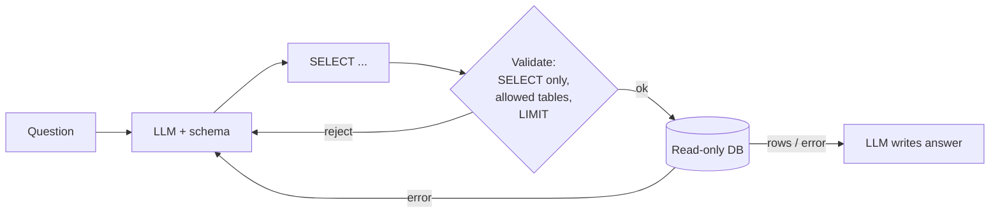

# SQL RAG

> **Level:** Advanced · **Reading time:** 7 min · **Phase:** 2 — Advanced RAG

**In one line:** SQL RAG (also called text-to-SQL) lets an LLM turn a question into a SQL query, runs it on your database, and uses the result rows as context for the answer.

## Explain it like I'm new

"How many orders did we ship to Germany last month?" No document contains that number. It lives in a database, and you get it by *counting*. Searching text for similar sentences cannot add up rows.

Structured data (tables with columns and types) needs a different kind of retrieval: a **query**. SQL RAG asks an LLM to write that query. The LLM sees the **schema** (table names, columns, types, a few example rows), writes SQL, your code runs it, and the LLM turns the result into a sentence.

This is powerful and risky. You are letting a model write code that runs against real data. Safety is not optional: read-only access, validation and limits.

## How it works

1. **Schema context:** give the LLM the relevant tables and columns (for big databases, retrieve only relevant tables first).
2. **Generate SQL** from the question. Few-shot examples of question → SQL help a lot.
3. **Validate:** single `SELECT` statement only, allowed tables only, add a `LIMIT`.
4. **Execute** with a read-only database user and a timeout.
5. **On error,** send the error message back to the LLM to fix the query (cap retries, e.g. 2).
6. **Answer** from the rows, and show the SQL to the user for transparency.



## Code example

Stdlib only, with `sqlite3` and a stubbed LLM. The important part is the guardrail.

```python
import re
import sqlite3

conn = sqlite3.connect(":memory:")
conn.executescript("""
CREATE TABLE orders (id INTEGER, country TEXT, amount REAL, shipped_on TEXT);
INSERT INTO orders VALUES (1,'DE',120,'2026-09-03'),(2,'DE',80,'2026-09-15'),(3,'FR',50,'2026-09-20');
""")
SCHEMA = "orders(id INTEGER, country TEXT, amount REAL, shipped_on TEXT)"
ALLOWED_TABLES = {"orders"}

def fake_llm_sql(question, schema):
    # A real LLM writes this from the question + schema.
    return "SELECT COUNT(*), SUM(amount) FROM orders WHERE country = 'DE' AND shipped_on LIKE '2026-09-%'"

def validate(sql):
    s = sql.strip().rstrip(";")
    if ";" in s or not re.match(r"(?is)^\s*select\b", s):
        raise ValueError("only a single SELECT is allowed")
    if re.search(r"(?i)\b(insert|update|delete|drop|alter|attach|pragma)\b", s):
        raise ValueError("forbidden keyword")
    tables = set(re.findall(r"(?i)\b(?:from|join)\s+(\w+)", s))
    if not tables <= ALLOWED_TABLES:
        raise ValueError(f"table not allowed: {tables - ALLOWED_TABLES}")
    return s if re.search(r"(?i)\blimit\b", s) else s + " LIMIT 100"

sql = validate(fake_llm_sql("How many orders did we ship to Germany in September 2026?", SCHEMA))
rows = conn.execute(sql).fetchall()
print(sql)
print(rows)  # [(2, 200.0)]
```

Regex validation is a teaching aid, not a security boundary. **The real protection is a read-only database user** with access to only the allowed tables or views.

**In real projects** LangChain and LlamaIndex both ship SQL database helpers and text-to-SQL query engines that wrap SQLAlchemy connections. Check [LangChain](https://python.langchain.com/) and [LlamaIndex](https://docs.llamaindex.ai/) for current class names, and still enforce read-only credentials yourself.

## When to use it / when not to

- **Use it** for counts, sums, filters, rankings and trends over structured data.
- **Use it** for internal analytics assistants where users know the data exists.
- **Avoid it** for unstructured text questions. Use normal RAG, or route between both.
- **Avoid giving it** write access, or direct access to tables with sensitive personal data.

| Question | Best retrieval |
|---|---|
| "What is our refund policy?" | Vector RAG over documents |
| "How many refunds last week?" | SQL RAG |
| "Why did refunds spike last week?" | Both: SQL for numbers, docs/tickets for reasons |

## Common mistakes

- Running LLM SQL with a read–write user. One `DROP TABLE` and you have an incident.
- Sending the whole schema of a 500-table warehouse. Retrieve relevant tables first, and describe columns in plain words.
- No `LIMIT` or timeout, so one query scans billions of rows.
- Not showing the SQL. Users and reviewers need to verify how a number was produced.
- Ambiguous columns (`status = 3`). Add descriptions and allowed values to the schema prompt.

## Interview questions

**1. How do you make text-to-SQL safe?**
<details><summary>Answer</summary>
Read-only database user scoped to approved tables or views, single-SELECT validation, row limits and timeouts, row-level security for multi-tenant data, logging of every query, and human-visible SQL.
</details>

**2. The LLM keeps writing wrong joins. What helps?**
<details><summary>Answer</summary>
Better schema context (foreign keys, column descriptions), few-shot examples of correct queries, pre-built views that hide complex joins, and an error-feedback retry loop. Evaluate with a set of question → expected-result pairs.
</details>

**3. How do you evaluate SQL RAG?**
<details><summary>Answer</summary>
Execution accuracy: run the generated query and the reference query and compare result sets, rather than comparing SQL strings, because many different queries are correct.
</details>

## Go deeper

- [Python sqlite3 documentation](https://docs.python.org/3/library/sqlite3.html)
- [Spider: a large-scale text-to-SQL benchmark (Yu et al.)](https://arxiv.org/abs/1809.08887)

**Prev:** [Multi Modal RAG](15-multi-modal-rag.md) · **Next:** [API RAG](17-api-rag.md) · **Back to phase:** [Phase 2](../README.md)
