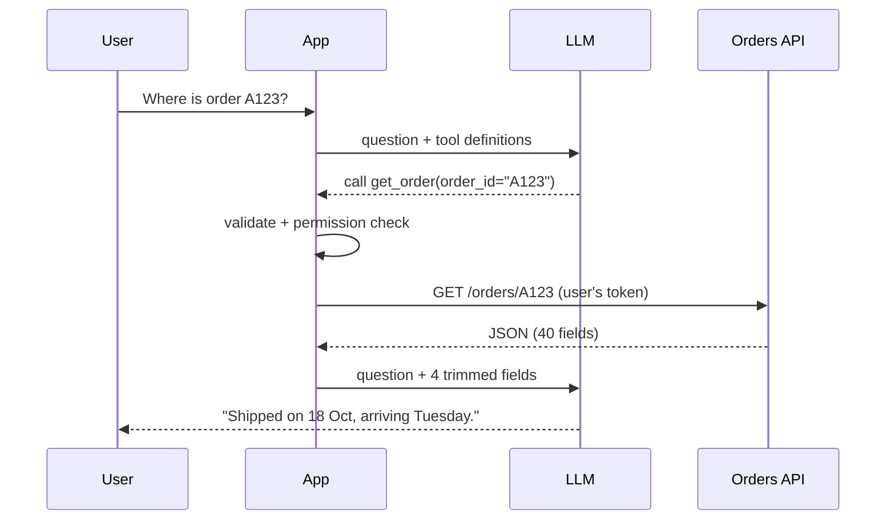

# API RAG

> **Level:** Advanced · **Reading time:** 6 min · **Phase:** 2 — Advanced RAG

**In one line:** API RAG fetches live data from an API at question time (weather, order status, stock levels) and gives the response to the LLM as context.

## Explain it like I'm new

"Where is my order?" You can't answer that from a document written last week. You have to look it up *now*, in the order system. A support agent does this by opening an internal tool and typing the order number. API RAG lets the AI do the same.

Retrieval does not have to mean a vector database. Any source that returns relevant facts for a question counts. An **API** (application programming interface) is a defined way for programs to ask another system for data, usually over HTTP returning JSON. With API RAG:

- The system decides **which API** to call and with **what parameters** (often the LLM decides this using **tool calling** / **function calling**: the model outputs a structured request like `{"name": "get_order", "arguments": {"order_id": "A123"}}`).
- Your code makes the call, with the user's permissions.
- The JSON response is trimmed and put in the prompt.
- The LLM answers from it.

This is where RAG and agents meet. A single fixed API call is RAG. Letting the model choose among many tools in a loop is an agent (Phase 4).

## How it works

1. Define each API as a tool: name, description, JSON schema of parameters.
2. LLM reads the question and picks a tool and arguments (or your router does, with rules).
3. **Validate** arguments against the schema; check the user may access that resource.
4. Call the API with a timeout; handle errors and retries.
5. **Trim** the response to the fields that matter (APIs return far more than needed).
6. Build the prompt: question + trimmed data + "answer only from this data".



## Code example

Stdlib only. The "API" is a function so the example runs offline; the router and trimming are the real lessons.

```python
import json
import re

def orders_api(order_id, user_id):  # stands in for an HTTP call
    db = {"A123": {"owner": "u1", "status": "shipped", "carrier": "DHL", "eta": "2026-10-27",
                   "warehouse_bin": "Z-19", "internal_margin": 0.31}}
    order = db.get(order_id)
    if not order or order["owner"] != user_id:
        return {"error": "not found"}  # never reveal other users' orders
    return order

TOOLS = {"get_order": {"pattern": r"\b([A-Z]\d{3})\b", "fields": ["status", "carrier", "eta"]}}

def route(question):
    m = re.search(TOOLS["get_order"]["pattern"], question)
    return ("get_order", {"order_id": m.group(1)}) if m else (None, {})

def api_context(question, user_id):
    tool, args = route(question)
    if tool is None:
        return None
    raw = orders_api(args["order_id"], user_id)
    if "error" in raw:
        return raw
    return {k: raw[k] for k in TOOLS[tool]["fields"]}  # trim: no internal fields

ctx = api_context("Where is my order A123?", user_id="u1")
prompt = f"Answer only from this data.\nData: {json.dumps(ctx)}\nQuestion: Where is my order A123?"
print(prompt)
```

Here a regex router picks the tool. In production you would usually let the LLM pick via tool calling, then still validate its arguments in code.

**In real projects** most LLM provider SDKs support tool/function calling, and frameworks like LangChain and LlamaIndex wrap APIs as tools. The [Model Context Protocol](https://modelcontextprotocol.io/) standardises how tools are exposed to models (see Phase 6).

## When to use it / when not to

- **Use it** for data that changes often: order status, inventory, prices, tickets, calendars, metrics.
- **Use it** when the source of truth is a system, not a document.
- **Avoid it** for static knowledge; indexing documents is cheaper and faster.
- **Avoid** calling slow or rate-limited APIs on every question without caching.

| | Document RAG | API RAG |
|---|---|---|
| Freshness | As of last index | Live |
| Latency | Low | Depends on the API |
| Main risk | Stale answers | Permissions, failures, prompt injection in responses |

## Common mistakes

- Calling APIs with a service account that sees everything, instead of the user's own permissions.
- Dumping the whole JSON response into the prompt (cost, noise, and data leaks such as internal fields).
- Trusting text fields from APIs. User-written content (ticket bodies, reviews) can contain prompt-injection instructions; treat it as data.
- No timeout or fallback, so one slow API freezes the whole answer.

## Interview questions

**1. How does API RAG differ from vector RAG?**
<details><summary>Answer</summary>
The retrieval step is a live, structured API call chosen from the question, instead of a similarity search over pre-indexed text. It gives fresh data but adds latency, failure modes and permission concerns.
</details>

**2. How do you enforce permissions?**
<details><summary>Answer</summary>
Call the API with the end user's identity or scoped token, check resource ownership in code, and never let the LLM choose whose data to fetch without validation.
</details>

**3. Why trim API responses before prompting?**
<details><summary>Answer</summary>
Fewer tokens and less noise improve cost and accuracy, and trimming prevents leaking internal fields the user should not see.
</details>

## Go deeper

- [Toolformer: Language Models Can Teach Themselves to Use Tools (Schick et al.)](https://arxiv.org/abs/2302.04761)
- [Model Context Protocol](https://modelcontextprotocol.io/)

**Prev:** [SQL RAG](16-sql-rag.md) · **Next:** [Incremental Indexing](18-incremental-indexing.md) · **Back to phase:** [Phase 2](../README.md)
