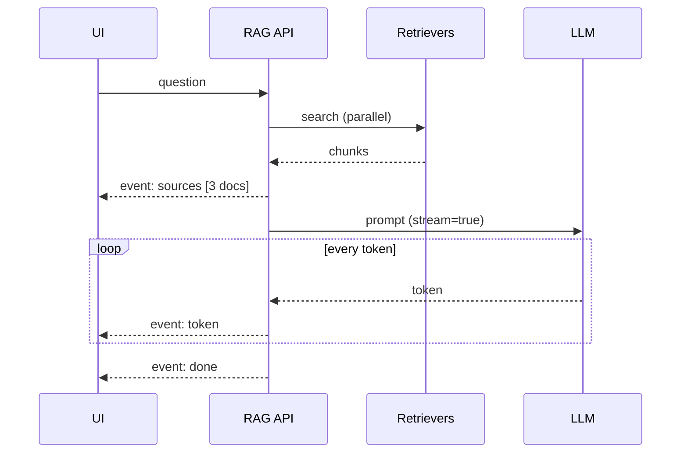

# Streaming Retrieval

> **Level:** Advanced · **Reading time:** 6 min · **Phase:** 2 — Advanced RAG

**In one line:** Streaming retrieval means sending results and answer tokens to the user as soon as each piece is ready, and keeping the index updated continuously as new data arrives, instead of waiting for everything to finish.

## Explain it like I'm new

At a restaurant, you'd rather get bread and drinks right away than wait 40 minutes for everything to arrive at once. Nothing is faster overall, but it *feels* faster and you can start.

"Streaming" in RAG is used for two related ideas:

1. **Streaming the response path:** show the user progress early. Send the sources as soon as retrieval finishes, then stream the LLM's answer **token by token** (a token is a word-piece). The key metric is **time to first token (TTFT)**: how long until the user sees anything.
2. **Streaming the ingest path:** new data (chat messages, tickets, logs, news) flows into the index continuously, within seconds, instead of in a nightly batch. This keeps answers fresh.

Both use **generators** or async iterators in code: functions that produce results one at a time, rather than building a full list first.

## How it works

**Response path:**
1. Start retrievers concurrently (vector, keyword, API).
2. As soon as results are merged, emit a `sources` event to the client.
3. Start the LLM call with streaming on; forward each token as a `token` event.
4. Emit a `done` event with citations and usage.
5. Transport is usually **Server-Sent Events (SSE)** or WebSockets.

**Ingest path:**
1. A queue or change feed (Kafka, a database change stream, webhooks) delivers new or changed records.
2. A worker chunks, hashes and embeds them ([Incremental Indexing](18-incremental-indexing.md)).
3. Upsert into the vector store; the next query can see them.



## Code example

Stdlib generators showing the event stream shape. Swap `fake_llm_stream` for a real streaming SDK call.

```python
import json
import time

def retrieve(question):
    return [{"id": "auth.txt#0", "text": "Refresh tokens belong in an httpOnly cookie."}]

def fake_llm_stream(prompt):
    for token in "Store refresh tokens in an httpOnly cookie [auth.txt#0].".split(" "):
        time.sleep(0.01)  # pretend network delay
        yield token + " "

def answer_stream(question):
    chunks = retrieve(question)
    yield {"event": "sources", "data": [c["id"] for c in chunks]}   # user sees sources at once
    prompt = "\n".join(c["text"] for c in chunks) + "\nQ: " + question
    for tok in fake_llm_stream(prompt):
        yield {"event": "token", "data": tok}
    yield {"event": "done", "data": None}

def to_sse(events):  # Server-Sent Events wire format
    for e in events:
        yield f"event: {e['event']}\ndata: {json.dumps(e['data'])}\n\n"

for line in to_sse(answer_stream("Where do refresh tokens go?")):
    print(line, end="")
```

**In real projects** FastAPI's `StreamingResponse` can return a generator like `to_sse(...)` with `media_type="text/event-stream"`, and LLM SDKs offer a streaming mode that yields tokens. See [FastAPI docs](https://fastapi.tiangolo.com/).

## When to use it / when not to

- **Use response streaming** for any chat UI. Users tolerate long answers much better when text appears immediately.
- **Use streaming ingest** when freshness matters in minutes: support tickets, incidents, chat, news, prices.
- **Skip response streaming** for batch jobs or when the output must be validated as a whole first (strict JSON for another system).
- **Skip streaming ingest** for documents that change weekly; a scheduled incremental job is simpler.

| | Batch | Streaming |
|---|---|---|
| Time to first token | Full generation time | Retrieval + first token |
| Index freshness | Hours | Seconds to minutes |
| Complexity | Low | Higher (queues, partial failure, back-pressure) |

## Common mistakes

- Streaming tokens before retrieval and permission checks finish. Never stream content the user may not be allowed to see.
- Running output guardrails only at the end, after the user already saw the text. Check incrementally or buffer risky sections.
- Not handling client disconnects, so the server keeps paying for tokens nobody reads.
- Streaming ingest without idempotency, so retries create duplicate chunks. Use content hashes or stable IDs.

## Interview questions

**1. What is TTFT and how does streaming help it?**
<details><summary>Answer</summary>
Time to first token: the delay before the user sees any output. Streaming forwards tokens as they are generated, so TTFT becomes retrieval time plus the model's first-token latency instead of the full generation time.
</details>

**2. How do you keep a RAG index fresh in near real time?**
<details><summary>Answer</summary>
Consume a change feed or queue, chunk/hash/embed only changed records, upsert idempotently, process deletes, and monitor lag between source change and index update.
</details>

**3. What safety issue does streaming introduce?**
<details><summary>Answer</summary>
Output moderation and validation can't wait for the full answer if tokens are already displayed. You need incremental checks, buffering of risky segments, or a non-streamed path for high-risk use cases.
</details>

## Go deeper

- [FastAPI documentation (custom and streaming responses)](https://fastapi.tiangolo.com/)
- [Python generators (PEP 255)](https://peps.python.org/pep-0255/)

**Prev:** [Incremental Indexing](18-incremental-indexing.md) · **Next:** [RAG Evaluation (RAGAS / DeepEval)](20-rag-evaluation.md) · **Back to phase:** [Phase 2](../README.md)
