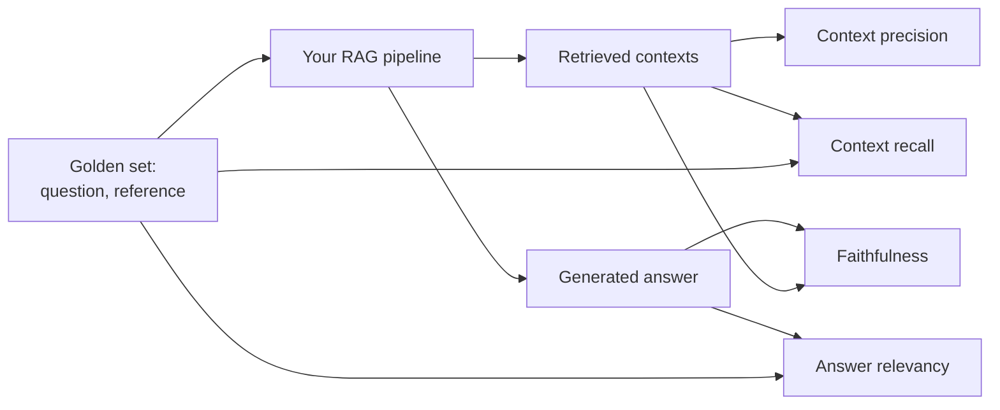

# RAG Evaluation (RAGAS / DeepEval)

> **Level:** Advanced · **Reading time:** 9 min · **Phase:** 2 — Advanced RAG

**In one line:** RAG evaluation measures, with numbers, whether your system retrieves the right context and writes answers that are correct, grounded in that context, and on-topic.

## Explain it like I'm new

A restaurant critic doesn't just say "nice". They score the ingredients, the cooking, and the service separately. If the dish is bad, they can tell you *why*: stale ingredients or a bad cook.

A RAG system has two parts that can fail independently: the **retriever** (the ingredients) and the **generator** (the cook). If you only look at the final answer, you can't tell which part broke. Good evaluation scores each part.

You start with a **golden set** (also called a test set): realistic questions, ideally with a **reference answer** (what a correct answer says) and the sources that should be found. You run every question through the pipeline and compute **metrics**. Then every change — new chunk size, a [reranker](01-reranking.md), a new prompt — becomes a measured decision instead of a guess.

**RAGAS** and **DeepEval** are two popular open-source Python libraries that implement these metrics, mostly using an **LLM-as-judge**: a language model that reads the question, contexts and answer and makes yes/no judgements, like "is this claim supported by the context?".

## How it works

The four core RAG metrics (names as popularised by RAGAS; DeepEval has close equivalents such as faithfulness, answer relevancy, contextual precision and contextual recall):

| Metric | Part tested | Question it answers | Needs reference? |
|---|---|---|---|
| **Context precision** | Retriever | Are the relevant chunks ranked at the top? | Usually |
| **Context recall** | Retriever | Did we retrieve everything needed for the reference answer? | Yes |
| **Faithfulness** | Generator | Is every claim in the answer supported by the retrieved context? | No |
| **Answer relevancy** | Generator | Does the answer actually address the question? | No |

Simplified formulas, with a tiny worked example:

1. **Context precision** — average of precision@k at each relevant position. Retrieved relevance `[1, 0, 1]` → (1/1 + 2/3) / 2 = **0.83**. If the relevant chunks were first, `[1, 1, 0]` → **1.0**.
2. **Context recall** — split the reference answer into claims; share supported by the contexts. 2 of 2 claims found → **1.0**.
3. **Faithfulness** — split the generated answer into claims; share supported by the contexts. "Stored in an httpOnly cookie" (supported) + "expire after exactly 30 days" (not in context) → 1/2 = **0.5**. That is a hallucination caught.
4. **Answer relevancy** — RAGAS generates questions *from* the answer and compares them to the real question by embedding similarity. An evasive or off-topic answer scores low.



Also keep the simple retrieval metrics from this phase's harness: **hit@k** and **MRR** (see [`eval_harness.py`](../code/eval_harness.py)). They are deterministic, free and fast.

## Code example

[`adv_rag_metrics.py`](../code/adv_rag_metrics.py) implements toy versions of all four metrics, replacing the LLM judge with sentence splitting and word overlap so the formulas are visible:

```python
from adv_rag_metrics import SAMPLE, evaluate

print(evaluate(SAMPLE))
# {'context_precision': 0.833, 'context_recall': 1.0, 'faithfulness': 0.5, 'answer_relevancy': 1.0}
```

The faithfulness core:

```python
def faithfulness(answer, contexts, threshold=0.6):
    ans = claims(answer)                 # an LLM splits claims in real tools
    if not ans:
        return 0.0
    return sum(supported(c, contexts, threshold) for c in ans) / len(ans)
```

**In real projects** use RAGAS or DeepEval. Both build an evaluation dataset of samples (question, retrieved contexts, answer, optional reference), choose metrics, and call an evaluate function that uses a judge LLM you configure. Their APIs have changed across major versions (for example, field names and metric classes), so copy the current quick-start from the official docs rather than older blog posts:

- RAGAS: https://docs.ragas.io/
- DeepEval: https://deepeval.com/docs/ — it also integrates with pytest so metrics can run as test cases in CI.

## When to use it / when not to

- **Always** have a golden set and deterministic retrieval metrics (hit@k, MRR) in CI.
- **Add LLM-judged metrics** (faithfulness, relevancy) before launch and on every major change.
- **Grow the golden set** from real user questions and production failures.
- **Don't** treat scores as absolute truth. Judges are imperfect; compare versions, not universes.
- **Don't** run expensive LLM metrics on every commit if a cheap smoke test catches most regressions; run them nightly or before release.

## Common mistakes

- Only evaluating the final answer, so you can't tell retrieval failures from generation failures.
- A tiny, self-written golden set that the system already scores 100% on. It proves nothing.
- Trusting LLM-as-judge blindly. Judges can prefer longer answers, be inconsistent between runs, and miss subtle errors. Spot-check against human labels and fix the judge model and prompt version.
- Changing the judge model between runs and comparing scores as if nothing changed.
- Ignoring cost and latency. A better score that doubles latency may not be a better product.

## Interview questions

**1. Explain faithfulness vs answer relevancy.**
<details><summary>Answer</summary>
Faithfulness checks that every claim in the answer is supported by the retrieved context (no hallucination). Answer relevancy checks that the answer addresses the question. An answer can be fully faithful but irrelevant (quotes the context, misses the question), or relevant but unfaithful (on-topic but invented).
</details>

**2. Context recall is low but faithfulness is high. What does that tell you?**
<details><summary>Answer</summary>
The generator is behaving (only uses what it gets), but the retriever is missing needed information. Work on retrieval: chunking, hybrid search, query transformation, larger k, or reranking.
</details>

**3. How would you set up RAG evaluation in CI?**
<details><summary>Answer</summary>
Keep a versioned golden set. On every PR run cheap deterministic checks (hit@k, MRR, schema validity) and fail on regressions beyond a threshold. Run LLM-judged metrics (faithfulness, relevancy, context precision/recall) nightly or before release with a pinned judge model, and track trends over time.
</details>

## Go deeper

- [RAGAS: Automated Evaluation of Retrieval Augmented Generation (Es et al.)](https://arxiv.org/abs/2309.15217)
- [RAGAS documentation](https://docs.ragas.io/)
- [DeepEval documentation](https://deepeval.com/docs/)

More interview answers: [Interview prep — evaluation and production](../../08-interview-prep/04-evaluation-and-production.md).

**Prev:** [Streaming Retrieval](19-streaming-retrieval.md) · **Next:** [Phase 3 — LLM Concepts](../../03-llm-concepts/README.md) · **Back to phase:** [Phase 2](../README.md)
