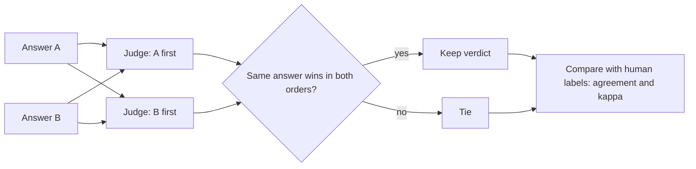

# LLM-as-a-Judge
> **Level:** Advanced · **Reading time:** 9 min · **Phase:** 2 — Advanced RAG

**In one line:** LLM-as-a-judge uses a language model to grade answers when there is no exact match to check, and it only works if you design a rubric, fight the judge's known biases, and measure how often it agrees with people.

## Explain it like I'm new
A teacher can mark a maths test with an answer key. But an essay has no key. Someone has to read it and decide if it is good. That is slow and costly if you have thousands of essays.

An **LLM judge** is a model you ask to be that reader. You give it the question, the answer, and a list of things to check. It returns a score or a choice. It is fast and cheap, so you can grade every change to your system.

But the judge is a reader with habits. It may like the first answer it sees. It may like long answers. It may like answers that sound like itself. So you do not trust it blindly. You check it against a small set of answers that real people graded.

## How it works
1. **Pick a mode.**
   - **Pointwise:** grade one answer on its own, such as "score 1 to 5". Good for tracking quality over time.
   - **Pairwise:** show two answers and ask "which is better, A or B?". Easier for a model than absolute scores, so it is good for comparing two versions of your system.
2. **Write a rubric.** List clear, separate checks: "Is every claim supported by the context?", "Does it answer the question?", "Is it short and clear?" Define each score level in words. Vague rubrics give noisy scores. This links to [RAG evaluation](20-rag-evaluation.md): *faithfulness* and *answer relevancy* are rubric items judged by a model.
3. **Add a reference answer** when you have one. The judge then compares with something solid instead of guessing.
4. **Know the biases.**
   - **Position bias:** prefers the answer shown first (or last).
   - **Verbosity bias:** prefers longer answers, even if they say less.
   - **Self-preference:** prefers answers written by its own model family.
5. **Apply fixes.**
   - Run pairwise twice with the **order swapped**. If the verdict follows the position and not the answer, call it a **tie**.
   - Keep the rubric **fixed**, pin the judge model and prompt version, and tell it not to reward length.
   - Use a **different model** as judge than the one that wrote the answers.
   - **Calibrate:** have people label a small set (even 50 to 100 items), and compare.
6. **Measure the judge.** **Agreement** is the share of items where judge and human gave the same label. But agreement can look good by luck. If 90% of items are "good", a judge that always says "good" gets 90%. **Cohen's kappa** fixes this:

   `kappa = (po - pe) / (1 - pe)`

   `po` is the observed agreement. `pe` is the agreement you would expect by chance, from how often each side uses each label. Kappa is 1.0 for perfect agreement and 0.0 for chance level.



## Code example
[`adv_llm_judge.py`](../code/adv_llm_judge.py) has no network and no real model. A scripted judge stands in for the LLM, and it is **biased on purpose**: a bonus for the first slot (position bias) and an optional bonus per word (verbosity bias). That lets you see the biases and the fix.

```python
from adv_llm_judge import (ScriptedJudge, pairwise_judge, debiased_pairwise,
                           Q, SHORT_GOOD, LONG_WEAK)

judge = ScriptedJudge(["httpOnly", "cookie"], position_bonus=3.0)
print(pairwise_judge(judge, Q, SHORT_GOOD, LONG_WEAK))   # -> A  (good answer first)
print(pairwise_judge(judge, Q, LONG_WEAK, SHORT_GOOD))   # -> A  (weak answer first, still "A")
print(debiased_pairwise(judge, Q, SHORT_GOOD, LONG_WEAK))  # -> tie
```

The verdict is "A" in both orders, so it follows the position and not the quality. The debiased version spots the disagreement and returns `tie`.

For agreement, the demo has 10 items (1 = good, 0 = bad). Both say good on 5. The judge says good and the human bad on 1. The judge says bad and the human good on 2. Both say bad on 2. By hand: `po = 7/10 = 0.7`. The judge says good 6 of 10 times and the human 7 of 10, so `pe = 0.6 x 0.7 + 0.4 x 0.3 = 0.54`. Then `kappa = (0.7 - 0.54) / (1 - 0.54) = 0.3478`. Real output of `python 02-advanced-rag/code/adv_llm_judge.py`:

```text
pairwise (good first):   A
pairwise (good second):  A
debiased:                tie
verbosity-biased judge, good first: B
agreement: 0.7
kappa: 0.3478
```

Two lessons. First, 70% agreement sounds fine, but kappa of 0.35 is weak, so this judge is not ready to trust. Second, the verbosity-biased judge picks the long, weak answer (`B`) even with the good answer first. Swapping the order does not fix that bias, because the judge is consistently wrong. Only a better rubric, a reference answer, and human calibration catch it. The tests in [`test_adv_llm_judge.py`](../code/test_adv_llm_judge.py) check all of this, including that kappa of identical labels is 1.0.

**In real projects** the judge is a prompt sent to a model, often with structured output (for example JSON with a score and a reason). Libraries such as RAGAS and DeepEval wrap this, and their APIs change, so copy current examples from their docs.

## When to use it / when not to
| Situation | Use an LLM judge? |
|---|---|
| Open-ended answers, tone, helpfulness, faithfulness to context | Yes, with a rubric and a human-labelled check |
| Comparing two versions of a prompt or pipeline | Yes, pairwise with both orders |
| A fact you can check with code (a number, a date, an exact ID, valid JSON) | **No.** Write a deterministic check. It is free and exact |
| A tiny budget, or a handful of examples | Probably not. Read them yourself |
| High-stakes decisions (safety, legal) | Not alone. Keep people in the loop |
| Judge and system use the same model | Be careful. Self-preference may inflate scores |

## Common mistakes
- Trusting the judge with no human-labelled check. You do not know how good it is.
- Reporting raw agreement only. Use kappa when one label is common.
- Using one order in pairwise tests. Position bias then leaks into your results.
- Vague rubrics ("is it good?"). Split them into clear checks with defined levels.
- Changing the judge model or prompt between runs and comparing scores as if nothing changed.
- Using an LLM for what code can check exactly.
- Letting long answers win. Say in the rubric that length is not quality, and spot-check it.

## Interview questions
<details>
<summary><b>1. What biases do LLM judges have, and how do you reduce them?</b></summary>

Position bias (prefers the first or last answer), verbosity bias (prefers longer answers) and self-preference (prefers its own model family). Reduce them by running both orders and calling disagreement a tie, using a fixed rubric that does not reward length, giving a reference answer, using a different judge model, and checking against human labels.
</details>

<details>
<summary><b>2. Why use Cohen's kappa instead of plain accuracy to compare a judge with humans?</b></summary>

Accuracy can be high by chance. If 90% of items are "good", a judge that always says "good" is 90% accurate and useless. Kappa subtracts the agreement expected by chance: (po - pe) / (1 - pe). It is 1.0 for perfect agreement and about 0 for chance level.
</details>

<details>
<summary><b>3. When would you pick pairwise over pointwise scoring?</b></summary>

When comparing two versions of a system. Models are better at saying which of two answers is better than at giving a stable absolute score. Use pointwise when you need a score for one answer, for tracking over time or for thresholds, and calibrate it against human labels.
</details>

## Go deeper
- Judging LLM-as-a-Judge with MT-Bench: https://arxiv.org/abs/2306.05685
- G-Eval: https://arxiv.org/abs/2303.16634

**Prev:** [RAG Evaluation (RAGAS / DeepEval)](20-rag-evaluation.md) · **Next:** [Phase 3 — LLM Concepts](../../03-llm-concepts/README.md) · **Back to phase:** [Phase 2](../README.md)
