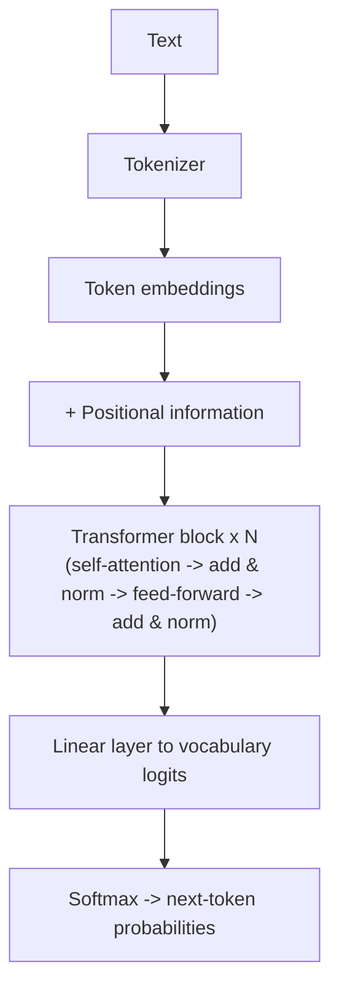

# Transformer Architecture
> **Level:** Beginner · **Reading time:** 7 min · **Phase:** 3 · LLM Concepts

**In one line:** A transformer is a neural network that reads a whole sequence of tokens at once and lets every token look at every other token (attention) to decide what it means.

## Explain it like I'm new
Imagine a group of people reading the sentence "The bank by the river flooded." Each person holds one word. Before deciding what their word means, each person looks around at everyone else's word. The person holding "bank" sees "river" and "flooded" and decides "this is a riverbank, not a money bank." That looking-around step is **attention**, and it is the heart of a transformer.

A **token** is a piece of text the model works with, often a word or part of a word. An **embedding** is a list of numbers (a vector) that stands for a token. The transformer turns each token's embedding into a better, context-aware embedding, layer after layer.

Before transformers (2017), most language models were **recurrent neural networks (RNNs)**. They read one word at a time, left to right, like reading through a straw. That was slow to train and they forgot early words in long text. The paper *Attention Is All You Need* removed the recurrence and kept only attention plus simple feed-forward layers. Because every position is processed at the same time, training runs well on GPUs. Every major LLM today (GPT, Claude, Llama, Gemini) is built on this design.

## How it works
1. **Tokenize.** Split text into tokens and map each to an ID.
2. **Embed.** Look up a vector for each token ID.
3. **Add position.** Add positional information so the model knows word order (see [Positional Encoding](04-positional-encoding.md)).
4. **Repeat N transformer blocks.** Each block has:
   - **Multi-head self-attention:** every token gathers information from other tokens.
   - **Feed-forward network (FFN):** a small two-layer network applied to each token on its own.
   - **Residual connections** (add the input back to the output) and **layer normalization** (rescale numbers to a stable range) around both parts. These keep training stable in deep stacks.
5. **Output head.** Turn the final vector of each position into a score (a **logit**) for every token in the vocabulary.
6. **Softmax.** Turn logits into probabilities. Pick the next token (see [Temperature](09-temperature.md)).



The original paper had two stacks: an **encoder** (reads the input) and a **decoder** (writes the output). Modern chat LLMs mostly keep only the decoder ([Decoder-Only Models](05-decoder-only-models.md)); translation-style models keep both ([Encoder-Decoder Models](06-encoder-decoder-models.md)).

**Size intuition.** In the base model of the original paper: 6 encoder layers, 6 decoder layers, model width `d_model = 512`, 8 attention heads, and FFN width 2048.

## Code example
A toy transformer block using the stdlib attention code from this phase. There are no learned weights, so it shows the data flow, not real language skill.

```python
# run from 03-llm-concepts/code
from llm_attention import multi_head_attention, sinusoidal_positional_encoding, add

tokens = ["The", "cat", "sat"]
emb = [[1.0, 0.0, 1.0, 0.0], [0.0, 1.0, 0.0, 1.0], [1.0, 1.0, 0.0, 0.0]]  # pretend embeddings

x = add(emb, sinusoidal_positional_encoding(len(tokens), 4))   # step 3: add position
attn, _ = multi_head_attention(x, num_heads=2, causal=True)    # step 4a: attention
x = add(x, attn)                                               # residual connection
ffn = [[max(0.0, v) for v in row] for row in x]                # stand-in for the feed-forward net (ReLU)
x = add(x, ffn)                                                # residual connection
print([[round(v, 2) for v in row] for row in x])
```

**In real projects** you load a trained transformer instead of building one:

```python
# pip install transformers torch
from transformers import AutoModelForCausalLM, AutoTokenizer

tok = AutoTokenizer.from_pretrained("gpt2")
model = AutoModelForCausalLM.from_pretrained("gpt2")
print(model.config.n_layer, model.config.n_head, model.config.n_embd)  # 12 12 768
```

## When to use it / when not to
- **Use** transformers for almost any text, code, or multi-modal task where pretrained models exist.
- **Don't** train one from scratch for a small business task. Use a pretrained model with prompting, RAG, or fine-tuning.
- Attention cost grows with the **square** of sequence length, so very long inputs get expensive.

| | RNN | Transformer |
|---|---|---|
| Reads tokens | one at a time | all at once |
| Training speed on GPU | slow | fast (parallel) |
| Long-range links | weak | strong (direct attention) |
| Cost vs length | linear | quadratic in attention |

## Common mistakes
- Thinking the transformer "understands" like a person. It learns statistical patterns that predict tokens.
- Forgetting positional information. Attention alone ignores word order.
- Confusing parameters (learned weights) with the context window (how many tokens it reads).
- Assuming all LLMs use the full encoder-decoder design. Most chat models are decoder-only.

## Interview questions
**1. What problem did the transformer solve compared with RNNs?**
<details><summary>Answer</summary>
RNNs process tokens one after another, which blocks parallel training and makes long-range dependencies hard to learn. Transformers use self-attention so every token links directly to every other token and all positions are processed in parallel.
</details>

**2. What are the two sub-layers in a transformer block, and what wraps them?**
<details><summary>Answer</summary>
Multi-head self-attention and a position-wise feed-forward network. Each is wrapped by a residual connection and layer normalization.
</details>

**3. Why does a transformer need positional encoding?**
<details><summary>Answer</summary>
Self-attention treats its input as a set: shuffling the tokens shuffles the output in the same way. Position signals (sinusoidal, learned, or rotary) tell the model the order.
</details>

## Go deeper
- [Attention Is All You Need (Vaswani et al., 2017)](https://arxiv.org/abs/1706.03762)
- [Hugging Face Transformers documentation](https://huggingface.co/docs/transformers/index)

**Prev:** [Phase 3 overview](../README.md) · **Next:** [Self Attention](02-self-attention.md) · **Back to phase:** [Phase 3](../README.md)
