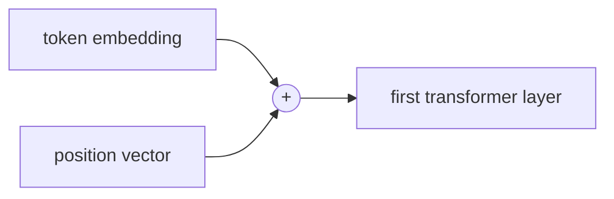

# Positional Encoding
> **Level:** Intermediate · **Reading time:** 6 min · **Phase:** 3 · LLM Concepts

**In one line:** Positional encoding adds information about each token's position, so the model can tell "dog bites man" from "man bites dog".

## Explain it like I'm new
Imagine cutting a sentence into word cards and throwing them in a bag. You have all the words, but not the order. Self-attention sees its input like that bag: it compares every token with every other token, and nothing in the math says which came first.

To fix this, we stamp each card with its seat number before it goes into the bag. In a transformer the "stamp" is a vector of numbers added to (or applied to) the token's embedding. Now "dog at position 0" looks different from "dog at position 2".

There are three common ways to stamp:
- **Sinusoidal** (original transformer): a fixed pattern of sine and cosine waves.
- **Learned absolute**: a trainable vector per position (used in GPT-2 and BERT).
- **Rotary (RoPE)**: rotates the Q and K vectors by an angle that depends on position. Used in many current open LLMs such as Llama.

## How it works
**Sinusoidal formula** for position `pos` and dimension index `i`:

```text
PE[pos, 2i]   = sin( pos / 10000^(2i / d_model) )
PE[pos, 2i+1] = cos( pos / 10000^(2i / d_model) )
```

1. Each pair of dimensions is a wave with a different speed. Early dimensions change quickly between positions; later ones change slowly.
2. Together they give each position a unique "fingerprint", like the hands of a clock (seconds, minutes, hours).
3. The vector is **added** to the token embedding before the first layer.
4. Because `sin(a+b)` can be written using `sin(a)` and `cos(a)`, the offset between two positions is a simple linear function. This helps the model learn relative distance.

**Worked example** with `d_model = 4`:

```text
pos 0: [sin(0),  cos(0),  sin(0/100),  cos(0/100)] = [0.000, 1.000, 0.000, 1.000]
pos 1: [sin(1),  cos(1),  sin(1/100),  cos(1/100)] = [0.841, 0.540, 0.010, 1.000]
pos 2: [sin(2),  cos(2),  sin(2/100),  cos(2/100)] = [0.909, -0.416, 0.020, 1.000]
```
(`10000^(2/4) = 100`, which is why dimensions 2 and 3 move slowly.)



**RoPE** in one sentence: instead of adding a vector, it rotates each 2-D pair of Q and K features by `pos × θ_i`, so the dot product `q·k` depends on the **distance** between positions.

## Code example
From [`llm_attention.py`](../code/llm_attention.py):

```python
import math

def sinusoidal_positional_encoding(seq_len, d_model):
    pe = []
    for pos in range(seq_len):
        row = []
        for j in range(d_model):
            angle = pos / (10000 ** (2 * (j // 2) / d_model))
            row.append(math.sin(angle) if j % 2 == 0 else math.cos(angle))
        pe.append(row)
    return pe

for row in sinusoidal_positional_encoding(3, 4):
    print([round(v, 3) for v in row])
# [0.0, 1.0, 0.0, 1.0]
# [0.841, 0.54, 0.01, 1.0]
# [0.909, -0.416, 0.02, 1.0]
```

## When to use it / when not to
You rarely pick this yourself; it comes with the model. It matters when you read model cards or try to extend context length.

| Method | Learned? | Handles longer text than training? | Seen in |
|---|---|---|---|
| Sinusoidal | No | In theory, quality often drops | Original transformer |
| Learned absolute | Yes | No, fixed max positions | GPT-2, BERT |
| RoPE | No (fixed rotation) | Can be stretched with scaling tricks | Llama and many open LLMs |
| ALiBi | No (distance penalty on scores) | Designed to extrapolate | Some open models |

## Common mistakes
- Thinking attention knows order by default. It does not.
- Assuming a model will work well past the context length it was trained on. Position handling is a main reason it often doesn't.
- Mixing up "position in the sentence" with "position in the vector". The formula uses both.
- Adding positional encoding twice (once in your code, once inside the library model).

## Interview questions
**1. Why is positional information needed in a transformer?**
<details><summary>Answer</summary>
Self-attention is permutation-equivariant: reordering the input tokens just reorders the outputs. Without position signals the model cannot distinguish different word orders.
</details>

**2. What is the advantage of sinusoidal over learned absolute positions?**
<details><summary>Answer</summary>
It has no parameters, works for any position number, and relative offsets are a linear function of the encodings. Learned positions are limited to the maximum length seen in training.
</details>

**3. How does RoPE encode position?**
<details><summary>Answer</summary>
It rotates pairs of features in the query and key vectors by an angle proportional to the token position. The dot product between a rotated query and key then depends on their relative distance.
</details>

## Go deeper
- [Attention Is All You Need (Vaswani et al., 2017)](https://arxiv.org/abs/1706.03762), section 3.5
- [RoFormer: Enhanced Transformer with Rotary Position Embedding (Su et al., 2021)](https://arxiv.org/abs/2104.09864)
- [Train Short, Test Long: ALiBi (Press et al., 2021)](https://arxiv.org/abs/2108.12409)

**Prev:** [Multi Head Attention](03-multi-head-attention.md) · **Next:** [Decoder Only Models](05-decoder-only-models.md) · **Back to phase:** [Phase 3](../README.md)
