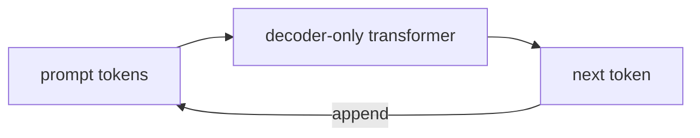

# Decoder Only Models
> **Level:** Intermediate · **Reading time:** 6 min · **Phase:** 3 · LLM Concepts

**In one line:** A decoder-only model is a transformer that reads text left to right and is trained to predict the next token; this is the design behind GPT, Claude, Llama, and most chat LLMs.

## Explain it like I'm new
Think of the autocomplete on your phone, scaled up massively. You type "See you", it suggests "tomorrow". A decoder-only model does the same thing, one token at a time, and then feeds its own guess back in to guess the next one. Doing this over and over produces whole paragraphs, code, or answers.

"Decoder-only" means the model keeps only the **decoder** half of the original transformer. It has no separate encoder. Your prompt and the model's answer live in one single sequence. The model is **autoregressive**: each new token depends on all the tokens before it.

The key rule is the **causal mask**: when computing position 5, the model may look at positions 0-5 but never 6 and beyond. This matches how text is generated (the future doesn't exist yet) and lets training learn from every position in a document at once.

## How it works
**Training (pretraining):**
1. Take a huge amount of text, cut it into token sequences.
2. For every position, the target is the **next** token. "The cat sat" trains: "The" → "cat", "The cat" → "sat".
3. The causal mask stops each position from peeking at its answer.
4. The loss is cross-entropy: how surprised the model was by the real next token. One forward pass trains all positions in parallel.

**Inference (generation):**
1. Tokenize the prompt.
2. Run the model and get probabilities for the next token.
3. Pick one with a decoding strategy ([Temperature](09-temperature.md), [Top-k](10-top-k.md), [Top-p](11-top-p.md)).
4. Append it to the sequence and repeat until a stop token or a length limit.

```text
Causal mask for 4 tokens (1 = may attend, 0 = blocked)
            The  cat  sat  on
   The   [   1    0    0    0 ]
   cat   [   1    1    0    0 ]
   sat   [   1    1    1    0 ]
   on    [   1    1    1    1 ]
```



**From base model to chat model.** A pretrained "base" model only continues text. To follow instructions, it is further trained with **instruction tuning** (supervised examples) and preference methods such as **RLHF** (reinforcement learning from human feedback).

## Code example
A causal mask and a generation loop, both stdlib. Uses [`llm_attention.py`](../code/llm_attention.py) and [`llm_decoding.py`](../code/llm_decoding.py).

```python
from llm_attention import causal_mask, scaled_dot_product_attention
from llm_decoding import greedy

X = [[1.0, 0.0], [0.0, 1.0], [1.0, 1.0]]
_, w = scaled_dot_product_attention(X, X, X, causal_mask(3))
print([[round(v, 2) for v in row] for row in w])
# first row is [1.0, 0.0, 0.0]: token 0 can only see itself

print(greedy())  # ['the', 'cat', 'sat', '<end>']  autoregressive: one token at a time
```

**In real projects** (Hugging Face Transformers):

```python
from transformers import AutoModelForCausalLM, AutoTokenizer

tok = AutoTokenizer.from_pretrained("gpt2")
model = AutoModelForCausalLM.from_pretrained("gpt2")
ids = tok("The capital of France is", return_tensors="pt")
out = model.generate(**ids, max_new_tokens=5, do_sample=False)
print(tok.decode(out[0]))
```

## When to use it / when not to
- **Use** for open-ended generation: chat, writing, code, agents, summarization, extraction with prompts.
- Decoder-only models are general. With prompting they handle tasks that once needed special models.
- **Consider** an encoder model (like BERT) for cheap classification or embeddings at large scale.

| Family | Sees | Trained to | Good at |
|---|---|---|---|
| Decoder-only (GPT, Llama, Claude) | left context only | predict next token | generation, chat |
| Encoder-only (BERT) | both sides | fill masked tokens | classification, embeddings |
| Encoder-decoder (T5, BART) | input fully, output left-to-right | map input to output | translation, summarization |

## Common mistakes
- Thinking the model plans the whole answer first. It commits one token at a time (though its internal states can carry information about what comes later).
- Forgetting that the prompt and the answer share the same [context window](08-context-window.md).
- Calling a base model and expecting chat behaviour. Use the instruction-tuned version and its chat template.
- Assuming output is deterministic. With sampling, it varies unless you use greedy decoding (and even then, hardware can add tiny differences).

## Interview questions
**1. What is the causal mask and why is it needed?**
<details><summary>Answer</summary>
It blocks each position from attending to later positions. During training this stops the model from seeing the token it must predict, and it matches left-to-right generation at inference.
</details>

**2. Why can training be parallel while generation is sequential?**
<details><summary>Answer</summary>
In training the whole target text is known, so all positions are predicted in one pass with the mask. In generation each new token depends on the previous one, which is not known until it is sampled.
</details>

**3. What is the difference between a base model and a chat model?**
<details><summary>Answer</summary>
A base model is only pretrained to continue text. A chat model is further tuned on instructions and preference data so it follows requests, uses a conversation format, and refuses unsafe requests.
</details>

## Go deeper
- [Language Models are Few-Shot Learners (GPT-3, Brown et al., 2020)](https://arxiv.org/abs/2005.14165)
- [Training language models to follow instructions with human feedback (Ouyang et al., 2022)](https://arxiv.org/abs/2203.02155)

**Prev:** [Positional Encoding](04-positional-encoding.md) · **Next:** [Encoder Decoder Models](06-encoder-decoder-models.md) · **Back to phase:** [Phase 3](../README.md)
