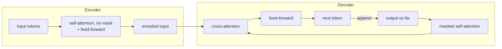

# Encoder Decoder Models
> **Level:** Intermediate · **Reading time:** 6 min · **Phase:** 3 · LLM Concepts

**In one line:** An encoder-decoder model first reads the whole input with an encoder, then writes the output with a decoder that looks back at the encoded input through cross-attention.

## Explain it like I'm new
Think of a human interpreter at a meeting. First they listen to the full sentence in French (the **encoder** step: understand everything, in both directions). Then they speak the sentence in English word by word (the **decoder** step), glancing back at their notes of the French sentence as they go. Those glances are **cross-attention**.

This was the original transformer design from *Attention Is All You Need*, built for machine translation. Popular examples are **T5** (which frames every task as "text in, text out") and **BART**. Speech recognition models such as **Whisper** also use this shape: audio in, text out.

The big difference from [decoder-only models](05-decoder-only-models.md): the input gets **bidirectional** attention (every input token sees every other input token), and the input and output are separate sequences.

## How it works
1. **Encoder.** The input tokens go through N layers of self-attention **without** a causal mask, plus feed-forward layers. Output: one context-rich vector per input token.
2. **Decoder.** Generates the output one token at a time. Each decoder layer has three parts:
   - **Masked self-attention** over output tokens produced so far (causal).
   - **Cross-attention:** queries from the decoder, keys and values from the encoder output.
   - **Feed-forward** network.
3. The decoder's final vector is turned into next-token probabilities, a token is chosen, and the loop repeats.
4. The encoder runs **once** per input; only the decoder loops.



**Training** is like the decoder-only case but the loss is only on the output tokens: given input X, predict output Y token by token. This is also called **sequence-to-sequence (seq2seq)** learning.

## Code example
Cross-attention is the same attention function with Q from one sequence and K, V from another. Uses [`llm_attention.py`](../code/llm_attention.py).

```python
from llm_attention import scaled_dot_product_attention

encoder_out = [[1.0, 0.0], [0.0, 1.0], [0.5, 0.5]]   # 3 input tokens, already encoded
decoder_state = [[0.9, 0.1]]                          # 1 output token so far

context, weights = scaled_dot_product_attention(
    q=decoder_state, k=encoder_out, v=encoder_out
)
print([round(w, 2) for w in weights[0]])  # which input tokens the decoder "looks at"
print(context)                            # blended information passed to the next layer
```

**In real projects** (Hugging Face Transformers, T5):

```python
from transformers import AutoTokenizer, AutoModelForSeq2SeqLM

tok = AutoTokenizer.from_pretrained("t5-small")
model = AutoModelForSeq2SeqLM.from_pretrained("t5-small")
ids = tok("translate English to German: The house is small.", return_tensors="pt")
print(tok.decode(model.generate(**ids, max_new_tokens=20)[0], skip_special_tokens=True))
```

## When to use it / when not to
- **Good for** tasks with a clear input → output mapping: translation, summarization, speech-to-text, structured rewriting.
- Encoding the input once can be efficient when the input is long and the output is short.
- **Less common** for general chat. Large decoder-only models handle these tasks well with prompting, and the ecosystem (tools, serving, fine-tuning recipes) centres on them.

| | Encoder-decoder | Decoder-only |
|---|---|---|
| Input attention | bidirectional | causal |
| Input/output | separate sequences | one shared sequence |
| Extra layer | cross-attention | none |
| Typical examples | T5, BART, Whisper | GPT, Llama, Claude |

## Common mistakes
- Saying cross-attention and self-attention are different math. The math is the same; only the source of Q vs K/V differs.
- Thinking the encoder re-runs every output step. It runs once; its output is reused.
- Calling BERT an encoder-decoder. BERT is encoder-only.
- Assuming encoder-decoder is "outdated". It is still a strong choice for seq2seq tasks such as speech recognition.

## Interview questions
**1. What does cross-attention do?**
<details><summary>Answer</summary>
It lets each decoder position query the encoder's outputs. Queries come from the decoder; keys and values come from the encoder. This is how the output stays tied to the input.
</details>

**2. Which parts use a causal mask in an encoder-decoder model?**
<details><summary>Answer</summary>
Only the decoder's self-attention. The encoder's self-attention and the cross-attention are not causally masked (padding masks may still apply).
</details>

**3. Why have decoder-only models become more common for general LLMs?**
<details><summary>Answer</summary>
They are simpler (one stack, one sequence), scale well with next-token prediction on raw text, and can handle input→output tasks by putting the input in the prompt. The tooling around them is also more mature.
</details>

## Go deeper
- [Attention Is All You Need (Vaswani et al., 2017)](https://arxiv.org/abs/1706.03762)
- [Exploring the Limits of Transfer Learning with a Unified Text-to-Text Transformer (T5, Raffel et al., 2019)](https://arxiv.org/abs/1910.10683)

**Prev:** [Decoder Only Models](05-decoder-only-models.md) · **Next:** [KV Cache](07-kv-cache.md) · **Back to phase:** [Phase 3](../README.md)
