# Context Window
> **Level:** Beginner · **Reading time:** 7 min · **Phase:** 3 · LLM Concepts

**In one line:** The context window is the maximum number of tokens a model can handle in one request, counting your input and its output together.

**Before you start:** [KV Cache](07-kv-cache.md) (optional, only for step 4 of "How it works").

**Words to know:**
- **Token:** a small chunk of text (a word, part of a word, or punctuation) that the model reads and writes.
- **Prompt:** everything you send to the model in one request.
- **Context window:** the most tokens (prompt plus answer) the model can handle in one request.
- **`max_tokens`:** a setting that caps how long the model's answer may be. That space is reserved up front.
- **Truncate:** cut text off, for example by dropping the oldest messages.

## Explain it like I'm new
Think of a whiteboard. Everything the model can "see" right now must fit on it: the system instructions, the chat history, any documents you pasted, and the answer it is writing. When the board is full, something has to be erased.

The model has no memory between requests. Each API call starts with a blank board. Chat apps give the illusion of memory by re-sending the conversation every time. That is why long chats cost more and eventually hit the limit.

Sizes are measured in **tokens**, not words. In English a token is often about three-quarters of a word, but it varies by language and tokenizer. Code, numbers, and non-English text often use more tokens per word.

<!-- anim:08-context-window -->
## Watch it


*It plays on a loop. Read the caption in the box, one step at a time. Want to go at your own pace? [Step through it with Previous and Next](https://techsaurabh-394.github.io/ai-engineer-roadmap/#08-context-window).*

## How it works
1. Your request is turned into tokens: `system prompt + messages + tool definitions + documents`.
2. The model also reserves room for output, often set by a `max_tokens` parameter.
3. If `input_tokens + max_output_tokens` exceeds the window, the API returns an error or the app must cut something.
4. Attention is the step where every token looks at every other token. Its cost grows with the square of the length (`n²`). The [KV cache](07-kv-cache.md) (stored per-token data the model reuses) grows in step with the length. So longer contexts are slower and more expensive.

```text
|<------------------- context window (e.g. 200k tokens) ------------------->|
| system prompt | tool specs | retrieved docs | chat history | new question | answer |
                                                                            ^ max_tokens reserved
```

### Worked example
Window = 8,000 tokens. System prompt 500, tools 700, history 3,000, question 300, reserve 1,000 for the answer.

1. Add up what is already used: 500 + 700 + 3,000 + 300 + 1,000 = 5,500.
2. Subtract from the window: 8,000 - 5,500 = 2,500 tokens left for retrieved documents.
3. Now the user pastes a 3,000-token document. 3,000 is more than 2,500, so it is 500 tokens over.
4. Something must give. Options: summarize the history (say it shrinks from 3,000 to 1,000, freeing 2,000, so the document now fits with 1,500 to spare), or cut the document.

**Bigger is not always better.** Studies such as *Lost in the Middle* found that models often use information at the start and end of a long context better than information buried in the middle. Long windows also add cost and latency.

**Ways to manage a full window:**
- **Truncate:** drop the oldest messages.
- **Summarize:** replace old turns with a short summary.
- **Retrieve:** store everything outside the model and pull back only relevant pieces ([RAG](../../01-rag-foundations/README.md)).
- **Agent memory:** short-term buffer plus long-term store ([Phase 4 memory](../../04-agentic-ai/topics/07-memory.md)).

## Code example
A simple token budget with a rough estimate (real code should use the provider's tokenizer or token-counting endpoint).

```python
def rough_tokens(text):
    return max(1, len(text) // 4)      # rule of thumb only, ~4 characters per token in English

def fit_history(system, history, question, window=8000, reserve=1000):
    budget = window - reserve - rough_tokens(system) - rough_tokens(question)
    kept = []
    for msg in reversed(history):       # keep the newest messages first
        cost = rough_tokens(msg)
        if cost > budget:
            break
        kept.insert(0, msg)
        budget -= cost
    return kept

history = [f"message {i} " * 200 for i in range(20)]
print(len(fit_history("You are helpful.", history, "What did we decide?")))  # how many old turns still fit
```

**In real projects** count tokens with the actual tokenizer, for example OpenAI's `tiktoken` package or the Anthropic API's token-counting endpoint, because the 4-characters rule can be far off.

## When to use it / when not to
- **Long context** is good for one-off analysis of a long document when you need the whole thing.
- **RAG** is usually better for large or changing knowledge bases: cheaper, faster, easier to cite.
- **Put key instructions** at the start (system prompt) and the question at the end.

| Approach | Cost per request | Freshness | Good for |
|---|---|---|---|
| Stuff everything in context | high | per request | one long document |
| RAG | low | update the index | big knowledge bases |
| Summarize history | low | lossy | long chats |

## Common mistakes
- Forgetting that output tokens count toward the limit.
- Counting words instead of tokens.
- Assuming the model "remembers" earlier sessions. It only sees what you send.
- Dumping huge documents in "because it fits" and getting worse, slower answers.
- Silently truncating the system prompt when trimming history.

## Recap
If you remember only three things:
- The context window is the token limit for input and output together, measured in tokens, not words.
- The model has no memory between requests; you must re-send anything it needs to see.
- When the window is full, truncate, summarize, or retrieve, and remember that bigger is not always better.

## Interview questions
**1. Does the context window include the output?**
<details><summary>Answer</summary>
Yes. Input tokens plus generated tokens must fit inside the window. APIs usually also cap output separately with max_tokens.
</details>

**2. Why can a longer prompt give worse answers?**
<details><summary>Answer</summary>
Relevant facts can be diluted by noise, models tend to use the middle of long contexts less reliably, and contradictory or outdated text may be included. Cost and latency also rise.
</details>

**3. How would you handle a chat that exceeds the window?**
<details><summary>Answer</summary>
Keep the system prompt, keep recent turns, summarize or drop older ones, and move durable facts into long-term memory or a retrieval store that you query when needed.
</details>

## Go deeper
- [Lost in the Middle: How Language Models Use Long Contexts (Liu et al., 2023)](https://arxiv.org/abs/2307.03172)
- [Anthropic docs: context windows](https://docs.anthropic.com/en/docs/build-with-claude/context-windows)

**Prev:** [KV Cache](07-kv-cache.md) · **Next:** [Temperature](09-temperature.md) · **Back to phase:** [Phase 3](../README.md)
