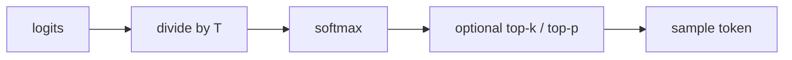

# Temperature
> **Level:** Beginner · **Reading time:** 6 min · **Phase:** 3 · LLM Concepts

**In one line:** Temperature is a number that controls how random the model's word choice is: low values make it pick the most likely token, high values spread the choice out.

## Explain it like I'm new
Imagine choosing dinner. On a cautious day (low temperature) you always order your favourite. On an adventurous day (high temperature) you might try the third or fourth item on the menu. The menu has not changed; only your willingness to take a chance has.

At each step, an LLM outputs a raw score called a **logit** for every possible next token. The **softmax** function turns these scores into probabilities that add up to 1. Temperature changes the scores **before** softmax:
- **Low temperature (for example 0.2):** big gaps between scores get bigger. The top token wins almost every time.
- **Temperature 1.0:** the model's original probabilities.
- **High temperature (for example 1.5-2.0):** gaps shrink. Unlikely tokens get picked more often.

Temperature does not make the model smarter or more knowledgeable. It only changes how it picks among options it already scored.

## How it works
```text
p_i = exp(logit_i / T) / sum_j exp(logit_j / T)
```

1. Get logits from the model.
2. Divide every logit by the temperature `T`.
3. Apply softmax.
4. Sample a token from the resulting probabilities (often after [Top-k](10-top-k.md) or [Top-p](11-top-p.md) filtering).

**Worked example.** After "The capital of France is", logits are `Paris 5.0, London 3.2, Rome 2.9, banana 0.5, the 1.0` (from [`sampling_demo.py`](../code/sampling_demo.py)):

| T | Paris | London | Rome | banana | the |
|---|---|---|---|---|---|
| 0.2 | 1.00 | 0.00 | 0.00 | 0.00 | 0.00 |
| 0.5 | 0.96 | 0.03 | 0.01 | 0.00 | 0.00 |
| 1.0 | 0.76 | 0.13 | 0.09 | 0.01 | 0.01 |
| 2.0 | 0.50 | 0.20 | 0.18 | 0.05 | 0.07 |

As `T → 0`, sampling becomes **greedy** (always the top token). Many APIs treat `temperature=0` as "as deterministic as possible", but tiny run-to-run differences can still happen because of how servers batch and compute.



## Code example
From [`sampling_demo.py`](../code/sampling_demo.py) (run `python 03-llm-concepts/code/sampling_demo.py`):

```python
import math

TOKENS = ["Paris", "London", "Rome", "banana", "the"]
LOGITS = [5.0, 3.2, 2.9, 0.5, 1.0]

def softmax(logits, temperature=1.0):
    if temperature <= 0:
        raise ValueError("temperature must be > 0")
    scaled = [x / temperature for x in logits]
    m = max(scaled)                       # subtract max for numerical stability
    exps = [math.exp(x - m) for x in scaled]
    return [e / sum(exps) for e in exps]

for t in (0.2, 1.0, 2.0):
    print(t, [round(p, 2) for p in softmax(LOGITS, t)])
```

**In real projects** temperature is a request parameter:

```python
import anthropic
client = anthropic.Anthropic()
msg = client.messages.create(
    model="claude-sonnet-4-5", max_tokens=200, temperature=0.2,
    messages=[{"role": "user", "content": "Extract the invoice total from: ..."}],
)
```

Check your provider's docs for the allowed range (for example Anthropic accepts 0-1, OpenAI 0-2).

## When to use it / when not to
| Task | Suggested temperature |
|---|---|
| Extraction, classification, code, SQL, tool arguments | low (0-0.3) |
| General Q&A, summaries | medium (around 0.3-0.7) |
| Brainstorming, creative writing, varied test data | higher (0.8-1.0+) |

- These are starting points, not rules. Test on your own data.
- Change **either** temperature **or** top-p first, not both at once, so you know what caused the effect.

## Common mistakes
- Thinking low temperature reduces [hallucination](13-hallucination.md). It makes output more consistent, but a consistently wrong answer is still wrong.
- Using high temperature for JSON or tool calls and getting broken output.
- Expecting `temperature=0` to give byte-identical outputs forever.
- Comparing temperatures across providers as if the scales were identical.

## Interview questions
**1. What does temperature do mathematically?**
<details><summary>Answer</summary>
It divides the logits by T before softmax. T below 1 sharpens the distribution toward the top token; T above 1 flattens it.
</details>

**2. What happens as temperature approaches 0?**
<details><summary>Answer</summary>
The probability of the highest-scoring token approaches 1, so sampling becomes greedy decoding.
</details>

**3. Which temperature would you use for an agent's tool calls and why?**
<details><summary>Answer</summary>
Low, often 0 or close to it. Tool arguments must be exact and valid; randomness only adds errors.
</details>

## Go deeper
- [The Curious Case of Neural Text Degeneration (Holtzman et al., 2019)](https://arxiv.org/abs/1904.09751)
- [Anthropic Messages API reference](https://docs.anthropic.com/en/api/messages)

**Prev:** [Context Window](08-context-window.md) · **Next:** [Top-k](10-top-k.md) · **Back to phase:** [Phase 3](../README.md)
