# Top-k
> **Level:** Beginner · **Reading time:** 6 min · **Phase:** 3 · LLM Concepts

**In one line:** Top-k sampling keeps only the k most likely next tokens, throws the rest away, and samples from what is left.

**Before you start:** [Temperature](09-temperature.md) (it explains logits, softmax and sampling).

**Words to know:**
- **Vocabulary:** the full list of tokens the model can pick from, often tens of thousands.
- **Probability distribution:** one probability per token, all adding up to 1.
- **Long tail:** the many unlikely tokens at the bottom of the sorted list.
- **Renormalize:** rescale the kept probabilities so they add up to 1 again.
- **Greedy decoding:** always picking the single most likely token.

## Explain it like I'm new
Imagine a quiz show where you may pick any answer, but the host first crosses out everything except the top 3 most popular answers from the audience. You still choose at random, but only among sensible options. Silly answers can't sneak in.

An LLM's vocabulary often has tens of thousands of tokens. Even if each odd token has a tiny probability, together they can add up. Pure sampling then sometimes picks a strange token, and one strange token can derail the rest of the text. Top-k cuts off this "long tail".

- `k = 1` is the same as greedy decoding (always the top token).
- Large `k` (for example the whole vocabulary) is the same as plain sampling.

<!-- anim:top-k -->
## Watch it


*It plays on a loop. Read the caption in the box, one step at a time. Want to go at your own pace? [Step through it with Previous and Next](https://techsaurabh-394.github.io/ai-engineer-roadmap/#top-k).*

## How it works
1. Compute probabilities (after [temperature](09-temperature.md)).
2. Sort tokens by probability.
3. Keep the first `k`. Set all others to 0.
4. **Renormalize:** divide the kept probabilities by their sum so they add up to 1.
5. Sample.

**Worked example** with the toy table in [`llm_decoding.py`](../code/llm_decoding.py). After `<start>`: `the 0.5, a 0.4, my 0.1`.

```text
k = 2  ->  keep the 0.5, a 0.4   (sum 0.9)
           renormalize: the 0.5/0.9 = 0.556, a 0.4/0.9 = 0.444
           "my" can never be picked
```

```text
probabilities (sorted)     k = 2
the  ##########  0.50      the  ###########  0.56
a    ########    0.40  ->  a    #########    0.44
my   ##          0.10      my   (removed)
```

### Worked example (picking a token)
Same table: `the 0.5, a 0.4, my 0.1`, with `k = 2`.

1. Sort: the 0.5, a 0.4, my 0.1.
2. Keep the first 2: `the` and `a`. Drop `my`.
3. Their sum is 0.9, so divide each by 0.9: the 0.556, a 0.444.
4. Sample. Imagine a random number between 0 and 1 comes out as 0.30. Numbers below 0.556 pick `the`, the rest pick `a`. So 0.30 picks `the`.
5. If the draw were 0.80 it would pick `a`. `my` is never possible.

**The weakness.** `k` is fixed. When the model is very sure (one token at 0.97), `k = 50` still lets 49 poor tokens in. When the model is unsure (100 tokens all plausible), `k = 50` may cut good ones. [Top-p](11-top-p.md) adapts to this by using a probability threshold instead.

## Code example
From [`llm_decoding.py`](../code/llm_decoding.py):

```python
import random

def top_k_filter(probs, k):
    kept = sorted(probs.items(), key=lambda kv: kv[1], reverse=True)[:k]
    total = sum(p for _, p in kept)
    return {t: p / total for t, p in kept}

probs = {"the": 0.5, "a": 0.4, "my": 0.1}
filtered = top_k_filter(probs, 2)
print(filtered)  # {'the': 0.555..., 'a': 0.444...}

rng = random.Random(0)
print(rng.choices(list(filtered), weights=list(filtered.values()))[0])
```

Try the full generator: `sample(k=2)` in `llm_decoding.py`. The test `test_top_k_one_sampling_is_greedy` checks that `k = 1` matches greedy.

**In real projects** (Hugging Face Transformers):

```python
out = model.generate(**inputs, do_sample=True, top_k=50, max_new_tokens=50)
```

The Anthropic Messages API also accepts a `top_k` parameter; OpenAI's chat API exposes `temperature` and `top_p` but not `top_k`. Check your provider's reference.

## When to use it / when not to
- **Use** a moderate `k` to block junk tokens while keeping variety in creative text.
- **Prefer** top-p when you want the cut-off to adapt to model confidence.
- **Skip** sampling filters for exact tasks (extraction, code): use low temperature or greedy.

| Setting | Effect |
|---|---|
| k = 1 | greedy, no variety |
| small k (5-20) | safe, limited variety |
| large k (100+) | close to plain sampling |

## Common mistakes
- Forgetting to renormalize after filtering.
- Using one fixed `k` for every task.
- Combining very high temperature with large `k` and wondering why text goes off the rails.
- Assuming every API supports `top_k`.

## Recap
If you remember only three things:
- Top-k keeps the k most likely tokens, drops the rest, and renormalizes.
- `k = 1` is greedy decoding; a huge `k` is plain sampling.
- The count k is fixed, so it cannot adapt to how confident the model is; top-p can.

## Interview questions
**1. What does top-k sampling do?**
<details><summary>Answer</summary>
It restricts sampling to the k highest-probability tokens, renormalizes their probabilities, and samples among them.
</details>

**2. What is the main weakness of top-k?**
<details><summary>Answer</summary>
k is fixed regardless of how confident the model is. It can allow bad tokens when the distribution is peaked and cut good tokens when it is flat.
</details>

**3. What is top-k with k = 1?**
<details><summary>Answer</summary>
Greedy decoding: always pick the most likely token.
</details>

## Go deeper
- [Hierarchical Neural Story Generation (Fan et al., 2018)](https://arxiv.org/abs/1805.04833), popularized top-k sampling
- [The Curious Case of Neural Text Degeneration (Holtzman et al., 2019)](https://arxiv.org/abs/1904.09751)

**Prev:** [Temperature](09-temperature.md) · **Next:** [Top-p](11-top-p.md) · **Back to phase:** [Phase 3](../README.md)
