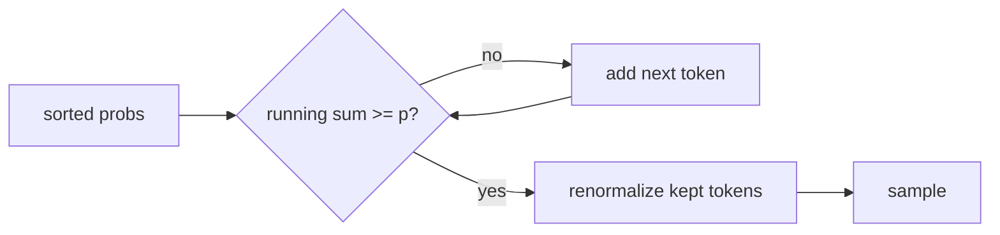

# Top-p
> **Level:** Intermediate · **Reading time:** 6 min · **Phase:** 3 · LLM Concepts

**In one line:** Top-p (nucleus) sampling keeps the smallest group of most-likely tokens whose probabilities add up to at least p, then samples only from that group.

## Explain it like I'm new
Imagine you're choosing a restaurant from reviews. Instead of saying "only look at the top 3" (that's [top-k](10-top-k.md)), you say "look at the most popular places until you've covered 90% of all visits". In a town with one famous place that gets 95% of visits, you only consider that one. In a city with many equally popular places, you consider many.

That is top-p. The group of kept tokens is called the **nucleus**. Its size **adapts**: small when the model is confident, large when it is unsure. The idea and name come from the paper *The Curious Case of Neural Text Degeneration*, which showed that both greedy/beam decoding (too repetitive) and pure sampling (too random) produce poor text, and proposed nucleus sampling as a middle path.

## How it works
1. Compute probabilities (after [temperature](09-temperature.md)).
2. Sort tokens from most to least likely.
3. Walk down the list, adding probabilities, until the running total reaches `p`.
4. Keep those tokens; drop the rest.
5. Renormalize and sample.

**Worked example** (toy table in [`llm_decoding.py`](../code/llm_decoding.py)), after `<start>`: `the 0.5, a 0.4, my 0.1`.

```text
p = 0.5  -> the (0.5)                 -> nucleus {the}
p = 0.9  -> the (0.5) + a (0.4) = 0.9 -> nucleus {the, a}
p = 1.0  -> all three                 -> nucleus {the, a, my}
```

**Adaptive size, side by side** with `p = 0.9`:

```text
confident step:  sat 0.95, ran 0.03, ...      -> nucleus = {sat}            (1 token)
unsure step:     8 tokens at ~0.12 each       -> nucleus = 8 tokens
top-k with k=3 would keep 3 in both cases.
```

With the [`sampling_demo.py`](../code/sampling_demo.py) logits at T = 1.0 (`Paris 0.76, London 0.13, Rome 0.09, ...`), `p = 0.9` keeps `Paris, London, Rome` and renormalizes them to about `0.78, 0.13, 0.10`.



## Code example
From [`llm_decoding.py`](../code/llm_decoding.py):

```python
def top_p_filter(probs, p):
    kept, mass = [], 0.0
    for t, pr in sorted(probs.items(), key=lambda kv: kv[1], reverse=True):
        kept.append((t, pr))
        mass += pr
        if mass >= p - 1e-12:      # small tolerance for floating-point sums
            break
    total = sum(pr for _, pr in kept)
    return {t: pr / total for t, pr in kept}

print(top_p_filter({"the": 0.5, "a": 0.4, "my": 0.1}, 0.9))  # {'the': 0.555..., 'a': 0.444...}
```

**In real projects** `top_p` is a common API parameter:

```python
from openai import OpenAI
client = OpenAI()
resp = client.chat.completions.create(
    model="gpt-4o-mini", top_p=0.9,
    messages=[{"role": "user", "content": "Suggest five names for a bakery."}],
)
```

OpenAI's docs recommend changing temperature **or** top_p, not both.

## When to use it / when not to
- **Use** for open-ended generation where you want variety without junk.
- Common values are around 0.9-0.95. Lower p is safer and less varied.
- **Skip** for exact outputs (JSON, code, extraction): use low temperature instead.

| | Top-k | Top-p |
|---|---|---|
| Cut-off by | count of tokens | cumulative probability |
| Adapts to confidence | no | yes |
| p or k to disable | k = vocab size | p = 1.0 |

## Common mistakes
- Setting `p` very low (like 0.1) and wondering why output is nearly greedy.
- Tuning `top_p` and temperature together and not knowing which change helped.
- Forgetting the floating-point tolerance: sums like 0.5 + 0.4 may come out as 0.8999999.
- Believing top-p prevents factual errors. It only limits unlikely tokens.

## Interview questions
**1. How does top-p differ from top-k?**
<details><summary>Answer</summary>
Top-k keeps a fixed number of tokens. Top-p keeps the smallest set whose total probability reaches p, so the number of tokens changes with the model's confidence.
</details>

**2. With probabilities [0.6, 0.25, 0.1, 0.05] and p = 0.8, which tokens are kept?**
<details><summary>Answer</summary>
The first two: 0.6 + 0.25 = 0.85 ≥ 0.8. Renormalized: about 0.71 and 0.29.
</details>

**3. Why did the nucleus sampling paper argue against beam search for open-ended text?**
<details><summary>Answer</summary>
Maximizing likelihood tends to produce bland, repetitive text, and human text is not always the most probable sequence. Sampling from the nucleus produced text closer to human statistics while avoiding the unreliable tail.
</details>

## Go deeper
- [The Curious Case of Neural Text Degeneration (Holtzman et al., 2019)](https://arxiv.org/abs/1904.09751)
- [OpenAI API reference: chat completions](https://platform.openai.com/docs/api-reference/chat)

**Prev:** [Top-k](10-top-k.md) · **Next:** [Beam Search](12-beam-search.md) · **Back to phase:** [Phase 3](../README.md)
