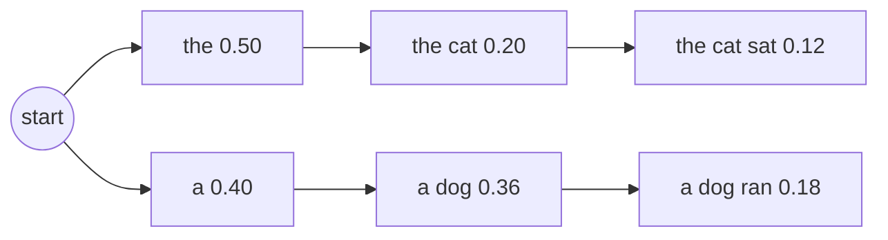

# Beam Search
> **Level:** Intermediate · **Reading time:** 7 min · **Phase:** 3 · LLM Concepts

**In one line:** Beam search keeps the few best partial sentences at each step instead of only the single best token, so it can find a more likely full sentence than greedy decoding.

## Explain it like I'm new
Imagine planning a road trip by always taking the road that looks fastest at each junction. That's **greedy**. Sometimes the fastest-looking first road leads to a traffic jam later. A smarter planner keeps the **3 best routes so far** at every junction, extends each one, and again keeps the best 3. That is **beam search**, and 3 is the **beam width**.

For language models, a "route" is a sequence of tokens and its "score" is how probable the whole sequence is. Because multiplying many small probabilities gives tiny numbers, we add **log-probabilities** instead (log turns multiplication into addition).

Beam search is deterministic: same input, same output. It is popular for tasks with one "right" answer, such as translation and speech recognition, and less common for chat.

## How it works
1. Start with one beam: the empty sequence, score 0.
2. For every beam, list every possible next token and its new score: `score + log P(token | sequence)`.
3. Collect all candidates and keep the top `B` (the beam width).
4. Move any candidate ending in an end token to a "finished" list.
5. Repeat until no beams are left or a length limit is hit.
6. Return the best finished sequence (often with a **length penalty** so short sentences aren't unfairly favoured).

**Worked example** with the toy table in [`llm_decoding.py`](../code/llm_decoding.py):

```text
<start> -> the 0.5 | a 0.4 | my 0.1
the -> cat 0.4 | dog 0.35 | big 0.25        a -> dog 0.9 | cat 0.1
cat -> sat 0.6 | ran 0.3 | <end> 0.1        dog -> ran 0.5 | sat 0.4 | <end> 0.1
```

**Greedy:** `the` (0.5) → `cat` (0.4) → `sat` (0.6) → `<end>`. Probability `0.5 × 0.4 × 0.6 = 0.12`.

**Beam, width 2:**

```text
step 1: keep  the (0.50), a (0.40)
step 2: candidates  the cat 0.20, the dog 0.175, the big 0.125, a dog 0.36, a cat 0.04
        keep  a dog (0.36), the cat (0.20)
step 3: candidates  a dog ran 0.18, a dog sat 0.144, the cat sat 0.12, ...
        keep  a dog ran (0.18), a dog sat (0.144)
result: "a dog ran"  probability 0.4 × 0.9 × 0.5 = 0.18  > greedy's 0.12
```

Greedy lost because "a" looked worse than "the" at step 1, but led to a much better continuation.



## Code example
From [`llm_decoding.py`](../code/llm_decoding.py):

```python
import math
from llm_decoding import next_probs, END, greedy, sequence_logprob

def beam_search(beam_width=2, start="<start>", max_len=10):
    beams, finished = [([start], 0.0)], []
    for _ in range(max_len):
        candidates = []
        for seq, lp in beams:
            for tok, pr in next_probs(seq[-1]).items():
                cand = (seq + [tok], lp + math.log(pr))
                (finished if tok == END else candidates).append(cand)
        if not candidates:
            break
        beams = sorted(candidates, key=lambda c: c[1], reverse=True)[:beam_width]
    finished.extend(beams)
    best = max(finished, key=lambda c: c[1])
    return best[0][1:], best[1]

seq, lp = beam_search(2)
print(seq, round(math.exp(lp), 3))                         # ['a', 'dog', 'ran', '<end>'] 0.18
print(greedy(), round(math.exp(sequence_logprob(greedy())), 3))  # ['the', 'cat', 'sat', '<end>'] 0.12
```

**In real projects** (Hugging Face Transformers):

```python
out = model.generate(**inputs, num_beams=4, do_sample=False, max_new_tokens=50, early_stopping=True)
```

## When to use it / when not to
- **Use** for tasks with a narrow correct output: translation, speech-to-text, short structured outputs.
- **Avoid** for open-ended chat or creative text. It tends to be repetitive and generic; [top-p](11-top-p.md) sampling usually reads better.
- Cost grows with beam width: `B` beams means about `B` times the compute per step.

| Strategy | Deterministic | Variety | Typical use |
|---|---|---|---|
| Greedy | yes | none | quick, exact tasks |
| Beam search | yes | low | translation, ASR |
| Top-k / top-p sampling | no | tunable | chat, creative writing |

## Common mistakes
- Multiplying raw probabilities and hitting floating-point underflow. Use log-probabilities.
- No length normalization, so the search prefers very short outputs.
- Very large beam widths. They can make output worse (more generic), not better.
- Expecting beam search to fix factual errors. It finds likely text, not true text.

## Interview questions
**1. How is beam search different from greedy decoding?**
<details><summary>Answer</summary>
Greedy keeps one sequence and picks the top token each step. Beam search keeps the B best partial sequences by total log-probability, which lets it recover from a choice that looked worse early but leads to a more probable whole sequence.
</details>

**2. Why use log-probabilities?**
<details><summary>Answer</summary>
Products of many probabilities underflow to zero. Logs turn products into sums, which are numerically stable, and ranking is unchanged because log is increasing.
</details>

**3. Why is beam search rarely used for chatbots?**
<details><summary>Answer</summary>
High-likelihood text tends to be bland and repetitive. Sampling methods such as top-p give more natural, varied responses. Beam search also costs more compute per token.
</details>

## Go deeper
- [Sequence to Sequence Learning with Neural Networks (Sutskever et al., 2014)](https://arxiv.org/abs/1409.3215)
- [The Curious Case of Neural Text Degeneration (Holtzman et al., 2019)](https://arxiv.org/abs/1904.09751)

**Prev:** [Top-p](11-top-p.md) · **Next:** [Hallucination](13-hallucination.md) · **Back to phase:** [Phase 3](../README.md)
