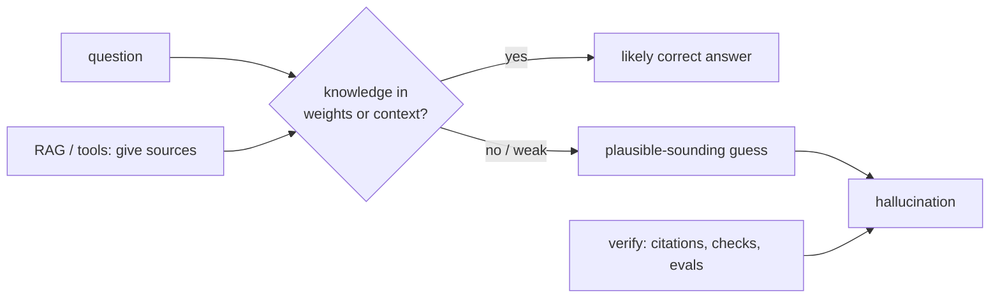

# Hallucination
> **Level:** Intermediate · **Reading time:** 7 min · **Phase:** 3 · LLM Concepts

**In one line:** A hallucination is when a model produces fluent, confident text that is false or not supported by its sources.

## Explain it like I'm new
Think of a student in an exam who doesn't know the answer but writes something that **sounds** right, in perfect grammar, because a blank answer gets zero marks. LLMs behave in a similar way. They are trained to produce the most plausible next token, not to check facts. When the true answer is missing from what they learned or from the prompt, a plausible-sounding guess comes out with the same confident tone as a correct answer.

Common forms:
- **Made-up facts:** wrong dates, numbers, or people.
- **Fake citations:** papers, URLs, or court cases that don't exist.
- **Unfaithful summaries:** the summary says something the source never said. This is often called an **unfaithful** or **ungrounded** output.
- **Invented tools or APIs:** code that calls functions that don't exist.

Researchers often split these into **factuality** errors (wrong about the world) and **faithfulness** errors (not supported by the given context).

## How it works
Why it happens, step by step:
1. **Training goal:** predict likely text. "Likely" and "true" usually overlap, but not always.
2. **Missing or rare knowledge:** facts seen rarely in training are stored weakly. The model fills the gap with a pattern that fits.
3. **No built-in lookup:** a plain LLM has no database to check against unless you give it one (RAG, tools).
4. **Decoding:** sampling can pick a less likely, wrong token; once written, the model continues consistently with it.
5. **Pressure to answer:** prompts and training that reward helpful-sounding answers can discourage "I don't know".



**How to reduce it (none removes it fully):**
1. **Ground** the model: give it the source text ([RAG](../../01-rag-foundations/README.md)) or tools (search, database, calculator).
2. **Instruct** it to answer only from the provided context and to say "I don't know" otherwise.
3. **Ask for citations** that point to specific passages, then check them in code.
4. **Constrain output** with schemas (JSON with required fields) so it can't ramble.
5. **Verify:** a second pass or a separate check compares claims to sources.
6. **Evaluate** on a test set of questions with known answers, and track the rate over time.

## Code example
A tiny groundedness check: flag answer sentences that share few words with the source. Real systems use stronger methods (NLI models or an LLM judge), but the idea is the same.

```python
import re

def words(text):
    return set(re.findall(r"[a-z0-9]+", text.lower()))

def unsupported_sentences(answer, source, min_overlap=0.5):
    src = words(source)
    flagged = []
    for sent in re.split(r"(?<=[.!?])\s+", answer.strip()):
        w = words(sent)
        if w and len(w & src) / len(w) < min_overlap:
            flagged.append(sent)
    return flagged

source = "The Eiffel Tower is in Paris. It was completed in 1889."
answer = "The Eiffel Tower is in Paris. It was designed by Leonardo da Vinci in 1450."
print(unsupported_sentences(answer, source))
# ['It was designed by Leonardo da Vinci in 1450.']
```

A prompt pattern that helps:

```text
Answer using ONLY the documents below. Quote the sentence you used in [brackets].
If the documents do not contain the answer, reply exactly: "I don't know based on the provided documents."
```

## When to use it / when not to
Every LLM product needs a plan for hallucination. How strict depends on risk.

| Risk level | Example | Controls |
|---|---|---|
| Low | brainstorming names | none needed, creativity is the goal |
| Medium | internal knowledge bot | RAG + citations + "I don't know" |
| High | medical, legal, finance | RAG + verification + human review + evals |

## Common mistakes
- Believing low [temperature](09-temperature.md) fixes it. It only makes the same answer more likely.
- Trusting citations without checking that they exist and say what is claimed.
- Adding RAG but retrieving the wrong documents. Bad retrieval leads to confident wrong answers.
- Measuring hallucination by "it looked fine in a demo" instead of a labelled test set.

## Interview questions
**1. Why do LLMs hallucinate?**
<details><summary>Answer</summary>
They are trained to generate plausible text, not to verify facts. When knowledge is missing or weak, the most plausible continuation can be false, and the model has no built-in way to check unless given sources or tools.
</details>

**2. What is the difference between a factuality and a faithfulness error?**
<details><summary>Answer</summary>
Factuality: the claim is wrong about the world. Faithfulness: the claim isn't supported by the provided context (for example a summary adding facts not in the document), even if it happens to be true.
</details>

**3. Name three practical ways to reduce hallucinations in a RAG app.**
<details><summary>Answer</summary>
Improve retrieval quality, instruct the model to answer only from context and abstain otherwise, require citations and verify them, and run an evaluation set that measures groundedness.
</details>

## Go deeper
- [Survey of Hallucination in Natural Language Generation (Ji et al., 2022)](https://arxiv.org/abs/2202.03629)
- [Anthropic docs: reduce hallucinations](https://docs.anthropic.com/en/docs/test-and-evaluate/strengthen-guardrails/reduce-hallucinations)

**Prev:** [Beam Search](12-beam-search.md) · **Next:** [Prompt Engineering](14-prompt-engineering.md) · **Back to phase:** [Phase 3](../README.md)
