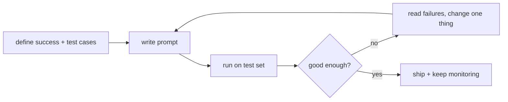

# Prompt Engineering
> **Level:** Beginner · **Reading time:** 8 min · **Phase:** 3 · LLM Concepts

**In one line:** Prompt engineering is writing and testing the instructions, examples, and context you give a model so it reliably produces the output you need.

## Explain it like I'm new
Think of briefing a smart new teammate who knows a lot but knows nothing about your company or this task. "Write something about our product" gets you something vague. "Write a 3-sentence product update for existing customers, friendly tone, mention the new export button, no pricing" gets you what you want.

A **prompt** is all the text the model sees. In chat APIs it is usually split into:
- **System prompt:** standing instructions (role, rules, format).
- **User messages:** the actual request and any data.
- **Assistant messages:** earlier model replies, or examples you write yourself.

Prompt engineering is less about magic words and more about clear writing plus **testing**: you change the prompt, run it on a set of examples, and check the results.

## How it works
A reliable process:
1. **Define success.** What does a good output look like? Write 10-30 test inputs with expected outputs or checks.
2. **Write a clear first prompt.** Include:
   - **Task:** what to do, in plain words.
   - **Context:** who the audience is, background, data.
   - **Constraints:** length, tone, what to avoid.
   - **Output format:** for example a JSON schema or headings.
3. **Add examples (few-shot).** Show 1-5 input → output pairs. Examples often teach format better than descriptions.
4. **Separate data from instructions.** Wrap documents in clear markers such as XML-style tags (`<document>...</document>`), so the model knows what is data.
5. **Ask for reasoning when the task needs it.** "Think step by step before answering" (**chain-of-thought**) can help with multi-step problems. Many current models also have a built-in reasoning or "extended thinking" mode.
6. **Run the test set, read failures, change one thing, repeat.**



**Common techniques:**

| Technique | What it is | Good for |
|---|---|---|
| Zero-shot | instructions only | simple tasks |
| Few-shot | add worked examples | format, style, edge cases |
| Chain-of-thought | ask for steps before the answer | math, logic, planning |
| Role / system prompt | set persona and rules | consistent behaviour |
| Structured output | JSON schema or tool schema | parsing in code |
| Prompt chaining | split work into several calls | long or complex tasks |

**Prompt injection.** If your prompt includes untrusted text (a web page, an email, a user upload), that text can contain instructions such as "ignore previous instructions". The model may follow them. No prompt wording fully prevents this. Treat untrusted text as data, limit what tools the model can use, and check actions in code ([Agent Guardrails](../../04-agentic-ai/topics/16-agent-guardrails.md)).

## Code example
A reusable prompt builder with few-shot examples and clear data markers, plus a tiny test loop.

```python
SYSTEM = (
    "You classify customer messages. Reply with exactly one label: "
    "billing, bug, feature_request, or other."
)
EXAMPLES = [
    ("I was charged twice this month.", "billing"),
    ("The app crashes when I upload a PDF.", "bug"),
]

def build_messages(text):
    msgs = []
    for inp, out in EXAMPLES:                       # few-shot as prior turns
        msgs.append({"role": "user", "content": f"<message>{inp}</message>"})
        msgs.append({"role": "assistant", "content": out})
    msgs.append({"role": "user", "content": f"<message>{text}</message>"})
    return msgs

def evaluate(model_fn, cases):
    hits = sum(model_fn(SYSTEM, build_messages(x)).strip() == y for x, y in cases)
    return hits / len(cases)

# offline stand-in for a model so the example runs without an API key
fake_model = lambda system, msgs: "bug" if "error" in msgs[-1]["content"] else "other"
print(evaluate(fake_model, [("Error 500 on login", "bug"), ("Love it!", "other")]))  # 1.0
```

**In real projects** pass `SYSTEM` and `build_messages(...)` to your provider:

```python
import anthropic
client = anthropic.Anthropic()
resp = client.messages.create(
    model="claude-sonnet-4-5", max_tokens=10, temperature=0,
    system=SYSTEM, messages=build_messages("Can you add dark mode?"),
)
print(resp.content[0].text)
```

## When to use it / when not to
- **Start here** for every LLM task. It is the cheapest lever.
- **Move to RAG** when the model lacks knowledge (your documents, recent facts).
- **Move to fine-tuning** when you need a consistent style or behaviour at scale and prompting plateaus.
- Don't keep adding rules forever. Long, contradictory prompts get worse; restructure or split into steps.

## Common mistakes
- No test set, so every change is judged by feel.
- Vague instructions ("make it better") instead of concrete ones ("under 50 words, no jargon").
- Mixing instructions and untrusted data without markers.
- Examples that are all the same, so the model copies them too closely.
- Believing a prompt can make the system safe against injection on its own.

## Interview questions
**1. What is few-shot prompting and when does it help?**
<details><summary>Answer</summary>
Including a few input-output examples in the prompt. It helps most when the format, style, or labelling rules are easier to show than to describe, and for tricky edge cases.
</details>

**2. How do you know a prompt change is an improvement?**
<details><summary>Answer</summary>
Run the old and new prompt on the same fixed test set and compare metrics (accuracy, format validity, judge scores), reading failures by hand. Change one thing at a time.
</details>

**3. What is prompt injection and how do you defend against it?**
<details><summary>Answer</summary>
Untrusted content containing instructions that the model follows. Defences: mark untrusted text as data, give the model the least tool access needed, validate tool calls in code, require human approval for risky actions, and filter outputs. No single prompt fully prevents it.
</details>

## Go deeper
- [Anthropic prompt engineering overview](https://docs.anthropic.com/en/docs/build-with-claude/prompt-engineering/overview)
- [Chain-of-Thought Prompting Elicits Reasoning in Large Language Models (Wei et al., 2022)](https://arxiv.org/abs/2201.11903)
- [Language Models are Few-Shot Learners (Brown et al., 2020)](https://arxiv.org/abs/2005.14165)

**Prev:** [Hallucination](13-hallucination.md) · **Next:** [Phase 4 · Agentic AI](../../04-agentic-ai/README.md) · **Back to phase:** [Phase 3](../README.md)
