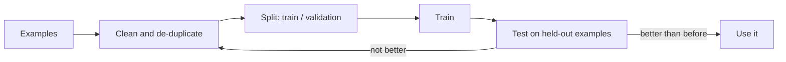

# Fine-Tuning (the overview)
> **Level:** Intermediate · **Reading time:** 8 min · **Phase:** 3 · LLM Concepts

**In one line:** Fine-tuning means training an existing model a little more on your own examples, so it picks up a style or a narrow skill, and it is usually the last thing to try after prompting and RAG.

## Explain it like I'm new
A new chef already knows how to cook. You can do three things to get the food you want:
- **Prompting:** give clear instructions each time ("less salt, plate it like this").
- **RAG:** hand the chef your family's recipe book to look things up.
- **Fine-tuning:** send the chef to train in your kitchen for a few weeks, until your style is habit.

Training takes time and money, and what the chef learned stays fixed. If the recipe changes next week, you need another round of training. A recipe book is easy to update. That is why fine-tuning is for **behaviour** (style, format, a narrow task), and RAG is for **facts**.

## How it works
1. **Collect examples:** pairs of "input" and "the answer you wanted". Quality matters more than quantity.
2. **Clean them:** remove empty answers, duplicates and wrong answers. This is where most projects go wrong.
3. **Split:** keep some examples aside (a **validation set**) that the model never trains on, so you can measure it.
4. **Train:** the provider or your own code adjusts the model on your examples.
5. **Test:** compare the new model with the original on the held-out examples. If it is not better, do not use it.
6. **Re-run:** when your needs or your base model change, repeat the cycle.



**Full fine-tuning vs LoRA.** Full fine-tuning changes all of the model's weights, which needs a lot of memory. **LoRA** (low-rank adaptation) freezes the original model and trains a small add-on, so it is far cheaper. **QLoRA** does the same on a compressed (quantized) base model so that it fits on a smaller GPU. Hosted providers hide these details behind an upload-and-train service.

**What about RLHF?** Reinforcement learning from human feedback is a different, later step used to make models follow instructions and be helpful: people rank answers and the model is trained to prefer the better ones. Providers do it for you. You will rarely do it yourself.

## Code example
Most fine-tuning failures are data problems, so this demo checks the data. It needs only the standard library. Run it: `python 03-llm-concepts/code/llm_finetune_data.py`

```python
from llm_finetune_data import clean, split, to_jsonl

data = [
    {"prompt": "Can I cancel?", "completion": "Yes, before it ships."},
    {"prompt": "Can I cancel?", "completion": "Yes, before it ships."},  # duplicate
    {"prompt": "Where is my parcel?", "completion": ""},                  # empty answer
    {"prompt": "Opening hours?", "completion": "Mon to Fri, 9 to 5."},
]
kept, problems = clean(data)
print(problems)          # -> [(1, 'duplicate'), (2, 'empty field')]
train, valid = split(kept)
print(len(train), len(valid))   # -> 1 1
```

The real output of the full demo with 8 rows is:

```text
kept 6 of 8 | problems: [(3, 'duplicate'), (4, 'empty field')]
train 5 | validation 1
```

The tests in [`test_llm_finetune_data.py`](../code/test_llm_finetune_data.py) check that nothing is lost in the split, that the same seed gives the same split, and that the input list is not changed.

**In real projects** the training itself is a provider service or a library, and the upload format and commands change, so check the current docs: the [OpenAI fine-tuning guide](https://platform.openai.com/docs/guides/fine-tuning) and the [Hugging Face PEFT docs](https://huggingface.co/docs/peft/index) (for LoRA). Read the provider's current list of models that can be fine-tuned before planning anything.

## When to use it / when not to
| Situation | Use fine-tuning? |
|---|---|
| The model gives the wrong format or tone, and clearer prompts did not fix it | Maybe. Try prompts and a few examples in the prompt first |
| The model lacks your facts, or facts change often | **No.** Use [RAG](../../01-rag-foundations/README.md) |
| You need citations to sources | **No.** Fine-tuning cannot cite where a fact came from |
| One narrow task at huge scale, where a small tuned model would be cheaper than a big one | Yes, if you have good examples and a test set |
| You have fewer than a few dozen clean examples | Not yet. Collect more |

A good order: **prompt, then add examples in the prompt, then RAG, then fine-tune.** Each step costs more than the one before.

## Common mistakes
- Fine-tuning to teach facts. The model may learn them badly, and it cannot update them without retraining.
- Training on messy data. Duplicates and empty answers teach the model the wrong thing.
- No validation set, so you cannot tell whether the new model is better.
- Training on private or customer data without checking the rules for it first.
- Forgetting that the base model changes. A tuned model may need to be redone when you move to a newer one.

## Interview questions
<details>
<summary><b>1. A client says "our chatbot doesn't know our latest prices, let's fine-tune it." What do you say?</b></summary>

Prices change often, and fine-tuning teaches fixed behaviour, not live facts. Use RAG so the bot looks up the current price list, and it can cite it. Fine-tuning might help later with tone or format.
</details>

<details>
<summary><b>2. What is the point of a validation set?</b></summary>

It is a set of examples the model never trained on. Comparing the tuned and original model on it is the only fair way to tell whether training helped, instead of just memorizing the training examples.
</details>

<details>
<summary><b>3. What is LoRA, in one or two sentences?</b></summary>

LoRA freezes the original model and trains only a small add-on, so fine-tuning needs far less memory and time than changing all the weights. QLoRA does this on a compressed base model to save even more.
</details>

## Go deeper
- LoRA paper: https://arxiv.org/abs/2106.09685
- QLoRA paper: https://arxiv.org/abs/2305.14314
- Instruction tuning with human feedback (InstructGPT): https://arxiv.org/abs/2203.02155
- OpenAI fine-tuning guide: https://platform.openai.com/docs/guides/fine-tuning
- Hugging Face PEFT: https://huggingface.co/docs/peft/index

**Prev:** [Prompt Engineering](14-prompt-engineering.md) · **Next:** [Phase 4 · Agentic AI](../../04-agentic-ai/README.md) · **Back to phase:** [Phase 3](../README.md)
