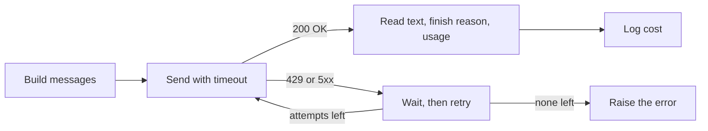

# Calling an LLM API
> **Level:** Beginner · **Reading time:** 7 min · **Phase:** 3 · LLM Concepts

**In one line:** Calling an LLM API means sending a list of role-tagged messages over HTTPS and getting back text plus a count of the tokens you used, and a production call also needs a timeout, retries and a cost check.

## Explain it like I'm new
Think of ordering food by phone. You say who you are and what you want. The kitchen sends the food and a bill.

- The **system message** is your standing note: "I am vegetarian, keep it short."
- The **user message** is today's order.
- The **assistant message** is what the kitchen said earlier. You repeat it on every call, because the kitchen forgets you between calls.

The bill depends on how much you ordered (input tokens) and how much came back (output tokens). Sometimes the phone line is busy. Then you wait a bit and call again, and you wait longer each time. That is a **retry with backoff**.

## How it works
1. **Build messages.** A list of `{"role": ..., "content": ...}` items. Roles are `system`, `user` and `assistant`. The API is stateless, so you send the whole conversation each time.
2. **Set the knobs.** `max_tokens` caps the length of the reply. `temperature` sets how random it is: low (near 0) for steady answers, higher for more variety.
3. **Send it** with a **timeout**, so a hung request cannot freeze your app.
4. **Read the response.** You get the reply text, a **finish reason** (it ended on its own, or it hit `max_tokens`) and **usage** (input and output token counts).
5. **Handle errors.** HTTP **429** (too many requests) and **5xx** (server trouble) are temporary, so retry them. A 400 or 401 (bad request, bad key) will not fix itself, so do not retry.
6. **Count the cost.** `cost = (input_tokens * price_in + output_tokens * price_out) / 1,000,000`. Prices are quoted per million tokens and differ for input and output.



**Streaming vs non-streaming.** A normal call returns when the whole answer is ready. With **streaming**, the server sends small chunks as they are made, so a chat window can show words right away. The total time is about the same, but the user sees the first words sooner. The cost is more code: you must glue the chunks together and handle an error halfway through.

**Never hardcode keys.** Put the key in an environment variable (for example `os.environ["MY_API_KEY"]`) or a secrets manager. Never commit it to Git. Keys in a public repo get scraped within minutes.

**Retries, with numbers.** With a base delay of 1 second and doubling, the waits are 1, 2, 4 seconds. Real code also adds a little random **jitter**, so that many clients do not all retry at the same instant. Honour a `Retry-After` header if the server sends one.

## Code example
This demo has no network. `FakeLLM` returns a dict shaped like a typical response. Real providers use their own field names, so check their docs. Run it: `python 03-llm-concepts/code/llm_api_basics.py`

```python
from llm_api_basics import FakeLLM, Flaky, retry_with_backoff, cost_estimate

msgs = [
    {"role": "system", "content": "You are a short, polite assistant."},
    {"role": "user", "content": "What is the capital of France?"},
]
llm = FakeLLM()
resp = llm.chat(msgs, max_tokens=50, temperature=0.0)
print(resp["usage"])   # -> {'input_tokens': 12, 'output_tokens': 8}
print(cost_estimate(resp["usage"], 3.0, 15.0))   # -> 0.000156

waits = []
flaky = Flaky(FakeLLM(), fail_first=2)   # first 2 calls fail with 429
retry_with_backoff(lambda: flaky.chat(msgs), attempts=4, base_delay=1.0, sleep=waits.append)
print(flaky.attempts, waits)   # -> 3 [1.0, 2.0]
```

The prices 3.0 and 15.0 are made-up toy numbers. Look up real ones. The full demo prints:

```text
reply: You said: What is the capital of France?
usage: {'input_tokens': 12, 'output_tokens': 8}
cost : 0.000156
cut off: length | You said: What
attempts: 3 | waits: [1.0, 2.0] | ok: stop
stream: ['You ', 'said', ': Wh', 'at i', 's th', 'e ca', 'pita', 'l of', ' Fra', 'nce?']
```

Notice `cut off: length`. With `max_tokens=3` the reply stopped mid-sentence, and the finish reason told us so. Always check it. The demo counts one token per word, which is a rough stand-in: real tokenizers split text differently.

The `sleep` argument is injectable, so the test passes `waits.append` and runs instantly instead of really waiting. The tests in [`test_llm_api_basics.py`](../code/test_llm_api_basics.py) check the exact delays, that a 400-style error is not retried, and that the stream chunks join into the full reply.

**In real projects** use the official SDK, for example `anthropic.Anthropic().messages.create(model=..., max_tokens=..., messages=...)` or `OpenAI().chat.completions.create(model=..., messages=...)`. Model names, parameters and built-in retry settings change, so check the docs: the [Anthropic Messages API](https://docs.anthropic.com/en/api/messages) and the [OpenAI chat API reference](https://platform.openai.com/docs/api-reference/chat).

## When to use it / when not to
| Situation | Advice |
|---|---|
| Quick prototype, low traffic | Call the hosted API directly with the official SDK |
| Answers must appear as they are written | Use streaming |
| Batch jobs, nobody is waiting | Non-streaming, with retries and a spending cap |
| Private data that may not leave your network | Check the provider's data terms, or run a local model |
| Same question asked again and again | Cache the answer instead of paying each time |
| You need a fixed output format | See [Structured Outputs](17-structured-outputs.md) |

## Common mistakes
- Hardcoding the API key in code or committing it to Git.
- No timeout, so one slow request hangs the whole app.
- Retrying every error, including 400 and 401, or retrying with no delay and making a 429 worse.
- Ignoring the finish reason, and showing a reply that was cut off at `max_tokens`.
- Forgetting that the API is stateless and that the whole history is billed again on every call.
- Never logging token usage, then getting a surprise bill.

## Interview questions
<details>
<summary><b>1. The API returns 429 errors during a traffic spike. What do you do?</b></summary>

Retry with exponential backoff and jitter, and respect a `Retry-After` header if present. Cap the number of attempts. Also reduce the load: queue requests, lower concurrency, or cache repeated questions. Do not retry in a tight loop, because that makes it worse.
</details>

<details>
<summary><b>2. A chat has 10 turns. Why does the last call cost more than the first?</b></summary>

The API is stateless, so you resend every earlier message as input on each call. Input tokens grow with every turn, and you pay for all of them each time. Fix it by summarizing or trimming old turns.
</details>

<details>
<summary><b>3. What is the trade-off of streaming?</b></summary>

Users see the first words sooner, so it feels faster, though the total time is about the same. You pay for it in complexity: you assemble chunks, and an error can come after part of the answer was already shown.
</details>

## Go deeper
- Anthropic Messages API: https://docs.anthropic.com/en/api/messages
- OpenAI chat API reference: https://platform.openai.com/docs/api-reference/chat
- Python `os.environ` (reading keys from the environment): https://docs.python.org/3/library/os.html#os.environ
- Python `time.sleep`: https://docs.python.org/3/library/time.html#time.sleep
- Language Models are Few-Shot Learners (GPT-3): https://arxiv.org/abs/2005.14165

**Prev:** [Fine-Tuning (the overview)](15-fine-tuning.md) · **Next:** [Structured Outputs](17-structured-outputs.md) · **Back to phase:** [Phase 3](../README.md)
