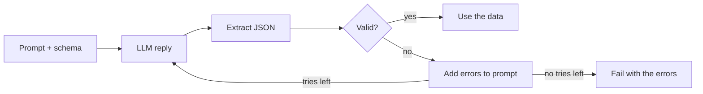

# Structured Outputs
> **Level:** Intermediate · **Reading time:** 7 min · **Phase:** 3 · LLM Concepts

**In one line:** Structured outputs make an LLM return data your code can parse, such as JSON that matches a schema, and you still validate every reply, because even a well-formed answer can be wrong.

## Explain it like I'm new
Imagine a paper form with boxes: Name, Category (tick one), Priority (1 to 3). A clerk checks it at the desk. If a box is empty or the tick is in the wrong place, the clerk hands it back and says what is wrong.

Free text is like a letter. A human can read it, but your program cannot reliably find the "category" in it. A model might write "Sure! Here is the JSON:" before the data, or call the field `type` one day and `category` the next. Structured outputs give you the form, and the validate-and-repair loop is the clerk.

## How it works
1. **Define a schema.** Say which fields exist, their types, which are required, and which values are allowed.
2. **Ask for it.** There are three common ways, from weakest to strongest:
   - **Prompt only:** "Reply with JSON like this." Cheap, but the model can drift.
   - **JSON mode:** the provider makes sure the output is valid JSON. It does *not* promise your field names.
   - **Schema-constrained output:** you pass a schema, and the provider restricts decoding so the output fits it.
   - **Tool-call arguments:** you describe a "function" with a schema, and the model fills in the arguments. This is the same mechanism agents use. See [Tool use in Phase 4](../../04-agentic-ai/README.md).

   The exact parameter names and supported schema features differ by provider and change over time. Check the current provider docs.
3. **Extract.** Pull the JSON object out of the reply. If the reply has prose or code fences around it, find the object inside.
4. **Validate** against your schema. Collect a *list* of errors, not just the first one.
5. **Repair.** If there are errors, send them back to the model: "Your last answer was invalid: ... Return only a corrected JSON object." Stop after a small number of tries.
6. **Give up cleanly.** After the last try, return an error you can log, not a half-valid object.



**Schema design tips.**
- Use an **enum** for categories (`billing`, `bug`, `other`), not free text. Add an `other` value, so the model is not forced to guess.
- Mark the fields you truly need as **required**, and keep the schema small.
- Set `minimum` and `maximum` on numbers (priority 1 to 3).
- Give fields clear names, and describe them in the prompt.

**What validation cannot do.** It checks the *shape*, not the *truth*. `{"category": "billing", "priority": 1, "tags": ["refund"]}` is valid even if the customer was really reporting a bug. Check facts another way: compare to a source, add an evaluation set, or have a human review the risky cases. See [Hallucinations](13-hallucination.md) for why a confident answer can still be wrong.

## Code example
This demo is stdlib only. It has a tiny validator for a *subset* of JSON Schema (`type`, `required`, `enum`, `minimum`, `maximum`, nested objects, array `items`), not the whole spec. Run it: `python 03-llm-concepts/code/llm_structured.py`

```python
from llm_structured import TICKET_SCHEMA, ScriptedLLM, extract_json, validate, repair_loop

prose = 'Sure! Here you go: {"category": "bug", "priority": 2, "tags": ["login"]} Hope it helps.'
print(extract_json(prose))   # -> {'category': 'bug', 'priority': 2, 'tags': ['login']}

bad = {"category": "refund", "priority": 7, "tags": ["ok", 5]}
print(validate(bad, TICKET_SCHEMA))
# -> ["$.category: 'refund' not in ['billing', 'bug', 'other']", '$.priority: 7 is above maximum 3', '$.tags[1]: expected string, got int']

llm = ScriptedLLM([
    "I think it is a billing issue, priority high.",
    '{"category": "billing", "priority": 9, "tags": []}',
    '{"category": "billing", "priority": 2, "tags": ["invoice"]}',
])
data, tries, errs = repair_loop(llm, "Classify: I was charged twice.", TICKET_SCHEMA, max_tries=3)
print(data, tries, errs)   # -> {'category': 'billing', 'priority': 2, 'tags': ['invoice']} 3 []
```

The `ScriptedLLM` plays back fixed replies: first prose with no JSON, then JSON with a bad priority, then a good answer. The full demo prints:

```text
extracted: {'category': 'bug', 'priority': 2, 'tags': ['login']}
error: $.category: 'refund' not in ['billing', 'bug', 'other']
error: $.priority: 7 is above maximum 3
error: $.tags[1]: expected string, got int
result: {'category': 'billing', 'priority': 2, 'tags': ['invoice']} | tries: 3 | errors: []
second prompt ended with: Return only a corrected JSON object.
third prompt had: - $.priority: 9 is above maximum 3
```

The error messages are the useful part. The model sees *exactly* what to fix, and each message carries a path such as `$.tags[1]`. The tests in [`test_llm_structured.py`](../code/test_llm_structured.py) check that errors are fed back into the next prompt, that the loop gives up after `max_tries`, that `True` is not accepted as an integer, and that a schema-valid but wrong answer passes (shape is not truth).

**In real projects** you would use a full JSON Schema validator or a data-model library, plus your provider's structured-output feature. Names and parameters change, so check the docs: [JSON Schema](https://json-schema.org/) and the [Anthropic tool use guide](https://docs.anthropic.com/en/docs/build-with-claude/tool-use) or the [OpenAI function calling guide](https://platform.openai.com/docs/guides/function-calling).

## When to use it / when not to
| Situation | Advice |
|---|---|
| Your code reads the answer (classify, extract fields, route a ticket) | Use structured outputs |
| The model must call a function or tool | Use tool-call arguments, and validate them |
| A person reads the answer, and wording matters | Plain text is fine |
| The provider offers schema-constrained decoding | Use it, but still validate |
| Only prompt-based JSON is available | Use validate-then-repair, with a retry limit |
| You need the answer to be *true* | Validation is not enough. Add retrieval, checks or review |

## Common mistakes
- Trusting the output without validating it, even in schema mode.
- Using a free-text field where an enum would do.
- Retrying with the same prompt and no error feedback, and getting the same mistake.
- No retry limit, so a bad prompt loops and burns money.
- Making every field required, so the model invents values for things it does not know. Allow `null` or an `other` value instead.
- Assuming a valid shape means a correct answer.

## Interview questions
<details>
<summary><b>1. What is the difference between JSON mode and schema-constrained output?</b></summary>

JSON mode only guarantees that the output is valid JSON. It does not promise your fields, types or allowed values. Schema-constrained output limits generation to your schema, so the shape matches. Details vary by provider, so check the docs. In both cases, validate in your own code.
</details>

<details>
<summary><b>2. The model returns valid JSON that passes validation but the content is wrong. Why, and what now?</b></summary>

Validation checks shape, not truth. The model can fill a valid field with a wrong value. Add checks against a trusted source, an evaluation set to measure accuracy, and human review for high-risk cases.
</details>

<details>
<summary><b>3. Why feed the validation errors back instead of just retrying?</b></summary>

A plain retry often repeats the same mistake. The error list, such as "priority 9 is above maximum 3", tells the model exactly what to fix. Keep the number of tries small, and fail cleanly after that.
</details>

## Go deeper
- JSON Schema: https://json-schema.org/
- Python `json` module: https://docs.python.org/3/library/json.html
- Anthropic tool use: https://docs.anthropic.com/en/docs/build-with-claude/tool-use
- OpenAI function calling: https://platform.openai.com/docs/guides/function-calling
- Toolformer (models learning to call tools): https://arxiv.org/abs/2302.04761

**Prev:** [Calling an LLM API](16-calling-an-llm-api.md) · **Next:** [Quantization](18-quantization.md) · **Back to phase:** [Phase 3](../README.md)
