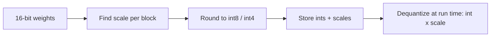

# Quantization (shrinking a model)
> **Level:** Intermediate · **Reading time:** 8 min · **Phase:** 3 · LLM Concepts

**In one line:** Quantization stores a model's weights as small integers (8-bit or 4-bit) instead of 16-bit decimals, so the model needs far less memory and often runs faster, at the cost of a small rounding error.

## Explain it like I'm new
Think of a photo. A raw photo keeps millions of subtle colours. Save it as a smaller file with fewer colours, and most people cannot tell the difference. But if the photo has a very bright sun in one corner, a poor palette can wash out everything else.

A model is a huge pile of numbers called **weights**. Normally each weight is a 16-bit float, which takes 2 bytes. Quantization rounds each weight to one of a few allowed levels, such as 256 levels (8-bit) or 16 levels (4-bit). Each weight then takes 1 byte or half a byte. The model is the same shape, just stored with fewer "colours".

## How it works
1. **Memory math:** memory is parameters × bytes per weight. A 7-billion-parameter model is 7e9 × 2 bytes = 14 GB in 16-bit, and 7e9 × 0.5 bytes = 3.5 GB in 4-bit. This counts weights only. The KV cache and activations need extra memory.
2. **Pick a scale:** find the biggest absolute weight in a block. Divide it by the biggest integer (127 for signed 8-bit). The result is the **scale**: the size of one integer step.
3. **Round:** integer = round(weight / scale). Store the integers and the one scale.
4. **Dequantize:** when the model runs, weight ≈ integer × scale.
5. **Rounding error:** the weight can be off by at most half a step, so by at most scale / 2. Fewer bits means bigger steps and bigger error.

**Symmetric vs asymmetric.** *Symmetric* uses a range centred on zero, so zero maps to integer 0 and only a scale is needed. *Asymmetric* uses the real minimum and maximum, and adds a **zero-point**: the integer that stands for 0.0. It fits lopsided data better and costs one more number to store.



**Why it works.** Weights are very redundant. Nudging each one by a tiny amount barely changes the output, because errors are random and mostly cancel out across billions of weights.

**Where it hurts.**
- **Outliers:** one huge weight forces a big scale, so all the small weights round to zero. The fix is a separate scale for each small group of weights (for example 32 or 128). The [LLM.int8() paper](https://arxiv.org/abs/2208.07339) studies this for large models.
- **Small models** have less spare redundancy and lose more quality.
- **Math and code** answers are brittle: one wrong digit or symbol ruins them. Test these tasks after quantizing.
- **Very low bits** (3-bit and below) lose more than 8-bit or 4-bit.

**PTQ vs QAT.** *Post-training quantization* (PTQ) shrinks a model that is already trained. It is cheap and the usual choice. *Quantization-aware training* (QAT) simulates rounding during training so the model learns to cope. It is better at very low bits, but costs a training run.

**Ecosystem names.** You will see **GGUF** (the file format used by [llama.cpp](https://github.com/ggml-org/llama.cpp) for running locally), **GPTQ** ([paper](https://arxiv.org/abs/2210.17323)) and **AWQ** ([paper](https://arxiv.org/abs/2306.00978)), which are PTQ methods that choose roundings carefully using sample data. Formats and tools change fast, so check each project's current docs.

## Code example
The demo uses only the standard library and a seeded random generator. Run it: `python 03-llm-concepts/code/llm_quantize.py`

```python
from llm_quantize import make_weights, quantize_symmetric, dequantize_symmetric, errors

w = make_weights(64, seed=0)
ints, scale = quantize_symmetric(w, 8)
mean_err, max_err = errors(w, dequantize_symmetric(ints, scale))
print(round(scale, 6), round(mean_err, 6), round(max_err, 6))   # -> 0.001028 0.000249 0.000507
print(max_err <= scale / 2)                                      # -> True
```

The real output of the full demo is:

```text
first 4 weights: [0.0471, -0.0698, -0.034, 0.0185]
symmetric int8 : scale 0.001028 | mean abs err 0.000249 | max err 0.000507 | scale/2 0.000514
asymmetric int8: scale 0.000967 | zero-point 120 | mean abs err 0.000245 | max err 0.000465
symmetric 8-bit: mean abs err 0.000249
symmetric 4-bit: mean abs err 0.005096

7B-parameter model, weights only:
  32-bit:  4.0 bytes/weight ->  28.0 GB
  16-bit:  2.0 bytes/weight ->  14.0 GB
   8-bit:  1.0 bytes/weight ->   7.0 GB
   4-bit:  0.5 bytes/weight ->   3.5 GB

Outlier demo (4-bit, 64 weights, one weight set to 2.0):
  one scale for all  : mean abs err on the other 63 weights 0.044647
  one scale per 8    : mean abs err on the other 63 weights 0.006502
  with one scale, 63 of the other 63 weights rounded to exactly 0
```

Read it like this. Going from 8-bit to 4-bit makes the error about 20 times bigger (0.000249 to 0.005096). With one 2.0 outlier and a single 4-bit scale, every other weight rounds to zero. Giving each group of 8 its own scale cuts the error from 0.044647 to 0.006502.

The tests in [`test_llm_quantize.py`](../code/test_llm_quantize.py) check that the round-trip error stays within scale / 2, that the memory ratios are exact, and that per-group scales beat one shared scale on outliers.

**In real projects** you rarely quantize by hand. You load a pre-quantized model or ask a library to do it. Check the current docs: [bitsandbytes](https://github.com/TimDettmers/bitsandbytes) (8-bit and 4-bit loading in the Hugging Face ecosystem) and [llama.cpp](https://github.com/ggml-org/llama.cpp) (GGUF).

## When to use it / when not to
| Situation | Quantize? |
|---|---|
| The model does not fit on your GPU or laptop | Yes. 8-bit or 4-bit is the usual fix |
| You want cheaper or faster serving, and quality tests still pass | Yes |
| Your task is exact maths, code or structured data | Careful. Test it against the 16-bit model first |
| You use a small model (about 1B parameters or less) | Careful. Quality drops faster |
| You will fine-tune it | Yes, with QLoRA, see [LoRA and PEFT](19-lora-and-peft.md) |
| You have plenty of memory and need the best possible quality | No need |

## Common mistakes
- Quoting memory from weights only. The KV cache and activations also need memory.
- Using one scale for a whole big matrix when it has outliers.
- Judging quality by "it still talks fine". Run your own test set on both versions.
- Assuming 4-bit is always the best choice. 8-bit is safer when you have the memory.
- Mixing up the file format (GGUF) with the method (GPTQ, AWQ).

## Interview questions
<details>
<summary><b>1. How much memory does a 13B-parameter model need in 16-bit and in 4-bit?</b></summary>

Weights only: 13e9 × 2 bytes = 26 GB in 16-bit, and 13e9 × 0.5 bytes = 6.5 GB in 4-bit. Add memory for the KV cache and activations, so real use is higher.
</details>

<details>
<summary><b>2. Why does one outlier weight damage a whole quantized block?</b></summary>

The scale is set by the largest absolute value. A huge outlier makes the scale big, so each step is coarse and the many small weights round to zero or to the same few levels. Using a separate scale per small group keeps the outlier from affecting its neighbours.
</details>

<details>
<summary><b>3. What is the difference between PTQ and QAT?</b></summary>

PTQ quantizes an already-trained model, which is quick and cheap. QAT simulates rounding during training so the model adapts to it. QAT usually keeps more quality at very low bit widths but costs a training run.
</details>

## Go deeper
- LLM.int8() paper: https://arxiv.org/abs/2208.07339
- GPTQ paper: https://arxiv.org/abs/2210.17323
- AWQ paper: https://arxiv.org/abs/2306.00978
- QLoRA paper (4-bit base for fine-tuning): https://arxiv.org/abs/2305.14314
- bitsandbytes: https://github.com/TimDettmers/bitsandbytes
- llama.cpp (GGUF): https://github.com/ggml-org/llama.cpp

**Prev:** [Structured Outputs](17-structured-outputs.md) · **Next:** [LoRA and PEFT](19-lora-and-peft.md) · **Back to phase:** [Phase 3](../README.md)
