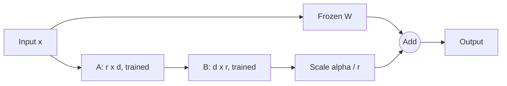

# LoRA and PEFT (cheap fine-tuning)
> **Level:** Advanced · **Reading time:** 9 min · **Phase:** 3 · LLM Concepts

**In one line:** LoRA freezes the big model and trains two tiny matrices whose product is added to each chosen weight matrix, so you train well under 1% of the parameters and still change the model's behaviour.

**Before you start:** [Fine-Tuning (the overview)](15-fine-tuning.md) and [Quantization](18-quantization.md).

**Words to know:**
- **Matrix:** a grid of numbers. A model's weights are stored as many matrices.
- **Rank (r):** how many independent directions of change the add-on can carry.
- **Adapter:** the small trained add-on, which you can load or remove.

## Explain it like I'm new
Imagine a huge printed textbook. Full fine-tuning means reprinting the whole book with your edits. LoRA means leaving the book alone and sticking a thin set of sticky notes on some pages. The notes are small and cheap to make. You can peel them off, or use a different set for each customer.

**PEFT** (parameter-efficient fine-tuning) is the family of methods that train only a small part of the model. LoRA is the most popular one. The [fine-tuning overview](15-fine-tuning.md) says *when* to fine-tune. This page shows *how the maths saves memory*.

## How it works
1. **Why full fine-tuning is expensive.** For each trained parameter you keep the weight (2 bytes in 16-bit), its gradient (2 bytes), and the optimizer state. The common Adam optimizer keeps two extra 32-bit numbers (8 bytes). That is about 12 bytes per parameter, so a 7B model needs roughly 84 GB before counting activations. Many setups use even more.
2. **Freeze the weight matrix W** (size d × d). It never changes.
3. **Learn a low-rank update.** Make two small matrices: **B** (d × r) and **A** (r × d), where the rank **r** is small, like 8. Their product B·A is d × d, but it can only carry r "directions" of change.
4. **Add it with a scale:** W' = W + (alpha / r) × B·A. The number **alpha** sets how strongly the update counts. B starts at zero, so at the start the model is exactly the original.
5. **Count the parameters.** One d × d matrix has d² parameters. The adapter has d×r + r×d = 2×d×r. For d = 4096 and r = 8, that is 16,777,216 versus 65,536. That is 256 times fewer, or 0.39%.
6. **Choose target modules.** You pick which matrices get an adapter. Common picks are the attention query and value projections. Adding more modules, or raising r, gives more capacity and more memory use.
7. **Merge or keep separate.** After training you can fold B·A into W, so inference costs exactly the same as the base model. Or you keep the adapter as a small file and load it on demand.



**QLoRA** is LoRA on a base model that is stored in 4-bit (see [Quantization](18-quantization.md)). The frozen weights are small, and only the adapter is trained in higher precision. This lets a large model be fine-tuned on a single GPU. Read the [QLoRA paper](https://arxiv.org/abs/2305.14314) for details.

**Swapping adapters.** One base model plus many small adapters can serve many tasks or customers. You load the right adapter for each request. Each file is megabytes, not gigabytes.

**What LoRA cannot fix.** It does not add reliable new facts (use [RAG](../../01-rag-foundations/README.md)). It does not give the model skills it is far from having. Bad data still gives a bad adapter. A low rank can also underfit a hard task, and a high learning rate can make the model forget other abilities. Always test against the base model.

### Worked example
Use a tiny 4×4 matrix W with rank r = 1:
1. A is 1×4 and B is 4×1, so they hold 4 + 4 = 8 numbers. W holds 16.
2. B·A is a full 4×4 grid, built from only those 8 numbers.
3. B starts at zero, so W' = W at the start and the model is unchanged.
4. Training moves A and B only. W' = W + (alpha / r) × B·A then changes the output, while W itself never changes.

## Code example
The demo uses plain Python lists, so every number is hand-checkable. Run it: `python 03-llm-concepts/code/llm_lora_math.py`

```python
from llm_lora_math import merge, adapter_forward, matvec

W = [[1, 0, 0, 0], [0, 1, 0, 0], [0, 0, 1, 0], [0, 0, 0, 1]]   # frozen base
B = [[1, 0], [0, 1], [1, 1], [0, 2]]                            # 4 x 2
A = [[1, 0, 2, 0], [0, 1, 0, 1]]                                # 2 x 4
x = [1, 2, 3, 4]
print(matvec(merge(W, B, A, alpha=4, r=2), x))      # -> [15.0, 14.0, 29.0, 28.0]
print(adapter_forward(W, B, A, alpha=4, r=2, x=x))  # -> [15.0, 14.0, 29.0, 28.0]
```

The real output of the full demo is:

```text
one 4096x4096 matrix: full 16,777,216 params | LoRA r=8 65,536 params | 0.3906% of full
32 layers x 2 matrices x 65,536 = 4,194,304 trainable params
7B full fine-tune ~ 84 GB | 7B LoRA ~ 14.04 GB (before activations)

Tiny 4x4 example, r=2, alpha=4 (scale alpha/r = 2):
B @ A      = [[1, 0, 2, 0], [0, 1, 0, 1], [1, 1, 2, 1], [0, 2, 0, 2]]
W' rows    =
   [3.0, 0.0, 4.0, 0.0]
   [0.0, 3.0, 0.0, 2.0]
   [2.0, 2.0, 5.0, 2.0]
   [0.0, 4.0, 0.0, 5.0]

W' @ x          = [15.0, 14.0, 29.0, 28.0]
adapter forward = [15.0, 14.0, 29.0, 28.0]

Rank check (r=1): B is a column, A is a row
   [3.0, 0.0, 1.0, 2.0]
   [6.0, 0.0, 2.0, 4.0]
   [-3.0, 0.0, -1.0, -2.0]
   [0.0, 0.0, 0.0, 0.0]
all rows proportional (rank <= 1): True
identity matrix rows proportional: False
```

Three things to notice. First, the 7B memory numbers are a rule of thumb: 12 bytes per parameter for full training, versus 2 bytes for the frozen weights plus 10 bytes for only the 4,194,304 trainable ones. The adapter case is dominated by the frozen 16-bit weights (14 GB), which is why QLoRA shrinks them to 4-bit. Second, the merged weight and the separate adapter give the same output, so merging loses nothing. Third, a rank-1 update has rows that are all multiples of one row, which shows the update can only carry r directions.

The tests in [`test_llm_lora_math.py`](../code/test_llm_lora_math.py) check the hand-worked matrices, the parameter counts, merge versus separate output, and that a zero B leaves the model unchanged.

**In real projects** use the Hugging Face PEFT library. Its API changes, so check the current [PEFT docs](https://huggingface.co/docs/peft/index) and [repo](https://github.com/huggingface/peft) rather than copying old snippets. For the 4-bit base in QLoRA, see [bitsandbytes](https://github.com/TimDettmers/bitsandbytes). The original method is in the [LoRA paper](https://arxiv.org/abs/2106.09685).

## When to use it / when not to
| Situation | Use LoRA? |
|---|---|
| Full fine-tuning does not fit in your GPU memory | Yes. LoRA, or QLoRA if still too big |
| One base model, many tasks or customers | Yes. Keep one small adapter per task |
| You need a style, format or narrow skill | Yes, after prompting has failed |
| The model needs new, changing facts | No. Use RAG |
| The task is far from anything the base model can do | Maybe not. Low rank may underfit, so try a higher r or a different base |
| A hosted provider offers fine-tuning and you do not need to own the weights | Probably use the provider's service |

## Common mistakes
- Thinking LoRA needs no memory for the base. The frozen weights still sit in memory (that is what QLoRA shrinks).
- Setting rank very high "to be safe". Capacity and memory grow with r, and so can overfitting.
- Changing alpha and r separately without noticing that the effective scale is alpha / r.
- Merging an adapter into a quantized base without checking the result.
- Comparing only against the training set. Test on held-out examples and against the base model.
- Using an adapter with a different base model version than the one it was trained on.

## Recap
If you remember only three things:
- LoRA freezes the weights and trains two small matrices whose product is added to W.
- For d = 4096 and r = 8 that is 65,536 trained numbers instead of 16,777,216 (0.39%).
- QLoRA adds a 4-bit base model for more savings. LoRA still does not add reliable facts.

## Interview questions
<details>
<summary><b>1. Why does LoRA use far fewer trainable parameters than full fine-tuning?</b></summary>

Instead of updating a d × d matrix (d² parameters), it learns B (d × r) and A (r × d), which is 2×d×r parameters. For d = 4096 and r = 8 that is 65,536 instead of 16,777,216. Gradients and optimizer state are also only kept for those few parameters.
</details>

<details>
<summary><b>2. What are rank r and alpha, and how do they interact?</b></summary>

The rank r is the inner size of the update, so it limits how many independent directions the change can have, and sets the adapter size. Alpha is a scaling number: the update is multiplied by alpha / r. Raising r adds capacity, and alpha / r controls how loud the update is relative to the frozen weight.
</details>

<details>
<summary><b>3. How is QLoRA different from LoRA, and what can neither one do?</b></summary>

QLoRA keeps the frozen base in 4-bit, so far less memory is needed, and trains a normal LoRA adapter on top. Neither one is a reliable way to add new facts, to give citations, or to rescue a bad dataset. Use RAG for facts and clean data for quality.
</details>

## Go deeper
- LoRA paper: https://arxiv.org/abs/2106.09685
- QLoRA paper: https://arxiv.org/abs/2305.14314
- Hugging Face PEFT docs: https://huggingface.co/docs/peft/index
- PEFT repo: https://github.com/huggingface/peft
- bitsandbytes: https://github.com/TimDettmers/bitsandbytes

**Prev:** [Quantization](18-quantization.md) · **Next:** [Inference Serving and Batching](20-inference-serving-and-batching.md) · **Back to phase:** [Phase 3](../README.md)
